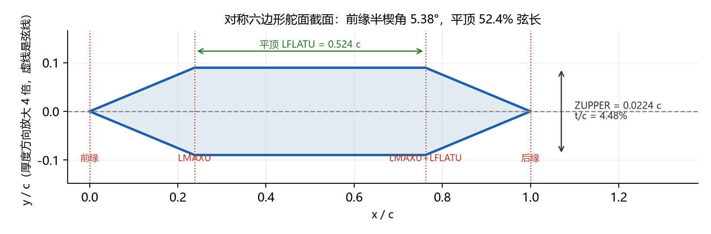

# DATCOM — 项目目录结构说明


## 一、核心工作目录（必要）

### `datcom_bin/`

DATCOM 程序本体目录，存放 `datcom.exe` 与历史输入模板 `for005.dat`。

`for005.dat` 是旧版手工算例模板（六边形截面，默认翼型参数就照它取的）。`01_batch_datcom.py` 不再改写它，
而是按几何、来流和 `scripts/naca_section.py` 里的截面参数整份生成 `for005.dat`。

不要把算例结果放在这里。`01_batch_datcom.py` 把结果写到 `../data_lib/runs/low/<geometry_id>/`，运行中的协议文件放在 `../data_lib/runs/low/.work/`。

### `scripts/`

所有 Python 源码（`.py` 文件全部放这里）。

| 文件 | 用途 |
| --- | --- |
| `01_batch_datcom.py` | DATCOM 批量计算主脚本：输入工作区 README 的 14 个几何参数与来流条件。11 个主尺寸来自总表，3 个翼型参数来自 `naca_section.py`。脚本自动生成 `for005.dat`、调用 `datcom.exe`、解析气动系数，并输出几何核对报告与三视图 |
| `04_pointnet_demo.py` | 导弹外形点云数据集生成（PointNet 演示，自带几何校验和三视图预览） |
| `naca_section.py` | 对称舵面截面：可切六边形（`SECTYP = HEX`）或 NACA 四位数，三个参数与外形方程都在这。批量 DATCOM 与点云共用这一份。怎么定参数见文末「四、舵面翼型」 |


`04_pointnet_demo.py` 默认把点云写到 `../data_lib/datasets/point_clouds/`。不带几何标识时文件名仍是 `missile_<N>.*`。用 `--geometry-id` 或 `--params` 读入总表的 11 个主尺寸，翼型取 `naca_section.py` 的三个参数，合计 14 个几何参数；带几何标识时主文件是 `<geometry_id>_pointcloud.ply`。默认 16384 点，并按 CFD 关键部位加密表面点：舵面、前缘后缘、根梢、锥顶倒角、头锥肩部、舵身交界和尾部底缘。总点数不变。脚本前部 `CFD_REFINEMENT_ENABLED = False` 可恢复按面积均匀采样。点云仍是表面点，不是 CFD 体网格。点数和文件格式仍沿用脚本里的现有演示，工作流侧的最终格式还待定。

### `../data_lib/runs/low/`（运行结果，项目外）

每个 `geometry_id` 一个子文件夹，位置由脚本顶部 `RESULT_ROOT` 决定
（默认 = 工作区 `data_lib/runs/low`）。`datcom.exe` 运行时只用 `../data_lib/runs/low/.work/` 里的 `for005.dat`、`for006.dat`、`for022.dat`，算完后工作目录会删掉。

同一个 `geometry_id` 加同一个 `altitude_m` 单元格是一次调用。子文件夹内的归档名带几何标识：

| 文件 | 内容 |
| --- | --- |
| `<geometry_id>_for005.dat` | 本次实际喂给 DATCOM 的输入卡片 |
| `<geometry_id>_for006.dat` | DATCOM 原始输出 |
| `<geometry_id>_for022.dat` | DATCOM 写出的 Tecplot ASCII 几何外形（英尺） |
| `<geometry_id>_aero_coefficients.csv` | 该几何唯一的系数表。不同高度的工况都合并在这一张表里，再次运行只替换本次工况的行 |
| `<geometry_id>_geometry_check.txt` | 几何模型核对报告 |
| `<geometry_id>_geometry_check.png` | 脚本自绘的三视图，仅供速查 |
| `<geometry_id>_case_params.json` | 本算例的几何、来流、参考量与派生量快照 |
| `<geometry_id>_datcom.log` | `datcom.exe` 的标准输出和标准错误 |

看外形的最直接方式：Tecplot 360 → *File → Load Data File(s)* → 选 `../data_lib/runs/low/<geometry_id>/<geometry_id>_for022.dat`，
会得到 9 个区（1 个 `FUSELAGE` + 前舵 4 片 `FINSET 1` + 后舵 4 片 `FINSET 2`）。
注意文件长度单位是**英尺**（DATCOM 几何输出固定用英尺，与输入卡片里的英寸无关）。

`aero_coefficients.csv` 一行一个工况，列依次为：`geometry_id`、`condition_id`、`altitude_m`，马赫数、攻角、飞行高度，11 个主尺寸，舵面翼型的四列，最后是 3 个气动系数。翼型四列的列名随截面类型变化：六边形是 `舵面翼型`（如 `HEX 4.48%-52.4%`）、`翼型相对厚度(%)`、`翼型平顶长度(%)`、`翼型前缘LER`；NACA 是 `舵面翼型`（如 `NACA 0004.48-63`）、`翼型相对厚度(%)`、`翼型前缘半径指数`、`翼型最大厚度位置(1/10弦长)`。同一张表里两种口径可以共存，缺的单元格留空。翼型几列让每一行都能自证算的是哪种舵面截面，不必再去翻 `case_params.json`。

系数只输出上面 3 个，需要别的系数（例如 `CNA`、`XCP`）时在脚本顶部
`OUTPUT_COEFFICIENTS` 里加一行即可。注意：CSV 若正被 Excel 打开，Windows 会拒绝覆盖写入，
脚本会给出警告并保留其余产物，关闭 Excel 后重跑即可。同一张表里更早的行如果缺后来新增的列，
这些单元格留空，脚本不去猜旧行的取值。

归档目录名就是 `geometry_id`。当前工作区总表有 4 行试算，几何标识暂为 `1`，高度 `0`，工况 C01、C02、C06、C07，结果在 `../data_lib/runs/low/1/`。

### `.vscode/`

VS Code 编辑器配置文件（`settings.json` 等）。属于 IDE 工具配置，建议保留。


### `hex_airfoil.png` / `naca_airfoil.png`

「四、舵面翼型」的两张截面示意图：`hex_airfoil.png` 对应默认的六边形截面，`naca_airfoil.png` 对应可切回的 NACA 四位数截面。只供阅读，脚本不读取它们。

### `AGENTS.md`

项目级 Agent 说明文档（如有使用 AI 编程助手）。

## 二、路径约定

整个项目文件夹可整体移动。

- 所有脚本 / 代码均不写死绝对路径，项目根目录由代码自动推导：
  - `scripts/` 下脚本用 `__file__` 推导（项目根 = `scripts/` 的上一级）。
  - 将来若加 `notebook/` 这类无 `__file__` 的运行环境，用“从当前目录向上查找含 `datcom_bin` 的目录”推导。
- 因此整个 `DATCOM` 文件夹可整体移动 / 改名到任意位置，无需修改任何路径配置；直接运行 `scripts/01_batch_datcom.py` 即可。
- 新增代码务必遵守同一约定：不要出现 `C:\Users\...` 这类写死的路径。

## 三、使用建议

### 1. 气动计算工作流

`01_batch_datcom.py` 的入口参数就是工作区 README「参数化方式与来流条件」里的 14 个几何参数和来流条件：

1. 正式输入是工作区的 `data_lib/inputs/cases.csv`。每一行是一个工况，列依次为
   `geometry_id`、`condition_id`、11 个主尺寸、`Ma`、`alpha_deg`、`altitude_m`。
   翼型截面类型（`SECTION_TYPE`：六边形或 NACA）和三个翼型参数
   写在 `scripts/naca_section.py`，前舵和后舵共用。同一个 `geometry_id` 的 11 个主尺寸必须相同。
   同一个 `geometry_id` 和同一个 `altitude_m` 单元格的来流必须是这些马赫数和攻角的完整组合。
2. 直接运行 `python scripts/01_batch_datcom.py` 就会读取这张表。脚本顶部的
   `MISSILE_GEOMETRY`、`MACH_LIST`、`ALPHA_LIST` 和 `CASES` 只在 `--demo` 时使用。
3. 飞行高度来自每一行的 `altitude_m`。不同高度分次调用。
4. 运行后把结果写到 `../data_lib/runs/low/<geometry_id>/`。归档名以 `geometry_id` 开头；
   同一个 `geometry_id` 的气动系数只保留 `<geometry_id>_aero_coefficients.csv` 一张表，
   各高度、各工况都在同一张表里，不再按工况拆成单行 CSV。

几条实测到的模型约定（改输入卡片前务必知道）：

- 本机 DATCOM 的 `$FINSET` **`SWEEP` 以后缘为基准**：梢部后缘 = 根部后缘 +
  展长 × tan(SWEEP)，梢弦长度不变。所以 README 的“后缘对齐”几何对应 `SWEEP = 0`，
  而不是 `atan((C_root - C_tip) / 展长)`；脚本已按此自动换算（前缘对齐 / 对称写负角度）。
- 数字卡片必须带小数点（`ALPHA = 4` 会报语法错）；参考长度变量名是 `LREF`（`CBAR` 会报未知变量）。
- 数字统一保留 5 位小数：本机 datcom.exe 对过长的数字串会在内部几何计算里报
  `sqrt DOMAIN` 且完全不输出结果。
- 第二个舵面组 `STA` 写 2.0 会让本机 datcom 直接终止，脚本固定写 1.0。

常用命令：

```powershell
python scripts/01_batch_datcom.py --list          # 只看输入总表里的算例与工况
python scripts/01_batch_datcom.py --dry-run       # 按总表生成 for005.dat 与几何核对图，不调用 DATCOM
python scripts/01_batch_datcom.py                 # 读取 data_lib/inputs/cases.csv 并计算
python scripts/01_batch_datcom.py --demo          # 用脚本顶部的演示几何和来流，不读总表
python scripts/01_batch_datcom.py --demo --mach 2.0 2.2 --alpha 4.0 6.0 --alt 5000
```

`--params`、`--mach`、`--alpha`、`--alt` 只在 `--demo` 下有效。正式计算改总表，不改命令行。

### 2. 批量扩展

- 多组几何对比：在 `data_lib/inputs/cases.csv` 里为新几何另起一个 `geometry_id`，并写全它的来流组合。
- 演示单组几何：加 `--demo`，此时才使用脚本顶部的 `CASES`。
- 一个 `geometry_id` 加一个 `altitude_m` = 一次 DATCOM 调用，结果落在 `../data_lib/runs/low/<geometry_id>/`。

### 3. Git 管理

结果现在写到项目外的 `../data_lib/runs/low/`，由上级工作区 `.gitignore` 忽略运行产物。点云写到 `../data_lib/datasets/point_clouds/`，点云文件同样不入库。

`__pycache__/` 等产物同样不入库（由上级 `.gitignore` 统一覆盖）。

## 四、舵面翼型

14 个几何参数里的翼型三项，就是 `scripts/naca_section.py` 顶部的三个默认值。改翼型只改那里。点云和 DATCOM 都读这一份，根部和梢部是同一副截面，按当地弦长等比缩放（等 t/c），弯度固定为 0，中弧与弦线重合，上下对称。

默认是**对称六边形**（DATCOM `SECTYP = HEX`）。文件顶部的 `SECTION_TYPE` 写 `"HEX"` 用六边形、写 `"NACA"` 用对称四位数翼型；两种截面各有一组三个默认值，切换只改这个开关，其余代码不用动。

### 1. 六边形（默认）

DATCOM 原生支持这种截面：参数直接写进 `$FINSET`，文件末尾不再需要 NACA 控制卡。

```text
$FINSET1
 SECTYP = HEX,
 ...
 STA = 1.0,
 LER = 0.01500,0.01500,
 ZUPPER = 0.02240,0.02240,
 LMAXU = 0.23800,0.23800,
 LFLATU = 0.52400,0.52400,
$END
```

四个数组都是**弦长分数**，根、梢各一个值（默认按等 t/c，所以两站同值）。默认值照 `datcom_bin/for005.dat` 取——那是 DATCOM 自带的历史六边形算例。



上图按默认截面绘制，厚度方向放大 4 倍，虚线是弦线。

| 参数 | 默认 | 对应 DATCOM 卡 | 改它会动哪里 | 允许值 |
| --- | --- | --- | --- | --- |
| `thickness_percent` | 4.48 | `ZUPPER = 该值 / 200` | 上下表面间距，总厚度 = 该值 × 弦长 / 100 | 大于 0、小于 40 |
| `flat_percent` | 52.4 | `LFLATU = 该值 / 100` | 平顶段长度；对称时 `LMAXU = (1 − LFLATU)/2` 自动派生 | 大于等于 0、小于 100 |
| `le_radius` | 0.015 | `LER` | 只进 DATCOM 的气动阻力项，点云仍按尖前缘画 | 大于等于 0 |

几何关系：

```text
x=0 ──斜坡──> LMAXU ──平顶 ZUPPER──> LMAXU+LFLATU ──斜坡──> x=1（尖后缘）
tan(前缘半楔角) = ZUPPER / LMAXU          截面积 / c² = ZUPPER × (1 + LFLATU)
```

三个参数按这个顺序定：

1. **厚度**：`thickness_percent` 就是想要的 t/c。物理厚度 = t/c × 当地弦长：后舵根弦 0.38 m 时整片约 17 mm，前舵梢弦 0.06 m 时约 2.7 mm。若要"等绝对厚度"贯穿全展，得按当地弦长把两站折成不同的 `ZUPPER`（当前代码固定按等 t/c 写两站同值）。
2. **平顶长度**：由想控制的**前缘半楔角**反推，`LFLATU = 1 − 2·ZUPPER / tanθ`。t/c = 4.48% 时：

| 前缘半楔角 θ (deg) | 4 | 5 | **5.38** | 6 | 8 | 10 | 12 |
| --- | --- | --- | --- | --- | --- | --- | --- |
| `LFLATU` | 0.359 | 0.488 | **0.524** | 0.574 | 0.681 | 0.746 | 0.789 |

默认那组 4.48% / 0.524 对应的半楔角是 **5.38°**，这是超声速舵面的常见量级。
3. **前缘**：`le_radius` 取 0.005–0.015（模板 0.015）。别填 0.0001 这种极小非零值——实测该档 CL 会异常跳动。

**换六边形必须知道的四条**（都在本机 rev 03/11 上实测）：

- **NACA 卡必须删掉**。留着 `NACA-1-4-...` 两行时，即使写了 `SECTYP = HEX` 和四个数组，DATCOM 仍按 NACA 算，输出逐位不变。脚本已按截面类型自动决定写不写卡。
- **四个数组漏写不报错**，DATCOM 会静默用默认截面，所以写完要核对 `for005.dat`。
- 必须满足 `LMAXU + LFLATU ≤ 1`（超了没有静态气动页）；`ZUPPER` 是半厚，填到 0.5 以上也算不出来。
- `for022.dat` 画的舵面截面恒为 5% 菱形示意，不随参数变化，**不能**用它核对翼型。能自证的只有 `for005.dat`、`case_params.json` 和系数表。

### 2. NACA 四位数（可切回）

`SECTION_TYPE` 改成 `"NACA"` 就回到旧口径：`SECTYP = NACA`，截面写在文件末尾的两张控制卡上，默认是 `NACA-1-4-0004.48-63` 和 `NACA-2-4-0004.48-63`。三个参数是 `thickness_percent`、`le_radius_index`（整数 0–9）、`max_thickness_tenths`（只允许 2、3、4、5、6），卡片拼法见 `naca_section.py` 里的 `NacaSection`，示意图仍是 `naca_airfoil.png`。

两种口径的实测对照（同一外形、α = 3°）：六边形 4.48%/52.4% 与 NACA 0004.48-63 的 CL 都是 1.589，CD 分别是 0.365 和 0.364。换成六边形不会推翻历史结果，但系数表里会多出另一组列名。

### 3. 系数表里的翼型列

- 六边形：`舵面翼型`（如 `HEX 4.48%-52.4%`）、`翼型相对厚度(%)`、`翼型平顶长度(%)`、`翼型前缘LER`
- NACA：`舵面翼型`（如 `NACA 0004.48-63`）、`翼型相对厚度(%)`、`翼型前缘半径指数`、`翼型最大厚度位置(1/10弦长)`

同一张表里两种口径可以共存：旧行只在旧列名上有值、新行只在新列名上有值，缺的单元格留空，脚本不去猜。

---

最后更新：2026-10-31
