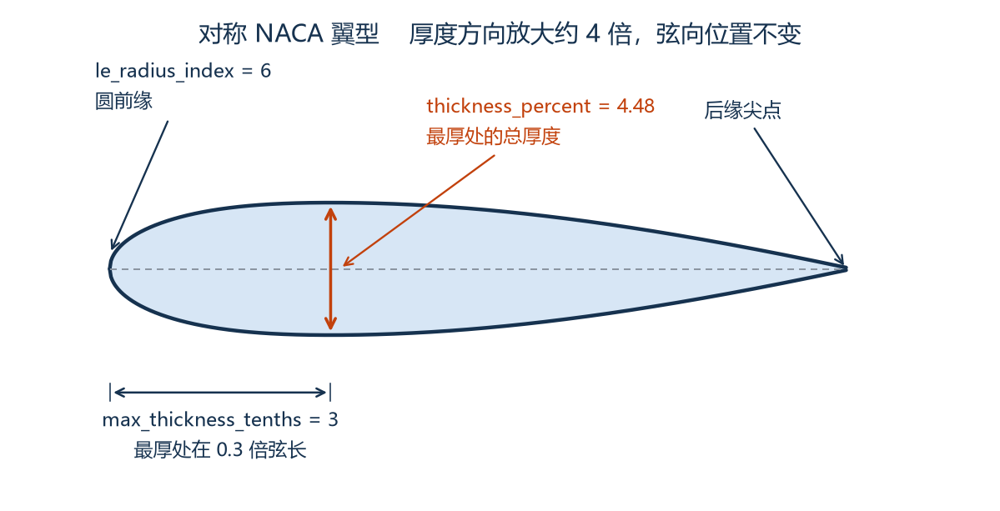

# DATCOM — 项目目录结构说明


## 一、核心工作目录（必要）

### `datcom_bin/`

DATCOM 程序本体目录，存放 `datcom.exe` 与历史输入模板 `for005.dat`。

`for005.dat` 是旧版手工算例模板。`01_batch_datcom.py` 不再改写它，
而是按几何、来流和 `scripts/naca_section.py` 里的翼型参数整份生成 `for005.dat`。

不要把算例结果放在这里。`01_batch_datcom.py` 把结果写到 `../data_lib/runs/low/<geometry_id>/`，运行中的协议文件放在 `../data_lib/runs/low/.work/`。

### `scripts/`

所有 Python 源码（`.py` 文件全部放这里）。

| 文件 | 用途 |
| --- | --- |
| `01_batch_datcom.py` | DATCOM 批量计算主脚本：输入工作区 README 的 14 个几何参数与来流条件。11 个主尺寸来自总表，3 个翼型参数来自 `naca_section.py`。脚本自动生成 `for005.dat`、调用 `datcom.exe`、解析气动系数，并输出几何核对报告与三视图 |
| `02_ml_train.py` | MLP 神经网络训练 |
| `03_plot_result.py` | 画图、误差分析、对比 DATCOM/Fluent |
| `04_pointnet_demo.py` | 导弹外形点云数据集生成（PointNet 演示，自带几何校验和三视图预览） |
| `naca_section.py` | 对称舵面 NACA 翼型的三个参数和外形方程。批量 DATCOM 与点云共用这一份。三个参数怎样定出截面，见文末「四、舵面翼型」 |
| `datcom_parser.py` | 解析 `for006.dat` 的工具函数 |


`04_pointnet_demo.py` 默认把点云写到 `../data_lib/datasets/point_clouds/`。不带几何标识时文件名仍是 `missile_<N>.*`。用 `--geometry-id` 或 `--params` 读入总表的 11 个主尺寸，翼型取 `naca_section.py` 的三个参数，合计 14 个几何参数；带几何标识时主文件是 `<geometry_id>_pointcloud.ply`。默认 16384 点，并按 CFD 关键部位加密表面点：舵面、前缘后缘、根梢、锥顶倒角、头锥肩部、舵身交界和尾部底缘。总点数不变。脚本前部 `CFD_REFINEMENT_ENABLED = False` 可恢复按面积均匀采样。点云仍是表面点，不是 CFD 体网格。点数和文件格式仍沿用脚本里的现有演示，工作流侧的最终格式还待定。

### `../data_lib/runs/low/`（运行结果，项目外）

每个 `geometry_id` 一个子文件夹，位置由脚本顶部 `RESULT_ROOT` 决定
（默认 = 工作区 `data_lib/runs/low`）。`datcom.exe` 运行时只用 `../data_lib/runs/low/.work/` 里的 `for005.dat`、`for006.dat`、`for022.dat`，算完后工作目录会删掉。

同一个 `geometry_id` 加同一个 `altitude_m` 单元格是一次调用。子文件夹内的归档名带几何标识：

| 文件 | 内容 |
| --- | --- |
| `<geometry_id>_for005.dat` | 本次实际喂给 DATCOM 的输入卡片 |
| `<geometry_id>_for006.dat` | DATCOM 原始输出 |
| `<geometry_id>_for022.dat` | DATCOM 写出的 Tecplot ASCII 几何外形（英尺） |
| `<geometry_id>_aero_coefficients.csv` | 该几何唯一的系数表。不同高度的工况都合并在这一张表里，再次运行只替换本次工况的行 |
| `<geometry_id>_geometry_check.txt` | 几何模型核对报告 |
| `<geometry_id>_geometry_check.png` | 脚本自绘的三视图，仅供速查 |
| `<geometry_id>_case_params.json` | 本算例的几何、来流、参考量与派生量快照 |
| `<geometry_id>_datcom.log` | `datcom.exe` 的标准输出和标准错误 |

看外形的最直接方式：Tecplot 360 → *File → Load Data File(s)* → 选 `../data_lib/runs/low/<geometry_id>/<geometry_id>_for022.dat`，
会得到 9 个区（1 个 `FUSELAGE` + 前舵 4 片 `FINSET 1` + 后舵 4 片 `FINSET 2`）。
注意文件长度单位是**英尺**（DATCOM 几何输出固定用英尺，与输入卡片里的英寸无关）。

`aero_coefficients.csv` 只输出上面 3 个系数，需要别的系数（例如 `CNA`、`XCP`）时在脚本顶部
`OUTPUT_COEFFICIENTS` 里加一行即可。注意：CSV 若正被 Excel 打开，Windows 会拒绝覆盖写入，
脚本会给出警告并保留其余产物，关闭 Excel 后重跑即可。

归档目录名就是 `geometry_id`。当前工作区总表有 4 行试算，几何标识暂为 `1`，高度 `0`，工况 C01、C02、C06、C07，结果在 `../data_lib/runs/low/1/`。前一次试算的归档留在 `../data_lib/runs/low/sample/`。

### `.vscode/`

VS Code 编辑器配置文件（`settings.json` 等）。属于 IDE 工具配置，建议保留。


### `naca_airfoil.png`

「四、舵面翼型」的截面示意图。只供阅读，脚本不读取它。

### `AGENTS.md`

项目级 Agent 说明文档（如有使用 AI 编程助手）。

## 二、路径约定

整个项目文件夹可整体移动。

- 所有脚本 / 代码均不写死绝对路径，项目根目录由代码自动推导：
  - `scripts/` 下脚本用 `__file__` 推导（项目根 = `scripts/` 的上一级）。
  - `notebook/` 无 `__file__`，用“从当前目录向上查找含 `datcom_bin` 的目录”推导。
- 因此整个 `DATCOM` 文件夹可整体移动 / 改名到任意位置，无需修改任何路径配置；直接运行 `scripts/01_batch_datcom.py` 即可。
- 新增代码务必遵守同一约定：不要出现 `C:\Users\...` 这类写死的路径。

## 三、使用建议

### 1. 气动计算工作流

`01_batch_datcom.py` 的入口参数就是工作区 README「参数化方式与来流条件」里的 14 个几何参数和来流条件：

1. 正式输入是工作区的 `data_lib/inputs/cases.csv`。每一行是一个工况，列依次为
   `geometry_id`、`condition_id`、11 个主尺寸、`Ma`、`alpha_deg`、`altitude_m`。
   翼型三个参数 `thickness_percent`、`le_radius_index`、`max_thickness_tenths`
   写在 `scripts/naca_section.py`，前舵和后舵共用。同一个 `geometry_id` 的 11 个主尺寸必须相同。
   同一个 `geometry_id` 和同一个 `altitude_m` 单元格的来流必须是这些马赫数和攻角的完整组合。
2. 直接运行 `python scripts/01_batch_datcom.py` 就会读取这张表。脚本顶部的
   `MISSILE_GEOMETRY`、`MACH_LIST`、`ALPHA_LIST` 和 `CASES` 只在 `--demo` 时使用。
3. 飞行高度来自每一行的 `altitude_m`。不同高度分次调用。
4. 运行后把结果写到 `../data_lib/runs/low/<geometry_id>/`。归档名以 `geometry_id` 开头；
   同一个 `geometry_id` 的气动系数只保留 `<geometry_id>_aero_coefficients.csv` 一张表，
   各高度、各工况都在同一张表里，不再按工况拆成单行 CSV。

几条实测到的模型约定（改输入卡片前务必知道）：

- 本机 DATCOM 的 `$FINSET` **`SWEEP` 以后缘为基准**：梢部后缘 = 根部后缘 +
  展长 × tan(SWEEP)，梢弦长度不变。所以 README 的“后缘对齐”几何对应 `SWEEP = 0`，
  而不是 `atan((C_root - C_tip) / 展长)`；脚本已按此自动换算（前缘对齐 / 对称写负角度）。
- 数字卡片必须带小数点（`ALPHA = 4` 会报语法错）；参考长度变量名是 `LREF`（`CBAR` 会报未知变量）。
- 数字统一保留 5 位小数：本机 datcom.exe 对过长的数字串会在内部几何计算里报
  `sqrt DOMAIN` 且完全不输出结果。
- 第二个舵面组 `STA` 写 2.0 会让本机 datcom 直接终止，脚本固定写 1.0。

常用命令：

```powershell
python scripts/01_batch_datcom.py --list          # 只看输入总表里的算例与工况
python scripts/01_batch_datcom.py --dry-run       # 按总表生成 for005.dat 与几何核对图，不调用 DATCOM
python scripts/01_batch_datcom.py                 # 读取 data_lib/inputs/cases.csv 并计算
python scripts/01_batch_datcom.py --demo          # 用脚本顶部的演示几何和来流，不读总表
python scripts/01_batch_datcom.py --demo --mach 2.0 2.2 --alpha 4.0 6.0 --alt 5000
```

`--params`、`--mach`、`--alpha`、`--alt` 只在 `--demo` 下有效。正式计算改总表，不改命令行。

### 2. 批量扩展

- 多组几何对比：在 `data_lib/inputs/cases.csv` 里为新几何另起一个 `geometry_id`，并写全它的来流组合。
- 演示单组几何：加 `--demo`，此时才使用脚本顶部的 `CASES`。
- 一个 `geometry_id` 加一个 `altitude_m` = 一次 DATCOM 调用，结果落在 `../data_lib/runs/low/<geometry_id>/`。

### 3. Git 管理

结果现在写到项目外的 `../data_lib/runs/low/`，由上级工作区 `.gitignore` 忽略运行产物。点云写到 `../data_lib/datasets/point_clouds/`，点云文件同样不入库。

`outputs/`、`__pycache__/` 等产物同样不入库（由上级 `.gitignore` 统一覆盖）。

## 四、舵面翼型

14 个几何参数里的翼型三项，就是 `scripts/naca_section.py` 顶部的三个默认值。改翼型只改那里。点云和 DATCOM 都读这一份，根部和梢部是同一个截面，按当地弦长缩放。弯度固定为 0，中弧与弦线重合，上下对称。后缘按 NACA 公式收到尖点，不另设参数。

下图按默认翼型的厚度方程绘制。厚度方向放大约 4 倍，弦向位置不变，否则 4.48% 的真实厚度在图上只是一条线。虚线是弦线。



圆头由 `le_radius_index` 决定，最厚处的弦向位置由 `max_thickness_tenths` 决定，上下表面的间距由 `thickness_percent` 决定。

| 参数 | 默认 | 改它会动哪里 | 允许值 |
| --- | --- | --- | --- |
| `le_radius_index` | 6 | 前缘圆角。0 是尖前缘，6 是标准圆前缘，再大更钝 | 整数 0–9 |
| `max_thickness_tenths` | 3 | 最厚处的弦向位置。3 表示 0.3 倍弦长。位置越靠后，后段收得越陡 | 只允许 2、3、4、5、6 |
| `thickness_percent` | 4.48 | 最厚处的总厚度，单位是弦长的百分数。只在垂直于弦线的方向缩放，不挪最厚点 | 大于 0、小于 40，写卡时四舍五入到 0.01 |

前缘半径由 `le_radius_index` 和 `thickness_percent` 一起决定：

```text
前缘半径 / 弦长 = 1.1019 × (le_radius_index / 6 × thickness_percent / 100)²
```

指数为 0 时半径为 0。指数为 6 时就是该厚度下的标准圆前缘。默认 4.48% 厚度、指数 6 时，半径约为弦长的 0.22%。

三个数写成 DATCOM 控制卡时按下面的位置拼接。前舵组号是 1，后舵组号是 2，截面相同。

```text
NACA-1-4-0004.48-63
     ^ ^ ^ ^     ^^
     | | | |     |+-- max_thickness_tenths = 3，最厚处在 0.3 倍弦长
     | | | |     +-- le_radius_index = 6，标准圆前缘
     | | | +-- thickness_percent = 4.48
     | | +-- 弯度固定为 00，不是可改参数
     | +-- 4 = 四位数翼型
     +-- 组号：1 前舵，2 后舵。两组用同一套三个数
```

所以默认卡片是 `NACA-1-4-0004.48-63` 和 `NACA-2-4-0004.48-63`。物理厚度等于厚度比乘当地弦长：后舵根弦 0.38 m 时整片厚约 17 mm，前舵梢弦 0.06 m 时约 2.7 mm。

---

最后更新：2026-10-25
