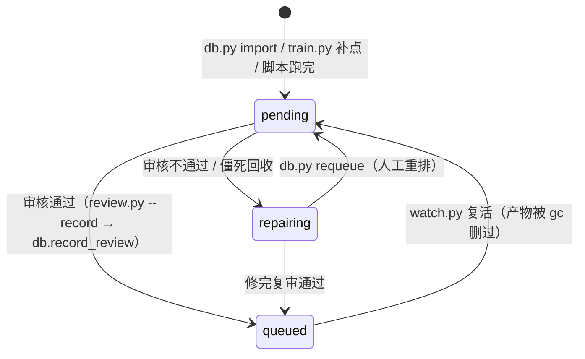

# 单阶段手动运行接口

本文件只讲一件事：**绕过 dispatcher，单独跑某一个阶段的脚本**，用什么命令、传什么参数、产物落在哪里、怎么判断跑通了。
管线调度、数据库入库、审核流程不在本文范围（只有状态转移在 §5 做了索引）；下列参数值以各脚本前部「输入 / 输出 / 参数配置」区为准（参数以代码为准，本文只做索引）。

## 0. 三个阶段共用的约定

| 项目 | 约定 |
| --- | --- |
| 运行根 | `data_lib/runs/high/<stage>/<run-id>/`（`workspace.json` 的 `dataRoot`） |
| run-id | 库里是 `<geometry_id>__<condition_id>__<时间戳>`（UTC）；手工不传时脚本自生成 `run-<UTC 时间戳>-<8 位十六进制>` |
| 运行目录 | 必须**不存在**。脚本是独占创建，目录已存在直接失败 |
| 失败留证 | 整个运行目录被移到 `feedback/<stage>/<run-id>/`，去那里找日志和证据 |
| 验收 | 脚本自己打印逐条判据；只有退出码 0 才算通过，进程退出码本身不被当作几何/网格正确的证明 |
| 时间戳 | 一律 UTC，由脚本自己生成 |

环境：Windows；ANSYS 安装位置从 `AWP_ROOT<数字>` / `AWP_ROOT` / 本机 setup 配置解析，不要把安装路径写进命令行或文档。

**转发壳**（可选）：`scripts\run.ps1` 只是下面三节入口的薄转发，参数原样透传，适合不想记长路径时用。它同时也能转发管线脚本（`db` `watch` `control` `dispatch` `review` `train` `docs`）与 MCP 入口（`spaceclaim-mcp`）；13 个 mode 各自的落点见 §6。

```powershell
.\scripts\run.ps1 spaceclaim --list                  # == node spaceclaim\scripts\missile.mjs --list
.\scripts\run.ps1 spaceclaim --L 3.69 --out D:\tmp\try
.\scripts\run.ps1 fluent_meshing --geometry D:\stage\missile.scdoc --stop-after surface
.\scripts\run.ps1 verify-spaceclaim --out D:\tmp\vsc             # == verify-geometry.mjs
.\scripts\run.ps1 verify-meshing -Geometry D:\stage\missile.scdoc # 必须先给 -Geometry，没有默认模型
```

若报 `running scripts is disabled on this system`（执行策略为 Restricted），用 `powershell -NoProfile -ExecutionPolicy Bypass -File .\scripts\run.ps1 <mode> ...`，或者直接用第 1、2 节里的原始命令。

---

## 1. SpaceClaim 建模

**入口**：`spaceclaim\scripts\missile.mjs`（在 `spaceclaim` 目录内等价于 `npm run missile`）

```powershell
# 看全部开关、默认值和优化区间（JSON，不起 SpaceClaim）
node spaceclaim\scripts\missile.mjs --list

# 全默认值跑一次建模
node spaceclaim\scripts\missile.mjs

# 改几个几何参数再跑
node spaceclaim\scripts\missile.mjs --L 3.69 --D 0.18 --thickness_percent 4.462 --out D:\tmp\try

# 用上一次运行留下的 params.json 复盘（--preset 优先级低于命令行开关）
node spaceclaim\scripts\missile.mjs --preset data_lib\runs\high\spaceclaim\<run-id>\params.json

# 只生成 params.json + model.py，不启动 SpaceClaim（最快的迭代方式）
node spaceclaim\scripts\missile.mjs --generate-only --out D:\tmp\gen
```

**选项**

| 选项 | 默认 | 说明 |
| --- | --- | --- |
| `--<几何参数>` | 见 `--list` | 一次一个开关，省略取默认值；命令行 > `--preset` |
| `--preset <file.json>` | 空 | 预设文件；接受裸参数对象或上次生成的 `params.json` |
| `--out <dir>` | `data_lib/runs/high/spaceclaim` | 产物根，最终目录是 `<out>/<run-id>` |
| `--run-id <id>` | 自生成 | 想和库里/审核对齐时显式传三段式 id |
| `--name <file.scdoc>` | `missile.scdoc` | 只允许叶子文件名 |
| `--generate-only` | 关 | 只写 `params.json` / `model.py` 和运行清单，不启动 SpaceClaim |
| `--timeout <ms>` | 300000 | SpaceClaim 单次执行超时 |
| `--json` | 关 | 机读输出 |
| `--list` | — | 打印默认值、优化区间、几何字段名后退出 |

**开关来自哪里**：`spaceclaim\lib\missile-schema.mjs`，加参数只需要改那里，CLI / MCP / `params.json` 同步生效。
16 个几何参数：`L_N` `L` `D` `L_W` `C_RW` `C_TW` `B_W` `L_F` `C_RF` `C_TF` `B_F`（11 个长度）+ `fin_section` + `thickness_percent` + 截面参数（`hexagon` 用 `flat_percent`；`naca` 用 `le_radius_index`、`max_thickness_tenths`）+ `nose_shape`。
此外，建模实现参数（`k_nose` `k_tip` `fin_phase` `root_overlap` `le_mode`）和流场域参数（`enclosure_*` `boi_*` `model_placement` `model_offset`）也从这个入口传入——网格阶段直接用它们生成的命名选择，所以调试网格时先在这里改。
当前实现范围：`nose_shape` 只有 `cone`；`le_mode` 只有 `trailing_aligned`；`fin_section` 支持 `naca` 和 `hexagon`。

**前置**：`SpaceClaim.exe` 按 `SCDM_EXECUTABLE` > `npm run setup` 存下的本机配置 > `AWP_ROOT<版本>` > `AWP_ROOT` 顺序解析；都没有时报 `SpaceClaim.exe not found`。首次配置跑 `npm run setup`（在 `spaceclaim` 目录内），页面里选 AWP 或手填 `SpaceClaim.exe`。API CHM 同理，顺序是 `SCDM_CHM` > setup 配置 > `AWP_ROOT<版本>`。

**产物**（`<run-id>/` 内）：`params.json`、`model.py`、`<name>.scdoc`、`run.json`、`result.json`，脚本报错时还有 `diagnostic.txt`；`request.json`、预览图、`error.txt` 不保留。`run.json` 里是 `status` + `verification.runtimeVerified` + 产物清单（含 sha256），`result.json` 里是实测体积/面积/整弹质心 `measurements.centerOfMassM`（弹尖起算）。

**验收**：控制台逐条打印 `通过/失败  判据  :: 详情`，最后一行给出产物目录。退出码 `0` 通过、`1` 验收未通过（产物保留在运行目录）、`2` 参数非法或调用错误。

**旁路工具**

| 命令 | 用途 |
| --- | --- |
| `node spaceclaim\scripts\verify-geometry.mjs [--out <dir>] [--timeout <ms>]` | 圆周阵列 fixture 端到端验证 SpaceClaim 通路（不是整弹几何） |
| `npm run verify:real` | 只验证 CHM 检索链路，不启动 SpaceClaim |
| `npm run smoke` | MCP 协议 smoke（需要 CHM 环境） |

---

## 2. Fluent Meshing 网格

**入口**：`fluent_meshing\run_meshing.cmd`（批处理，必须经 cmd 启动；PowerShell 里用 `cmd /c` 或 `& .\fluent_meshing\run_meshing.cmd ...`）

```powershell
# 最小调用（--geometry 必填，没有默认模型）
cmd /c fluent_meshing\run_meshing.cmd --geometry D:\stage\missile.scdoc

# 断点调试：画到局部尺寸就停，保留会话上手看
cmd /c fluent_meshing\run_meshing.cmd --geometry D:\stage\missile.scdoc --stop-after sizing --show-gui --keep-fluent

# 与库里对齐的运行目录和产物名
cmd /c fluent_meshing\run_meshing.cmd --geometry D:\stage\missile.scdoc --run-id <run_id> `
    --out data_lib\runs\high\fluent_meshing\<run_id>\<geometry_id>_mesh.msh.h5
```

**参数**

| 参数 | 默认 | 说明 |
| --- | --- | --- |
| `--geometry <file>` | 必填 | 导入的 `.scdoc`；相对路径按调用时工作目录解析 |
| `-n` / `--processors <n>` | 12 | Fluent 进程数（不是线程数，一进程一物理核） |
| `--run-dir <dir>` | 自生成 | 显式运行目录，必须不存在；优先级高于 `--run-id` |
| `--run-id <id>` | 自生成 | 三段式 id，运行目录落 `data_lib/runs/high/fluent_meshing/<id>/` |
| `--out <file>` | `<run-dir>/missile_mesh.msh.h5` | 网格产物路径，必须不存在 |
| `--start-timeout <s>` | 300 | 等 Fluent 启动就绪 |
| `--timeout <s>` | 900 | 整个网格流程总时限（超时杀整棵进程树） |
| `--keep-fluent` | 关 | 结束时不关 Fluent 会话（配合 `--show-gui` 手查） |
| `--show-gui` | 关 | 显示 Fluent 界面 |
| `--draw-size-control <true\|false>` | true | 局部尺寸控制是否画尺寸框 |
| `--stop-after <step>` | 不设 | 画到指定步骤就停：`import` / `sizing` / `surface` / `describe` / `share` / `regions` / `update-regions` / `bl` / `volume` |

**两条硬约束**

1. **模型文件名主干必须是 `missile`**：Fluent 用文件名主干拼 face zone label，`Add Local Sizing` 要的 label 是写死的 `missile_body`、`missile_nose`、`missile_nose_tip`、`missile_fin`、`missile-boi`。把已审模型复制成 `<某个目录>\missile.scdoc` 再喂进去；直接喂 `<geometry_id>_spaceclaim.scdoc` 会因为 label 变成 `<geometry_id>_spaceclaim-missile_body` 之类而报 Unknown exception。
2. **`--out` 指向的文件必须不存在**，脚本不会覆盖（新运行目录天然满足）。

**解释器**：`FLUENT_MESH_PYTHON` > `fluent_meshing\.python-path` 里写的路径 > `%LOCALAPPDATA%\Programs\Python\Python310|311` > `py -0p` 找到的 3.10/3.11。启动器把 `PYTHONPATH` 指向 `fluent_meshing\_deps`（PyFluent 装在这里，不能用 3.13）。Fluent 版本固定 2024 R1，需要 `AWP_ROOT241`。

**产物**（运行目录内）：`request.json`、`pipeline.log`、`quality.json`、`quality-native.json`、`validation.trn`、`completed_workflow.wft`（或 `stopped_workflow.wft` / `failed_workflow.wft`）、`supervisor.log`、`run.json`、`mesh-inspection.json`、网格文件。失败时整目录移到 `feedback/fluent_meshing/<run-id>/`。

**验收与输出**：stdout 最后一行是 JSON：`{"status","runId","runDir","verification"}`。`PASSED` 需要两道独立检查都过：
1. worker 内检查：正交质量下限（`mesh_validation.MINIMUM_ORTHOGONAL_QUALITY`）、边界 zone `inlet`/`outlet`/`wall`、唯一的非空流体 cell zone、导弹壁面 zone 非空；
2. 主管进程用**另一个隔离环境**（`.mesh_inspect_deps_313` + `.mesh-inspect-python` 或 `MESH_INSPECT_PYTHON`）把写出的 `.msh.h5` 重新读一遍，核对单元数和 zone 名。

第 2 道缺解释器会直接判 `FAILED`（"isolated mesh-inspection interpreter is not configured"）。退出码：`0` 为 `PASSED`/`STOPPED`，`1` 失败（含超时、验收不过），`2` 运行目录创建失败。

**单文件复核工具**

| 命令 | 用途 |
| --- | --- |
| `cmd /c fluent_meshing\mesh_check.cmd <mesh.msh.h5>` | 用隔离解释器读网格，打印维度/单元数/区域 JSON，不启动 Fluent |
| `python fluent_meshing\tools\probe_regions.py --geometry <file.scdoc> [-n N]` | 起会话打印导入后的 label / region / zone 名，排查命名问题 |
| `python fluent_meshing\tools\compare_with_reference.py <new.wft> [<ref.wft>]` | 把生成的 workflow 文件和历史参考逐任务对比 |

---

## 3. Fluent Solution 求解

**现状：还没有可运行脚本。** `fluent_solution\` 目录为空，`scripts\dispatch.py` 的 `UNIMPLEMENTED_STAGES` 里写着「求解脚本未实现（计划 P5 只建骨架）」，`--stage fluent_solution` 会**明确拒绝启动**（状态不改）并写上报单；`watch.py` 见到 `queued` 的网格也只打印「跳过 fluent_solution：……求解脚本未实现」，不会假装成功。

在脚本补齐之前，求解只能在 Fluent 里手工算。已经定下来、写脚本时要遵守的接口：

| 接口 | 位置 / 形状 |
| --- | --- |
| 上游交接 | `data_lib/queues/meshing_for_solution/<run_id>.json`：`schemaVersion`、`queue`、`run_id`、`geometry_id`、`condition_id`、`artifact{rel_path,size,sha256}`、`review_id`、`approved_at` |
| 网格文件 | 上面 JSON 的 `artifact.rel_path`（相对工作区），目前指 `data_lib/runs/high/fluent_meshing/<run_id>/<geometry_id>_mesh.msh.h5` |
| 工况 | 库表 `condition(mach, alpha_deg, altitude_m)`，`run_id` 中段就是 `condition_id` |
| 产物目录 | `data_lib/runs/high/fluent_solution/<run_id>/`，含 `run.json`（`status` + `verification.runtimeVerified`）与 `result.json` |
| 结果 | 只能经审核入库，写进 `cfd_task` 的 `CL` / `CD` / `CM` / `converged` / `residual` |
| 审核 | `python scripts/review.py --kind solution --run-id <run_id>`（库里必须已有该 `run_id`） |

---

## 4. 手工跑时容易踩的点

- **手工运行不推进数据库状态**：状态推进只由 `scripts\dispatch.py` 做，写库只有 `scripts\db.py` 一个入口（`review.py --record` 也只是转调它）。手工跑出来的目录是证据，不是入库结果。
- **`review.py` 靠 `run_id` 找目录**（`data_lib/runs/high/<stage>/<run-id>/`），并要求库里已有该任务。手工自生成的 `run-...` id 天然对不上，会直接报「库里没有 run_id ... 对应的任务」；想走审核就用 `--run-id <库里那个 id>` 显式指定。
- **目录和文件都是独占创建**：`--run-dir`、`--out`、运行目录三者只要已存在就失败，重跑就换个新 id。
- **失败先看 `feedback\<stage>\<run-id>\`**：`run.json` 的 `error`、`supervisor.log`、`pipeline.log`（网格）或 `diagnostic.txt`（建模）里的第一条异常才是根因。
- **不要按旧文档改参数**：参数以 `workspace.json`、各脚本前部配置区、schema 默认值和数据库里的行为准；本文不含参数表，需要列默认值时跑 `node spaceclaim\scripts\missile.mjs --list` 或看 `fluent_meshing\mesh_runner.py` 前部。

---

## 5. 状态怎么转移

四个阶段共用同一套**三态**词表（`scripts/db.py` 的 `TASK_STATUSES`，库内存英文码、文档里写中文）：
`pending` `repairing` `queued`。

| 代码 | 中文 | 含义 |
| --- | --- | --- |
| `pending` | 待处理 | 已入库 / 刚建行 / 脚本跑完**等审核** |
| `repairing` | 修理中 | 审核不通过，或进程非正常消失；子智能体修完再送审 |
| `queued` | 排队中 | **审核通过**，可被下一流程领取 |

`running` / `reviewing` / `rejected` / `passed` / `cancelled` **已删除**。"谁在跑"靠两样东西：
`claimed_at`（领取标记，`UPDATE ... WHERE claimed_at IS NULL` 的 rowcount 判成功）与
`task_process` 里的 pid。

状态落在四张表上，**同一个词表，四套行**：

| 阶段 | 状态字段 | 粒度 |
| --- | --- | --- |
| SpaceClaim | `geometry_state.model_status` | 按几何 |
| Fluent Meshing | `mesh_task.status` | 按 **`(geometry_id, condition_id)`** |
| Fluent Solution | `cfd_task.status` | 按 `(geometry_id, condition_id)` |
| DATCOM | `datcom_task.status` | 按 `(geometry_id, condition_id)`，执行时按"几何 + 高度"合批 |



### 5.1 主路径

| 转移 | 谁做 | 触发条件 | 落库动作 |
| --- | --- | --- | --- |
| — → `pending` | `db.py import` / `train.py` / `db.py requeue` | 新行入库、训练补点、人工重排 | 新行 `attempts=0`，`origin='human'` 或 `'active_learning'` |
| `pending` → `queued` | `review.py --record` → `db.record_review` | 否决性判据全过 | 模型：写 `model_path` + `model_run_id`；网格：写该行情 `mesh_path` + `run_id`；求解 / DATCOM：写 `CL` `CD` `CM`（求解另有 `converged` `residual`）与 `review_id`；事务提交后重写队列指针 |
| `pending` → `repairing` | 同上 | 任一否决性判据不过 | 路径清空，`run_id` 保留便于反查；超 `SELF_REPAIR_BUDGET` 自动写 `open` 上报单 |
| `repairing` → `queued` | 子智能体修完后再次审核 | 复审通过 | 同上 |
| （领取执行） | `dispatch.py` | `claimed_at IS NULL` 且 `status='pending'`（网格还要求建模已过审） | 写 `claimed_at` + 新 `run_id`；进程起来后登记 `task_process` 的 pid |
| （跑完） | `dispatch.py` | 退出码 0 且 `run.json.status='PASSED'` | **回到 `pending` 等审核**（不是 `queued`），清 `claimed_at`；建模成功还会顺手生成点云 |

### 5.2 不走主路径的转移

| 转移 | 谁做 | 条件与说明 |
| --- | --- | --- |
| `pending` → `repairing`（僵死） | `watch.py` | `claimed_at` 挂着但 pid 已消失（或领取后从未登记 pid 且超过 `CLAIM_ORPHAN_SECONDS`）→ `repairing`、`attempts+1`、写上报单 |
| （只上报） | `watch.py` | `repairing` 超过 `REPAIR_TIMEOUT_SECONDS`（默认 1800 秒）→ 写 `open` 上报单（按 stage + 几何 + 工况去重），明确打印"已停滞超过 N 分钟 → 上报" |
| `queued` → `pending` | `watch.py` | 仅当该行还是 `queued` 但产物路径为 NULL（被 `gc` 删过）；领取中的行不动 |
| 任意 → `pending` | `db.py requeue` | 不删审核历史、不重置重试次数；领取中的行必须先 `control.py stop`；加 `--resolve-reports` 顺手关掉同阶段 `open` 的上报单 |
| 任意 → `repairing` | `control.py stop` | 杀整棵进程树、**确认进程已死**才改状态（三态里没有 `cancelled`），并写一张 `open` 上报单 |
| `queued` → `repairing` | `review.py --force --force-reason "<理由>"` | 唯一能重审已过审任务的路，用在产物被下游重新保存、sha256 变了的时候；不带 `--force` 会直接拒绝执行 |
| （拒绝启动） | `dispatch.py` | 阶段还没实现（现在只有 `fluent_solution`）：不改状态、不启动进程，直接写上报单 |

### 5.3 认领前的前置条件

`pending` 不等于"马上会被领走"，`db._claim_rows` 的查询自带门槛：

- 网格（`mesh_task`）：必须该几何 `model_status='queued'` 且 `model_path` 非空（`CLAIM_GATES`）。
- 求解（`cfd_task`）：脚本未实现，`watch.py` 明确跳过并打印原因，`dispatch.py` 拒绝启动。
- DATCOM：一次领走同 `geometry_id` + 同 `altitude_m` 的全部 `pending` 行，**一批一个 `run_id`**（`condition_id` 段写 `shared`）。

### 5.4 另外几个和状态有关的字段

| 字段 | 取值 | 谁改 | 含义 |
| --- | --- | --- | --- |
| `claimed_at` | `NULL` / 时间戳 | `db.claim_*` 写入、`mark_task` 清空 | 非空 = 已被某进程领走。**防重复领取的唯一标记** |
| `control.state` | `running` / `paused` / `stopped` | `control.py start\|pause\|stop` | 是否允许 `watch.py` 继续触发；优先级 `task` > `stage` > `workflow`。这是**开关词**，与任务排队状态无关 |
| `report.status` | `open` → `resolved` / `dismissed` | 自动开单，`db.py resolve-report` 或 `requeue --resolve-reports` 关闭 | 上报单；同一阶段 + 几何 + 工况同时只允许一张 `open` |
| `review.verdict` | `passed` / `rejected` | `db.record_review` | **审核结论**，与任务排队状态是两层不同的词 |
| `training_round.status` | `running` → `passed` / `failed` / `cancelled` | `train.py` | 一轮训练自己的生死，不推动任务状态 |
| `geometry_state.deletable` | `0` → `1` | `refresh_deletable`（`gc` 的前置判定） | 该几何所有 `cfd_task` 都 `queued`（且网格行都完成）才自动置 1，**只升不降** |

### 5.5 重试次数是怎么数的

- `attempts` 不等于"跑过几次"。审核层用的是 `review` 表里的拒绝记录：同一 `(kind, 几何, 工况)` 上"最后一次 `passed` 之后"有多少条 `rejected`（`db._rejections_since_last_pass`）。
- 超过 `SELF_REPAIR_BUDGET = 2`——也就是**第 3 次被否决**——`record_review` 会自动写一张 `open` 上报单并停手。`requeue` 不会重置这个计数。
- `mesh_task` / `cfd_task` / `datcom_task` 有 `attempts` 列（脚本失败或僵死回收时 `+1`）；`geometry_state` **没有** `attempts` 列，建模的重试次数只能从 `review` 表的拒绝记录和 `report` 反查。

以上是索引，真实行为以 `scripts/db.py`（`TASK_STATUSES` / `STAGE_TARGET` / `CLAIM_GATES` / `SELF_REPAIR_BUDGET` / `record_review`）、`scripts/watch.py`（`scan_once`）、`scripts/dispatch.py`（`dispatch_once` / `spawn_once`）、`scripts/control.py`（`cmd_set`）为准。

---

## 6. `scripts/` 里各脚本做什么

三条分工原则，先看这三条就不容易用错：

1. **状态只由三个脚本推进**：`watch.py` 排队、`dispatch.py` 执行、`review.py` 判定；`control.py` 只管开关和杀进程。
2. **库只有一个入口**：所有写操作都走 `scripts/db.py`。别的脚本是 `import db` 或调 `python scripts/db.py <子命令>`，没有第二个 SQL 写入点。
3. **路径全部相对解析**：脚本用 `__file__` / `$PSScriptRoot` 推工作区根，再读 `workspace.json`；不写机器绝对路径。`snapshot` / `rollback` / `migrate` / `retire-old` / `find-directory-owner` 都把 `DATCOM/` 当受保护路径，路径落在里面会直接抛错。

### 6.1 管线（Python）

| 文件 | 作用 | 常用调用 |
| --- | --- | --- |
| `db.py` | **唯一写库入口**。建表与自检、16 参数规范化与哈希身份、`import` / `export`、原子领取、记审核、上报单、重排、启停表、`gc`。同时是被其他脚本 import 的库模块 | `python scripts\db.py check`、`python scripts\db.py gc`、`python scripts\db.py requeue --stage fluent_meshing --geometry-id <id> --condition-id <id>` |
| `watch.py` | **唯一推进器**。只认 `queued`：建模过审后为每个工况建 `mesh_task` 行、触发网格（起子进程，不阻塞自己）、僵死回收、修理超时上报、复活被 `gc` 删过产物的行。**不启动求解**（未实现，明确跳过并打印原因） | `python scripts\watch.py --once` |
| `dispatch.py` | **执行器**。原子领一条 `pending`（`claimed_at` 的 rowcount 判成功）、拼阶段命令行、起子进程、超时杀整棵进程树、成功回 `pending` 等审核。DATCOM 按"几何 + 高度"合批；`fluent_solution` 因未实现会明确拒绝。`--spawn` 模式领一条就立刻退出（watch 用，不会被 30 分钟的任务卡住） | `python scripts\dispatch.py --stage spaceclaim --once`、`--spawn` |
| `control.py` | **启停开关**。`start` / `pause` / `stop` / `status`，优先级 `task` > `stage` > `workflow`；`stop` 用 Win32 终止整棵进程树，确认进程已死才把任务置 `repairing` 并写上报单 | `python scripts\control.py status`、`python scripts\control.py stop --target stage:fluent_meshing` |
| `review.py` | **审核判据**，四个 `kind`（`model` / `mesh` / `solution` / `datcom`）各一套确定性检查，结果写成 JSON 并逐条打印。网格按工况审：判据 10/11 核 `condition_id` 与边界层设计值。加 `--record` 才调 `db.record_review` 入库；`--force --force-reason` 用于重审已过审的产物 | `python scripts\review.py --kind mesh --run-id <run_id> --record` |
| `train.py` | **训练一轮 + 提补点**。从 `cfd_task.status='queued'`（审核通过）取样本、训代理模型、把"不确定"的工况写回 `cfd_task`（`origin='active_learning'`、`pending`），并记 `training_round`。目前代理模型是 k-NN 占位，GPR 版见 `myplan.md` §6.4 | `python scripts\train.py --dry-run` |

### 6.2 转发壳与文档同步

| 文件 | 作用 | 常用调用 |
| --- | --- | --- |
| `run.ps1` | 薄转发，13 个 mode：`spaceclaim` / `fluent_meshing` / `verify-spaceclaim` / `verify-meshing` / `spaceclaim-mcp` / `index` / `db` / `watch` / `control` / `dispatch` / `review` / `train` / `docs`。`index` 已改指 `db.py export --format index`（`index.mjs` 退役）；`spaceclaim-mcp` 把 stdin/stdout 原样接到 `node spaceclaim\server.mjs`，只走 JSON-RPC | `.\scripts\run.ps1 db check`、`.\scripts\run.ps1 spaceclaim-mcp` |
| `docs.py` | 把参数默认值同步进 README：只重写 `<!-- AUTO-PARAMS:begin name=… -->` 与 `:end` 之间的生成块，块外散文不动。路径"暂存区优先"——`.readme/<相对路径>` 存在就写它 | `python scripts\docs.py --check`、`python scripts\docs.py --write` |

### 6.3 备份、回滚、迁移、退役（PowerShell）

这四个都是一次性/低频操作脚本，跑之前先看清楚前置条件；`migrate.ps1` 已经执行过，现在会主动拒绝重跑。

| 文件 | 作用 | 前置与副作用 |
| --- | --- | --- |
| `snapshot.ps1` | 把指定目录/文件打快照到 `archive\snapshot-<UTC>\`，写 `backup-manifest.json`（含每个文件 sha256） | 默认包含 `spaceclaim`、`fluent_meshing`、`scripts`、`workspace.json`、`AGENTS.md`、`.readme`；`DATCOM/` 会被拒绝 |
| `rollback.ps1` | 从 `archive\` 下的快照回滚 | 先逐文件校验 sha256 与 `backupVerified`，再把当前目录移到 `rollback-preserved\<时间戳>\` 而不是删除 |
| `migrate.ps1` | 早期的一次性目录迁移（`-BackupOnly` / `-ResumeSnapshot`） | 已执行；检测到 `data_lib\legacy\migration-manifest.json` 就抛错，改用 `rollback.ps1` |
| `retire-old.ps1` | 把旧工作流（`mcp_skill\*`、`docs`、`prompt`）移到 `archive\retired-originals-<UTC>\` | 要求 `runs/` 里已有 SpaceClaim 与 Fluent 各自的 PASSED + `runtimeVerified` 验收记录，否则拒绝执行 |

### 6.4 两个排查工具

| 文件 | 作用 | 常用调用 |
| --- | --- | --- |
| `find-directory-owner.ps1` | 查"哪个进程占着这个目录"：遍历系统句柄找持有该目录的进程。用于目录删不掉、`--out` 说目录已存在这类问题 | `.\scripts\find-directory-owner.ps1 -Path data_lib\runs\high\fluent_meshing\<run_id>` |
| `compare-models.mjs` | 对比两次建模运行：`run.json` / `params.json` / `result.json` 里的状态、失败判据、参数来源（preset 还是命令行）、派生几何与实测尺寸 | `node scripts\compare-models.mjs <基线运行目录> <对比运行目录>` |

任何一个 Python 脚本加 `--help` 就是它自己的完整参数表；本文只做职责索引，参数以脚本为准。
