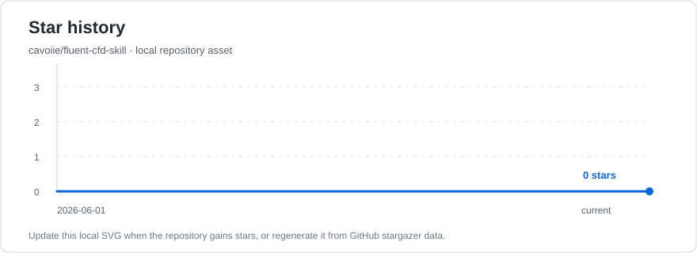

# Fluent CFD Skill

English | [简体中文](README.zh-CN.md)

A Codex skill for Ansys Fluent, PyFluent, and CFD simulation workflows.

This repository packages a research-oriented workflow skill for working with Fluent cases, solver setup, convergence diagnosis, and PyFluent MCP automation. It is designed as a judgment layer for agents: it does not replace the Fluent manuals, and it does not bundle a Fluent runtime.

## Highlights

- Fluent workflow discipline from problem framing to validation.
- PyFluent MCP tool-use guidance for safe, auditable Fluent automation.
- Convergence checks that combine residuals, monitors, conservation, and physical plausibility.
- Practical references for solver choice, boundary conditions, turbulence, numerics, validation, and error recovery.
- Conservative defaults for research use: no arbitrary Python execution unless explicitly enabled in the local MCP server.

## Repository Layout

```text
.
+-- SKILL.md
+-- agents/
|   +-- openai.yaml
+-- references/
    +-- workflow.md
    +-- solver-selection.md
    +-- boundary-conditions.md
    +-- turbulence-and-wall-treatment.md
    +-- numerics-and-convergence.md
    +-- pyfluent-mcp.md
    +-- validation-checklist.md
    +-- error-recovery.md
```

`SKILL.md` is intentionally compact. It routes the agent through the core CFD workflow and points to focused references only when needed.

## Use Cases

- Plan a Fluent case setup before touching the solver.
- Review boundary conditions, mesh quality, and physical assumptions.
- Choose solver settings, turbulence models, wall treatment, and convergence criteria.
- Diagnose residual stalls, reversed flow, divergence, and launch/license failures.
- Guide PyFluent MCP workflows such as launch, read case, run TUI commands, iterate, save, and close.

## Prompt Templates

Use the standard templates in [PROMPTS.md](PROMPTS.md) for full CFD reviews, short daily checks, PyFluent MCP runs, and convergence diagnosis.

## Installation

Copy this folder to your Codex skills directory:

```powershell
Copy-Item -Recurse . "$env:USERPROFILE\.codex\skills\fluent-cfd"
```

After installation, Codex can trigger the skill when a task mentions Fluent, PyFluent, Fluent TUI, CFD simulation setup, mesh quality, boundary conditions, turbulence models, residual convergence, UDFs, or post-processing.

## Versioning

Versions are managed with GitHub Releases and semantic version tags. Use the latest release for a stable skill snapshot, and use `main` for active edits.

## Safety Notes

- Residual decrease alone is not convergence.
- Mesh quality, units, boundary consistency, and wall-resolution checks should not be skipped.
- Turbulence model changes should have a physical reason or validation goal.
- The optional `execute_python` MCP tool should stay disabled unless the local workflow is trusted.
- This repository contains only the skill. A separate local PyFluent MCP server is required for live Fluent control.

## Related Execution Layer

The skill is designed to pair with a local `pyfluent` MCP server that exposes tools such as `server_info`, `launch_fluent`, `read_case`, `run_tui`, `iterate`, `write_case_data`, `session_status`, and `exit_fluent`.

That execution layer is intentionally separate from this repository so this skill remains lightweight, portable, and safe to publish.

## Stars



---

## 本工作区的目录注记

本目录是**完整保留的独立 skill 项目**（自带 Git），README 正文保留上游原文。工作区补充下列
说明，只用于目录核对：

| 下级 | 用途 |
| --- | --- |
| `agents/` | skill 的智能体定义。 |
| `assets/` | skill 的配图与素材。 |
| `references/` | 参考资料。 |
| `SKILL.md` | skill 主定义。 |
| `PROMPTS.md` / `PROMPTS.zh-CN.md` | 提示词（英文 / 中文）。 |
| `README.md` / `README.zh-CN.md` | 说明（英文 / 中文）。 |
| `LICENSE` | 上游许可证。 |
| `.gitignore` | 本 skill 自己的忽略规则。 |
