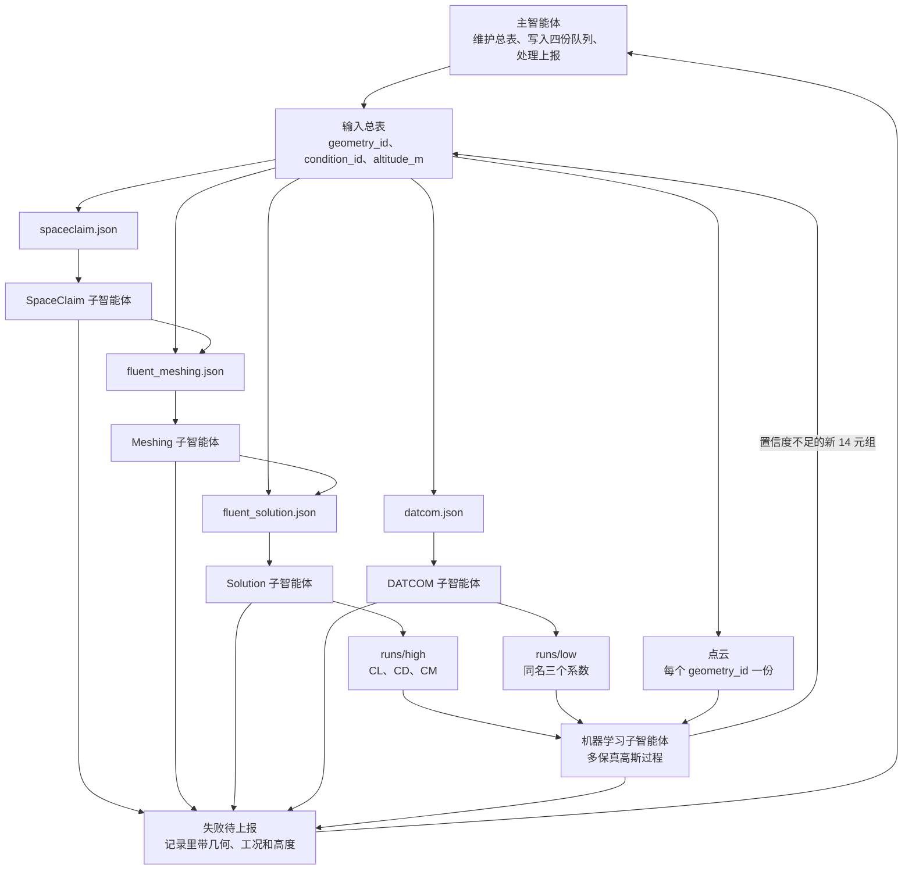
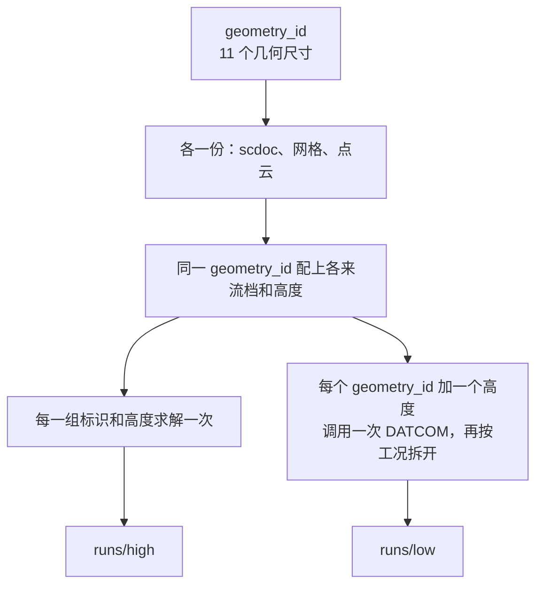
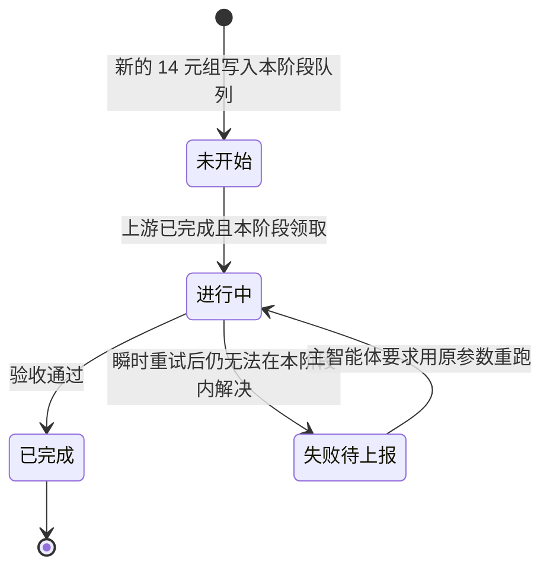

# 工作流与数据闭环计划

目录和下面这几条路径已经落地。队列文件在，记录仍是空的。主智能体和各阶段子智能体还没有接上。

已经落地的路径：

- 高保真默认目录是 `data_lib/runs/high/<run-id>/<阶段>/`。`<run-id>` 是 `run-<时间戳>-<短ID>`。
- `DATCOM/scripts/01_batch_datcom.py` 读取 `data_lib/inputs/cases.csv`。同一个 `geometry_id` 加同一个 `altitude_m` 是一次调用，归档在 `data_lib/runs/low/<geometry_id>/`。运行中的协议文件在 `data_lib/runs/low/.work/`，算完后删除。
- `DATCOM/scripts/04_pointnet_demo.py` 用 `--geometry-id` 或 `--params` 读取 11 个主尺寸，输出在 `data_lib/datasets/point_clouds/`。
- 总表现有 4 行试算。几何尺寸用根目录说明里的基准值，`geometry_id` 暂写 `1`，高度 `0`，工况 C01、C02、C06、C07。与这张表对应的结果在 `data_lib/runs/low/1/`。前一次试算把几何标识写成 `sample`，归档仍在 `data_lib/runs/low/sample/`。

仍待决定：标识符编码、置信度、补点范围、点云最终格式、求解器、上报后的调整权。

本文其余部分是队列、智能体和数据登记的设计说明。

14 个参数指根目录说明里的 11 个几何尺寸，加上马赫数 `Ma`、攻角 `α` 和飞行高度。长度单位是米，飞行高度的单位也是米。`Ma` 与 `α` 使用根目录说明中的离散档：6 个马赫数乘 5 个攻角，共 30 个来流档，编号 `C01`–`C30`。飞行高度写在每一行自己的 `altitude_m` 里，同一来流档可以有多个高度。

## 计划参数与路径

路径都相对工作区根目录。`workspace.json` 里的 `dataRoot` 仍是 `data_lib`，`feedbackRoot` 仍是 `feedback`。下表是本计划要使用的位置和默认参数；实施时改这一处即可。

| 名称 | 值 | 作用 |
|---|---|---|
| 输入总表 | `data_lib/inputs/cases.csv` | 一行一个 14 元组。前两列是 `geometry_id` 和 `condition_id`，飞行高度在 `altitude_m` |
| 建模队列 | `data_lib/queues/spaceclaim.json` | SpaceClaim 的状态和产物路径 |
| 网格队列 | `data_lib/queues/fluent_meshing.json` | Fluent Meshing 的状态和产物路径 |
| 求解队列 | `data_lib/queues/fluent_solution.json` | Fluent Solution 的状态和产物路径 |
| DATCOM 队列 | `data_lib/queues/datcom.json` | 低保真计算的状态和产物路径 |
| DATCOM 程序 | `DATCOM/` | 只放程序和模板。入口是 `DATCOM/scripts/01_batch_datcom.py`，程序本体是 `DATCOM/datcom_bin/datcom.exe` |
| 训练轮次 | `data_lib/queues/ml.json` | 每一轮训练的状态，不按工况拆行 |
| 高保真数据 | `data_lib/runs/high/<run-id>/<阶段>/` | `<run-id>` 是 `run-<时间戳>-<短ID>`。SpaceClaim、Fluent Meshing、Fluent Solution 各自一个阶段子目录 |
| 低保真数据 | `data_lib/runs/low/<geometry_id>/` | DATCOM 归档。同一个 `geometry_id` 的各高度共用这个目录 |
| 点云 | `data_lib/datasets/point_clouds/` | `04_pointnet_demo.py` 的输出。点数和最终格式仍待定 |
| 失败包 | `feedback/<阶段>/<执行目录>/` | 沿用现有异常包。包内文件名与原产物相同，因此也能回总表 |
| 每阶段并发 | `1` | 同一阶段同时处于「进行中」的任务数 |
| 瞬时故障重试 | `2` | 启动失败、超时、进程中断的重试次数 |

现有单组几何示例仍是 `data_lib/inputs/missile_params_example.json`。它只含 11 个几何尺寸，继续作为建模示例。工作流的批量入口是上面的 CSV。

## 身份与共用

比较参数时使用固定字段顺序和固定小数写法，保证同一个数值只有一种写法。字段顺序是：

`L_N`、`L`、`D`、`L_W`、`C_RW`、`C_TW`、`B_W`、`L_F`、`C_RF`、`C_TF`、`B_F`、`Ma`、`alpha_deg`、`altitude_m`

- `geometry_id` 与前 11 个几何尺寸一一对应，放在第一列。同一几何的各个工况共用一个 `geometry_id`。
- `condition_id` 是 `C01`–`C30`，只由 `Ma` 和 `alpha_deg` 决定，放在第二列。每个编号只对应网格里的一对马赫数和攻角，不包含高度。
- 一行由 `geometry_id`、`condition_id` 和 `altitude_m` 唯一确定。这三个值一起对应完整的 14 个参数。总表不再另设 `case_id`。
- 在现有 30 个来流档内，知道几何标识、工况编号和高度就能确定 `Ma`、`alpha_deg`、`altitude_m` 和 11 个几何尺寸。若以后出现这 30 档以外的马赫数或攻角，先给它分配新的 `condition_id`，再写入总表。
- `geometry_id` 的字符串编码留到实施时锁定，并且必须由 11 个几何尺寸的规范写法稳定得出。编码里不使用双下划线 `__`。`altitude_m` 用固定小数写法，本身也不含 `__`。总表以几何标识、工况编号和高度的组合保证唯一。队列和失败记录保存这三个值，参数以总表该行为准。
- `run_id` 是 `{geometry_id}__{condition_id}__{altitude_m}`。它由这三列拼出，不另占一列，也不另外编号。文件名里看到它，就从右侧两处 `__` 拆开：最后一段是高度，中间一段是 `condition_id`，剩下的是 `geometry_id`。

SpaceClaim、网格和点云都只由 11 个几何尺寸决定，因此每个 `geometry_id` 只生成一份模型、一份网格、一份点云。各行工况记录指向这三份产物。求解按每一组 `geometry_id`、`condition_id` 与 `altitude_m` 各执行一次。DATCOM 按 `geometry_id` 加 `altitude_m` 调用一次，同一次调用覆盖该几何、该高度在总表里的全部马赫数和攻角。

几何参数变化会得到新的 `geometry_id`。马赫数或攻角变化会得到新的 `condition_id`。飞行高度变化会得到新的 `altitude_m`。三种情况都追加新行，并得到新的 `run_id`。原行保留原来的标识和原来的参数。已有行的参数不再改写，避免标识还在、参数已经对不上。

## 产物文件名

中间产物的文件名本身要能回到总表，不依赖打开 `run.json` 才知道是哪一组参数。扩展名保持各程序原有的扩展名。

跟一个工况绑定的文件，以 `run_id` 开头：

| 文件 | 文件名 |
|---|---|
| 求解结果 | `{run_id}_fluent_solution.<扩展名>` |
| 求解日志 | `{run_id}_fluent_solution.log` |
| DATCOM 系数 | `{geometry_id}_aero_coefficients.csv`（该几何一张表，各工况、各高度都在里面） |
| DATCOM 日志 | `{geometry_id}_datcom.log` |

模型、网格和点云由同一几何的各个高度和来流档共用，只跟几何绑定，文件名以 `geometry_id` 开头。这个 `geometry_id` 就是相关 `run_id` 第一段。用第一列能列出这些工况，11 个几何参数在这些行上相同。

| 文件 | 文件名 |
|---|---|
| SpaceClaim 模型 | `{geometry_id}_spaceclaim.<扩展名>` |
| 建模日志 | `{geometry_id}_spaceclaim.log` |
| 网格 | `{geometry_id}_fluent_meshing.<扩展名>` |
| 网格日志 | `{geometry_id}_fluent_meshing.log` |
| 点云 | `{geometry_id}_pointcloud.<扩展名>` |
| DATCOM 输入卡片归档 | `{geometry_id}_for005.dat` |
| DATCOM 原始输出归档 | `{geometry_id}_for006.dat` |
| DATCOM 外形归档 | `{geometry_id}_for022.dat` |
| DATCOM 系数总表 | `{geometry_id}_aero_coefficients.csv` |
| DATCOM 几何核对 | `{geometry_id}_geometry_check.txt` |
| DATCOM 几何核对图 | `{geometry_id}_geometry_check.png` |
| DATCOM 参数快照 | `{geometry_id}_case_params.json` |

高保真一次执行放在 `data_lib/runs/high/<run-id>/<阶段>/`，`<run-id>` 是 `run-<时间戳>-<短ID>`。低保真归档放在 `data_lib/runs/low/<geometry_id>/`。两类数据分属这两个目录。目录里的文件名仍按上表，带 `run_id` 或 `geometry_id`。失败包中的副本沿用同一文件名。高保真重跑会新建 `<run-id>`。低保真对同一几何再次运行时，按几何标识命名的归档会被这次调用覆盖；系数表里其它高度的行保留，本次工况的行被替换。同名新文件只有在该次验收通过后才替换队列里的产物路径。

`datcom.exe` 运行当下，工作目录里的协议文件名仍是 `for005.dat`、`for006.dat`、`for022.dat`。工作目录用 `data_lib/runs/low/.work`。算例写完后只保留在 `data_lib/runs/low/{geometry_id}/`，文件名改成上表里带 `geometry_id` 的名字。系数表只写一张，放在这个子目录，同一个 `geometry_id` 的各工况、各高度都在里面，不再按工况抽出单行 CSV。`DATCOM/` 下面不保留算例结果。

## 两条链路

高保真链路：

`cases.csv` → SpaceClaim → Fluent Meshing → Fluent Solution → `data_lib/runs/high/`

低保真链路：

`cases.csv` → DATCOM → `data_lib/runs/low/`

两条链路从同一张总表分出，之后互不阻塞。DATCOM 可以在几何、网格、求解尚未结束时独立领取自己的未开始记录。网格只在对应几何已经完成时领取。求解只在对应网格已经完成时领取。

点云在新的 `geometry_id` 写入总表时生成，放在 `data_lib/datasets/point_clouds/`，不等待仿真。它是该几何的特征，供后续模型和检索使用。置信度与补点由 14 个参数上的多保真高斯过程负责。

## 逻辑图

### 总流程



图中的队列文件就是缓冲区。子智能体完成任务后，把本阶段状态写成「已完成」，并写下产物相对路径。下一步从自己的队列里领取那些上游已完成、自身仍未开始的记录。阶段之间不互相调用。

### 一个几何如何摊到 30 个工况



建模队列和网格队列仍是每一组 `geometry_id`、`condition_id` 与 `altitude_m` 一行。执行时只领取该 `geometry_id` 的代表行。其余行保持「未开始」，直到这一份产物验收通过，再一并写成「已完成」并填上同一路径。已有进行中或已完成的同几何记录时，子智能体不再另起一份模型或网格。DATCOM 队列同样每个工况一行，但一次调用按 `geometry_id` 和 `altitude_m` 把这些未开始的工况一起算完，再拆回各行。

### 状态流转



四个阶段队列和训练轮次使用同一套状态词：未开始、进行中、已完成、失败待上报。

子智能体只读取状态为「进行中」的日志。工作流只把「未开始」且上游已满足的记录领进「进行中」。已完成的记录留在队列里供下游读取，不重复执行。

## 输入总表

`data_lib/inputs/cases.csv` 的每一行是一个工况。人直接改这张表。四份阶段 JSON 由主智能体根据总表维护。

列的顺序固定，标识符在前，参数紧跟其后：

| 顺序 | 列 | 来源 | 含义 |
|---|---|---|---|
| 1 | `geometry_id` | 由 11 个几何尺寸得出 | 几何标识。模型或网格出问题时，用它滤出共用该几何的各行 |
| 2 | `condition_id` | 由 `Ma` 与 `alpha_deg` 得出 | `C01`–`C30`。不包含高度 |
| 3–13 | `L_N` `L` `D` `L_W` `C_RW` `C_TW` `B_W` `L_F` `C_RF` `C_TF` `B_F` | 人填写，或由学习回路追加 | 与建模 JSON 字段同名，单位米 |
| 14 | `Ma` | 人填写，或由学习回路追加 | 无量纲 |
| 15 | `alpha_deg` | 人填写，或由学习回路追加 | 攻角，单位度 |
| 16 | `altitude_m` | 人填写，或由学习回路追加 | 飞行高度，单位米 |
| 17 | `origin` | 写入时确定 | `human` 或 `active_learning` |

表头就是：

```text
geometry_id,condition_id,L_N,L,D,L_W,C_RW,C_TW,B_W,L_F,C_RF,C_TF,B_F,Ma,alpha_deg,altitude_m,origin
```

出错时的查法：日志、队列里的失败记录、失败包和两个数据集都写出 `geometry_id`、`condition_id` 和 `altitude_m`。打开 `cases.csv`，用这三项找到这一行，从第 3 列到第 16 列就是当时的 14 个参数。只知道 `geometry_id` 时，用第一列可以列出共用这份模型或网格的全部工况。

主智能体发现总表里有新的规范 14 元组时，在四份阶段队列里各追加一行，状态为「未开始」。已存在的 `geometry_id`、`condition_id` 与 `altitude_m` 组合保持原状态。总表拒绝第二组相同的这三项。

## 阶段队列

每份阶段 JSON 都包含该阶段名称，以及按 `geometry_id`、`condition_id` 与 `altitude_m` 索引的记录。一条记录至少包含：

| 字段 | 含义 |
|---|---|
| `geometry_id` / `condition_id` / `altitude_m` | 与总表对应列一致，用它们回到总表取出参数 |
| `status` | 未开始、进行中、已完成、失败待上报 |
| `artifact` | 本阶段产物的相对路径；未完成时为空 |
| `log` | 进行中日志的相对路径；子智能体只读这个字段指向的日志 |
| `execution_dir` | 高保真是 `data_lib/runs/high/<run-id>/<阶段>/`。低保真是 `data_lib/runs/low/<geometry_id>/`。它不是文件名里的 `run_id` |
| `updated_at` | 最近一次状态变化的时间 |

参数值放在总表该行，队列里保留几何标识、工况编号和高度。失败包里再抄一份当时的 14 个参数，这样单个失败包也能读，不必先打开总表。两处不一致时，以总表里这组 `geometry_id`、`condition_id` 与 `altitude_m` 所在行为准，并在失败包中标明差异。

上游关系：

| 阶段 | 可以领取的条件 |
|---|---|
| SpaceClaim | 本行未开始；同一 `geometry_id` 没有进行中或已完成的模型 |
| Fluent Meshing | 本行未开始；对应 SpaceClaim 行已完成；同一 `geometry_id` 没有进行中或已完成的网格 |
| Fluent Solution | 本行未开始；对应网格行已完成 |
| DATCOM | 该 `geometry_id` 和 `altitude_m` 下还有未开始的工况。一次领取这个几何、这个高度的全部未开始工况 |

领取后把该行改为「进行中」，写上 `log` 和 `execution_dir`，然后启动本阶段命令。日志文件名按「产物文件名」一节，以 `run_id` 或 `geometry_id` 开头。默认每个阶段同时只有一行处于进行中。几何共用的代表行占用这个名额，同几何的其余行继续留在未开始。

队列里的「已完成」表示对应运行记录为 `PASSED`，并且 `verification.runtimeVerified` 为 true。仅生成脚本产生的 `GENERATED` 记录仍不能交给下一阶段。`FAILED` 与 `STOPPED` 进入失败包，队列状态写成「失败待上报」。失败包和上报记录都把 `geometry_id`、`condition_id` 与 `altitude_m` 放在显眼位置。

`data_lib/queues/ml.json` 的一行是一轮训练，字段同样使用这四种状态，并记录训练日志、所用数据版本和模型产物路径。它不复制工况行。训练若引用了某些工况，记录这些 `geometry_id`、`condition_id` 与 `altitude_m`，以便回到总表查看参数。

## 智能体

主智能体：

- 读取和校验 `cases.csv`。`geometry_id`、`condition_id` 与 `altitude_m` 的组合重复，或与该行 14 个参数对不上时，拒绝写入队列。
- 为新的 `geometry_id`、`condition_id` 与 `altitude_m` 组合写入四份阶段队列。
- 接收「失败待上报」。上报正文以这三个值开头，再用它们到总表取出参数。
- 在确认原参数可以重跑时，把该行改回「进行中」。
- 几何、网格配方、求解设置或 DATCOM 设置需要改变时，保留原行，把新参数作为新的 14 元组追加到总表。新行写入对应的 `geometry_id`、`condition_id` 和 `altitude_m`。

四个阶段子智能体各自只写自己的 JSON。工具范围是：读本阶段队列、读进行中日志、重跑本阶段已有命令、更新本阶段状态、改为失败待上报。上报时必须带上 `geometry_id`、`condition_id` 和 `altitude_m`。

可以在本阶段内处理的情况，限于启动失败、超时和进程中断，次数默认 2 次。需要改科学设置或几何参数时，子智能体停止重试并上报。

SpaceClaim 现有 MCP 继续只承担文档检索，标准输出保持 JSON-RPC。本计划的流水线使用各阶段命令行入口。实施时建模走 `scripts/run.ps1 spaceclaim`，网格走 `scripts/run.ps1 fluent_meshing`。这次不注册新的外部 MCP。

机器学习子智能体读两个数据集、点云和总表。它训练、给出置信度，并把需要补充的 14 元组追加到 CSV，`origin` 填 `active_learning`。新行同样先写 `geometry_id`、`condition_id` 和 `altitude_m`。它不启动建模、网格、求解或 DATCOM。新行进入四份队列仍由主智能体完成。

## 数据登记

执行中的日志、请求和产物按保真度分开写入：高保真到 `data_lib/runs/high/<run-id>/<阶段>/`，低保真到 `data_lib/runs/low/<geometry_id>/`。`datcom.exe` 运行当下使用 `data_lib/runs/low/.work`。失败包写入 `feedback/<阶段>/<run-id>/`，内含 `run.json`、参数快照、诊断日志和已产生的文件。这些文件的文件名以 `run_id` 或 `geometry_id` 开头。`run.json` 与参数快照都记录 `geometry_id`、`condition_id` 和 `altitude_m`。大文件放在 `data_lib`，队列和失败包用相对路径、大小和 SHA-256 引用。

验收通过之后再登记系数：

| 数据集 | 写入时机 | 内容 |
|---|---|---|
| `data_lib/runs/high/` | 求解行为已完成 | `geometry_id`、`condition_id`、`altitude_m`、`CL`、`CD`、`CM`、参考量、运行路径、验证记录 |
| `data_lib/runs/low/{geometry_id}/` | 该几何、该高度的 DATCOM 调用已完成 | 原始输出和该几何唯一的系数表 `{geometry_id}_aero_coefficients.csv` |
| `data_lib/datasets/point_clouds/` | 新 `geometry_id` 进入总表 | 由 11 个几何尺寸确定生成的点云，以及引用它的 `condition_id` 列表 |

三个系数与现有 DATCOM 脚本一致：升力系数 `CL`、阻力系数 `CD`、俯仰力矩系数 `CM`。参考量也沿用该脚本：参考面积是机身横截面积 `π(D/2)²`，参考长度是机身直径 `D`，力矩参考点默认在 `L/2`。高低质量数据使用同名和这一套参考量。飞行高度是每个工况的 `altitude_m`，单位米。训练只读取两侧数据集中已完成且带验证记录的条目。失败运行和未经重新验收的历史数据先经过明确审查，再决定能否进入训练集。

`scripts/run.ps1 index` 继续生成 `data_lib/index.json`，用于检索来源和验证状态。领取任务以四份阶段 JSON 为准。由索引或运行目录回到参数时，用 `geometry_id`、`condition_id` 和 `altitude_m` 查总表。

## 学习闭环

预测交付的是高保真三个系数，以及每个系数的置信区间。DATCOM 结果作为低保真观测，CFD 结果作为高保真观测，输入向量是规范后的 14 个参数。点云按 `geometry_id` 存放，并在这一轮作为几何特征保存。

每一轮的顺序是：

1. 总表出现新的 14 元组。前两列写入对应的 `geometry_id` 和 `condition_id`，`altitude_m` 写入飞行高度。新几何立即生成点云。主智能体把四份队列中缺失的行补为未开始。
2. DATCOM 与 SpaceClaim 按各自队列领取。网格、求解按上游完成情况继续领取。
3. 求解和 DATCOM 验收通过后，系数分别进入 `data_lib/runs/high` 和 `data_lib/runs/low`。
4. 两侧都有已完成样本时，机器学习子智能体开始一轮训练，并在 `ml.json` 中把该轮标为进行中。
5. 训练完成后，把置信度不足的 14 元组追加到总表。这些新行有自己的 `geometry_id`、`condition_id` 与 `altitude_m`，四个阶段状态都是未开始。
6. 新行再次进入第 1 步。已完成的工况保持已完成，不会因为重新训练而重算。

本轮没有新的低置信度行要追加，并且四份阶段队列里都没有未开始或进行中的记录时，这一轮闭环结束。什么样的数值算置信度不足，留在下面的待定项里。

## 求解与 DATCOM 的落点

求解部分在本计划里写到子智能体、队列、输入和输出为止。输入是队列中已完成的网格路径。输出是 `CL`、`CD`、`CM`、日志和验证记录，参考量与 DATCOM 相同。求解文件名以 `{run_id}_fluent_solution` 开头，放在 `data_lib/runs/high/<run-id>/fluent_solution/`。失败包使用 `feedback/fluent_solution/<run-id>/`，副本保持同一文件名。求解器程序本身留空。`experiments/autoCFD` 继续作为独立保留的研究代码。

低保真计算使用已经改名的 `DATCOM/`。不带参数运行时，脚本自己读取 `data_lib/inputs/cases.csv`。同一个 `geometry_id`、同一个 `altitude_m` 的工况合成一次调用。命令行里的 `--params`、`--mach`、`--alpha`、`--alt` 以及脚本顶部的几何和来流列表只在 `--demo` 时生效，用来演示，不作为正式输入。

```text
python DATCOM/scripts/01_batch_datcom.py
```

一次调用对应一个 `geometry_id` 和一个 `altitude_m`。脚本生成输入卡片并调用 `DATCOM/datcom_bin/datcom.exe`。子智能体把标准输出和标准错误写入 `data_lib/runs/low/{geometry_id}/{geometry_id}_datcom.log`，只盯这份进行中的日志。

算例目录使用 `data_lib/runs/low/{geometry_id}/`。高保真产物放在 `data_lib/runs/high/<run-id>/<阶段>/`。两类数据都在 `data_lib/runs` 下面，目录分开。同一几何的不同高度分次调用，避免一次调用里只能写一个高度。验收通过要同时满足：几何核对报告没有未通过的自检，系数表的行数等于这次领取的工况数，每一行的马赫数、攻角和高度都能对上总表。通过后，该几何、该高度下这些工况的队列行改为已完成。每个工况的系数行都在 `{geometry_id}_aero_coefficients.csv` 里，它和 `{geometry_id}_for006.dat` 都留在 `data_lib/runs/low/{geometry_id}/`。

调用时不从命令行传几何和来流。总表里有哪些 `Ma`、`alpha_deg` 和 `altitude_m`，就计算哪些组合。脚本配置区里的马赫列表、几何基准值和单个飞行高度只属于 `--demo`。

舵面相位 `+`、后缘对齐和力矩参考点 `L/2` 仍是这次计算的冻结约定，写在算例的 `case_params.json` 快照里。它们不参与 `geometry_id`。相位一旦要改，就作为新的一批几何重新编号，不覆盖已有行。飞行高度改了则追加新的工况行。

`DATCOM/scripts/04_pointnet_demo.py` 用 `--geometry-id` 从总表读取 11 个主尺寸，或用 `--params` 读一份同名字段的 JSON。默认写到 `data_lib/datasets/point_clouds/`。带几何标识时主文件是 `<geometry_id>_pointcloud.ply`。点数和最终格式仍待定，脚本里的演示格式先沿用。

机器学习的后续实现放在已有的 `ML_training/`。`DATCOM/scripts/` 里已有的训练和画图脚本不作为这条闭环的入口。开始放训练代码时，同步更新 `ML_training` 的目录说明。

`.gitignore` 不忽略 `DATCOM/`。`datcom.exe` 留在 `DATCOM/datcom_bin/`，不写入计划或报告正文。低保真结果在 `data_lib/runs/low/`。

## 建议的实施顺序

已经做完的部分：目录、空队列文件、`01_batch_datcom.py` 读总表并归档到 `data_lib/runs/low/<geometry_id>/`、`04_pointnet_demo.py` 读取 11 个主尺寸并写到 `data_lib/datasets/point_clouds/`、高保真默认目录 `data_lib/runs/high/<run-id>/<阶段>/`。总表里的 4 行试算已经跑出 `data_lib/runs/low/1/`。

还没做的部分：

1. 用总表检查队列去重、共用几何和状态流转。CSV 检查包括 `geometry_id`、`condition_id` 与 `altitude_m` 的组合唯一，以及用这三项能取回同一行的 14 个参数。标识符编码仍待定，试算里的 `1` 只是临时写法。
2. 把 SpaceClaim 与 Fluent Meshing 的现有命令接到各自子智能体，验收标准沿用现有 `PASSED` 与 `runtimeVerified`。
3. 把已经能按总表计算的 `01_batch_datcom.py` 接到 DATCOM 子智能体，由队列领取，再按工况更新状态。
4. 求解器选定后再接通 `fluent_solution` 队列。
5. 在高低质量数据都有已完成样本后，接通多保真高斯过程和总表回写。

## 待定项

以下各项会改变实施细节。正文里的链路、队列和职责不依赖它们的具体取值。工况由 `geometry_id`、`condition_id` 和 `altitude_m` 确定，不再单设 `case_id`。

| 待定项 | 需要决定的内容 |
|---|---|
| 置信度阈值 | 三个系数的不确定性超过多少时追加新行，以及每一轮最多追加多少行 |
| 补点范围 | 新的 `Ma`、`alpha_deg` 与 `altitude_m` 取哪些值；`L_N`、`L`、`D` 的允许范围 |
| 标识符编码 | 规范小数的位数，以及 `geometry_id`、`altitude_m` 的具体字符串。几何标识和工况编号在总表第 1、2 列，高度在 `altitude_m` |
| 系数参考量 | DATCOM 侧已定为 `CL`、`CD`、`CM`，参考面积 `π(D/2)²`，参考长度 `D`，力矩点 `L/2`。求解侧要产出同一套量 |
| 点云最终格式 | `04_pointnet_demo.py` 已能用 `--geometry-id` 或 `--params` 读取 11 个主尺寸，并写到 `data_lib/datasets/point_clouds/`。点数和最终格式仍待定 |
| 求解器 | `fluent_solution` 的可执行流程，以及它如何给出与 DATCOM 同名的 `CL`、`CD`、`CM` |
| 上报后的调整权 | 主智能体在失败待上报之后，哪些设置允许改，哪些必须请人决定 |
