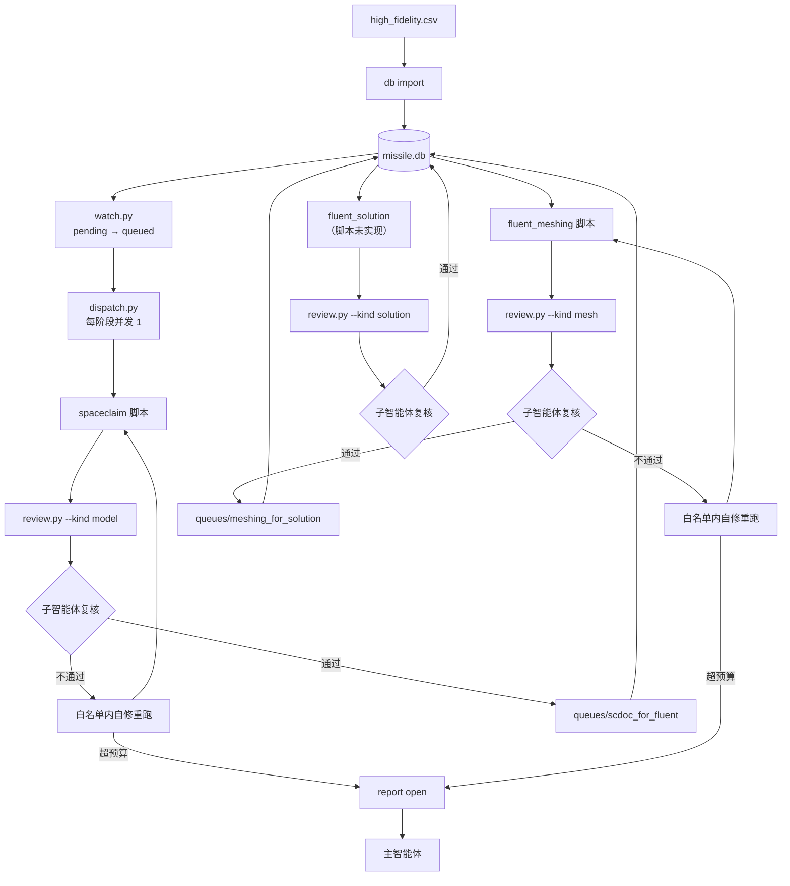
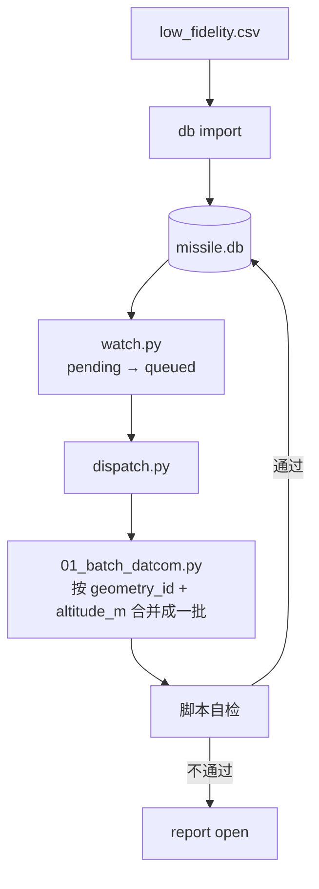
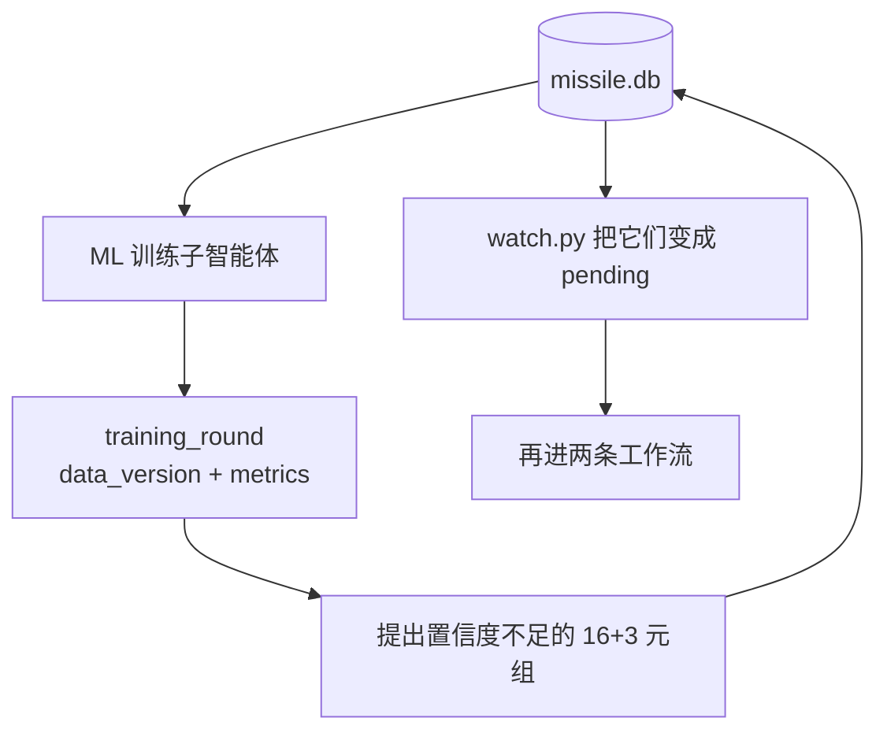

# 工作流与数据闭环计划


现状一句话：目录骨架已有，`data_lib/datasets/SQLite/` 是空目录，全仓库没有一行 SQLite 代码；`spaceclaim` 与 `fluent_meshing` 能跑，`DATCOM` 能按 `cases.csv` 批量算，`fluent_solution` 与 `ML_training` 仍是空壳。

---

## 1. 目标与成功判据

目标：让"几何参数 → 建模 → 网格 → 求解 → 气动系数 → 训练 → 补点"这条闭环在**无人手动搬文件**的前提下转起来，并且**任何进入数据库的结果都经过一次可复查的审核**。

成功判据（本计划的验收，不是工程实现的验收）：

1. 一条 `db import` 命令能把两份输入表灌进库，重复执行行数不变。
2. 新几何第一次入库后，`runs/` 下自动出现 `spaceclaim` → `fluent_meshing` 两个阶段的运行目录，产物通过审核后出现在 `queues/` 的两个队列目录里。
3. 任一阶段失败后，最多自修重跑 2 次；仍失败则在 `report` 表留下 `open` 记录，并在 `feedback/<stage>/<run_id>/` 留下失败包。
4. 主智能体能对任意工作流或阶段执行 `pause` / `stop`；`stop` 后 5 秒内对应 ANSYS / `datcom.exe` 进程消失，任务状态为 `cancelled`。
5. 同一 `geometry_id` 的全部工况求解通过后，`gc` 能删掉该几何的 `.scdoc` 与网格文件，且不会误删工作区之外或 `feedback/` 下的文件。
6. 训练一轮后，新提出的几何/工况直接成为 `pending` 任务行，不需要人工再写 SQL。
7. 每个目录的 `README.md` 与实际子项一致（含新增的 `SQLite/`）。

---

## 2. 配置区（要改路径和参数只改这里）

路径全部相对工作区根目录；根路径由脚本自 `workspace.json` 推导，代码里不写绝对路径。

| 名称 | 值 | 用途 |
|---|---|---|
| 数据库 | `data_lib/datasets/SQLite/missile.db` | 唯一真相源。WAL 模式，`-wal` / `-shm` 不入库 |
| 高保真输入 | `data_lib/inputs/high_fidelity.csv` | 人工接口，只在初始化导入时读取 |
| 低保真输入 | `data_lib/inputs/low_fidelity.csv` | 人工接口，只在初始化导入时读取 |
| 建模队列 | `data_lib/queues/scdoc_for_fluent/` | 已通过审核的模型（指针文件） |
| 网格队列 | `data_lib/queues/meshing_for_solution/` | 已通过审核的网格（指针文件） |
| 高保真运行 | `data_lib/runs/high/<stage>/<run_id>/` | 临时数据，入库后可清 |
| 低保真运行 | `data_lib/runs/low/<geometry_id>/` | DATCOM 归档，按几何命名 |
| 点云 | `data_lib/datasets/point_clouds/<geometry_id>/` | 每个几何一份，永久保留 |
| 失败包 | `feedback/<stage>/<run_id>/` | 永久保留，不自动清理 |
| 索引视图 | `data_lib/index.json` | 由 `db export` 生成，只读 |
| 每阶段并发 | `1` | 同时处于 `running` 的任务数上限 |
| 自修重试预算 | `2` | 每次上报前允许的自修重跑次数 |
| watch 周期 | `30` 秒 | `scripts/watch.py` 扫描间隔 |
| 文本时间戳 | UTC `YYYYMMDDTHHMMSSZ` | 所有 `run_id` 与数据库时间字段 |

`workspace.json` 新增两项，`schemaVersion` 由 1 升到 2：

```json
"database": "data_lib/datasets/SQLite/missile.db",
"queues": { "scdoc_for_fluent": "data_lib/queues/scdoc_for_fluent",
            "meshing_for_solution": "data_lib/queues/meshing_for_solution" }
```

---

## 3. 标识符与参数规范化

### 3.1 几何是 16 个参数

| 类别 | 字段 |
|---|---|
| 弹型（11，单位 m） | `L_N` `L` `D` `L_W` `C_RW` `C_TW` `B_W` `L_F` `C_RF` `C_TF` `B_F` |
| 翼型种类（1） | `fin_section_type`：`hex` 或 `naca` |
| 翼型参数（3，按类型二选一） | hex：`thickness_percent` `flat_percent` `le_radius`；naca：`thickness_percent` `le_radius_index` `max_thickness_tenths` |
| 鼻锥头型（1） | `nose_shape`：`ogive` 或 `cone` |

合计 16 个。**鼻锥头型和翼型种类从此进入参数表、参与身份、写进产物**——这是本版与旧版最重要的一处改变，它意味着 `DATCOM/scripts/missile_spec.py` 不再是"唯一配置区"，只保留解析式与**默认值**；实际取值一律来自数据库。

仍**不**进入身份的固定项：锥顶倒角 `NOSE_TIP_FILLET_RATIO`、舵面布局 `LE_MODE` / `FIN_PHASE` / `CRUCIFORM_COUNT`、力矩参考点 `XCG_M = L/2`、后缘对齐。它们变化即视为新一批数据，需人工决定，不静默生效。

### 3.2 工况是 3 个参数

`mach`、`alpha_deg`、`altitude_m`。`condition_id` 由这三者生成，**含高度**。旧表的 `C01`–`C30` 降级为可读标签 `condition.label`：它只编码马赫数与攻角，不含高度，因此同一标签可以在不同高度重复出现，**不得用作主键或查表依据**。

### 3.3 规范化串

字段按上表固定顺序拼接，浮点统一 `%.6f`、禁止科学计数法、枚举小写，分隔符为 `|`：

```text
L_N=0.490000|L=3.690000|D=0.180000|L_W=1.720000|C_RW=0.230000|C_TW=0.060000|B_W=0.230000|L_F=3.200000|C_RF=0.380000|C_TF=0.190000|B_F=0.220000|fin_section_type=hex|thickness_percent=4.462000|flat_percent=60.995000|le_radius=0.050000|nose_shape=cone
```

工况的规范串：

```text
mach=2.000000|alpha_deg=4.000000|altitude_m=0.000000
```

**先规范化、再入库、再算哈希**。规范化的顺序固定在 `scripts/db.py` 的 `normalize()`：

1. 先跑 `DATCOM/scripts/datcom_spec.normalize_geometry` 的几何校验与钳位（梢弦小于 1 mm 时钳到 0.001 m，以及 `L_N<L`、`D<L`、`L_W≥L_N`、`L_W+C_RW≤L`、`L_F≥L_N`、`L_F+C_RF≤L`、`L_W+C_RW≤L_F`）。
2. 按 `fin_section_type` 校验对应的三个翼型参数存在且在允许范围内（`thickness_percent` 0–40、`flat_percent` 0–100、`le_radius` ≥ 0、`le_radius_index` 0–9 整数、`max_thickness_tenths` ∈ {2,3,4,5,6}）。
3. 再生成规范串。

钳位必须在哈希之前完成，否则 `C_TW = 0.0005` 与 `0.001` 会得到两个身份、却是同一个外形。

### 3.4 哈希与字符串格式

| 标识 | 算法 | 示例 |
|---|---|---|
| `geometry_id` | `"g" + sha256(几何规范串)[:12]` | `g692bcb5d5e50` |
| `condition_id` | `"c" + sha256(工况规范串)[:12]` | `cc9633c86a360` |
| `run_id` | `<geometry_id>__<condition_id>__<时间戳>` | `g692b…__shared__20261101T101500Z` |
| `review_id` | `"r" + sha256(kind+run_id+verdict+created_at)[:12]` | `r0a9f2c81d3be` |
| `report_id` | `"p" + sha256(stage+run_id+created_at)[:12]` | `p7c1e2a90b4f3` |

全部小写十六进制，不含 `__`，因此 `run_id` 可按 `__` 从右往左拆：最后一段是时间戳，倒数第二段是 `condition_id`（几何级产物写 `shared`），剩下的是 `geometry_id`。

上表两个身份是**真实值**，不是示意：它们就是 §3.3 那段基准几何（`0.49 / 3.69 / …` ＋ `hex` ＋ `cone`）与 Ma 2、α 4°、0 m 的身份，`python scripts/db.py check` 会逐字比对，改动格式化规则会立刻报错。

`stage` **不进** `run_id`：它已经是运行目录、失败包、队列目录的父目录名，写进字符串只是重复。`run_id` 里唯一无法由身份推出的信息就是"这是第几次跑"。

**碰撞处理**：插入前按 `geometry_id` / `condition_id` 查已有行的 `canonical`；不一致就拒绝写入并报错（要求人工确认是否要加长位数），绝不静默覆盖。6 位小数的 16 维参数在 1 万个几何规模下 48 bit 的碰撞概率约 1e-8，出现即说明规范化有 bug。

---

## 4. 目录与文件命名

### 4.1 高保真

```text
data_lib/runs/high/<stage>/<run_id>/
```

`<stage>` 只取 `spaceclaim` / `fluent_meshing` / `fluent_solution`。本次把旧版的 `<run-id>/<阶段>/` 顺序**倒过来**，因为你在需求里写的就是 `runs/high/spaceclaim`、`runs/high/fluent_meshing`。

产物文件名：跟几何绑定的以 `geometry_id` 开头，跟工况绑定的以 `run_id` 开头。

| 文件 | 文件名 |
|---|---|
| 模型 | `<geometry_id>_spaceclaim.scdoc` |
| 建模日志 | `<geometry_id>_spaceclaim.log` |
| 建模参数快照 | `params.json` |
| 建模验收结果 | `result.json` |
| 运行记录 | `run.json`（每阶段每 `run_id` 一份） |
| 网格 | `<geometry_id>_fluent_meshing.msh.h5` |
| 网格日志 | `<geometry_id>_fluent_meshing.log` |
| 网格质量 | `quality.json` |
| 求解结果 | `<run_id>_fluent_solution.<扩展名>` |
| 求解日志 | `<run_id>_fluent_solution.log` |

### 4.2 低保真

```text
data_lib/runs/low/<geometry_id>/
data_lib/runs/low/<geometry_id>/<run_id>/run.json     ← 每批次一份运行记录
```

归档文件（系数表跨高度合并，只有一张）：

| 文件 | 文件名 |
|---|---|
| 输入卡片 | `<geometry_id>_for005.dat` |
| 原始输出 | `<geometry_id>_for006.dat` |
| 外形 | `<geometry_id>_for022.dat` |
| 系数总表 | `<geometry_id>_aero_coefficients.csv` |
| 几何核对 | `<geometry_id>_geometry_check.txt` |
| 几何核对图 | `<geometry_id>_geometry_check.png` |
| 参数快照 | `<geometry_id>_case_params.json` |
| 计算日志 | `<geometry_id>_datcom.log` |

DATCOM 运行当下的协议文件仍放在 `data_lib/runs/low/.work/`，算完删除。`DATCOM/` 目录下不保留任何算例结果。

### 4.3 队列目录

```text
data_lib/queues/scdoc_for_fluent/<run_id>.json
data_lib/queues/meshing_for_solution/<run_id>.json
```

队列里**不放产物本体**，只放指针文件：

```json
{
  "schemaVersion": 1,
  "queue": "scdoc_for_fluent",
  "run_id": "g692bcb5d5e50__shared__20261101T101500Z",
  "geometry_id": "g692bcb5d5e50",
  "condition_id": "shared",
  "artifact": {
    "rel_path": "data_lib/runs/high/spaceclaim/<run_id>/g692bcb5d5e50_spaceclaim.scdoc",
    "size": 4488574,
    "sha256": "…"
  },
  "review_id": "r0a9f2c81d3be",
  "approved_at": "2026-11-01T10:15:00Z"
}
```

**队列目录是数据库的导出视图，不是第二份真相。** 下游领任务只看数据库；指针文件由 `db export queue` 生成，任何不一致以数据库为准，可随时整目录删掉重建。

### 4.4 失败包

```text
feedback/<stage>/<run_id>/
```

包内是当次运行的完整副本（`run.json`、日志、参数快照、已产生的产物），沿用上面的文件名；`DATCOM` 失败包放 `feedback/datcom/<run_id>/`。失败包永久保留，不参与 `gc`。

---

## 5. SQLite 数据库

单一库文件，WAL 模式，`PRAGMA foreign_keys=ON`，`busy_timeout=5000`。写入统一经过 `scripts/db.py`，任何子智能体、脚本、智能体都不直接开 `sqlite3` 连接写（避免 `database is locked` 与半事务）。

### 5.1 表清单

| 表 | 作用 |
|---|---|
| `meta` | 键值对，存 `schema_version` |
| `geometry` | 16 个几何参数 + 规范串 + 可读标签 |
| `geometry_state` | 路径状态管理表：建模/网格状态、三条路径、可删除标志 |
| `condition` | 3 个工况参数 + 规范串 + 可读标签 |
| `cfd_task` | 高保真任务：几何 × 工况，求解状态与三个气动系数 |
| `datcom_task` | 低保真任务：几何 × 工况，运行状态与三个气动系数 |
| `review` | 每次审核的判据与结论（唯一的入库凭证） |
| `report` | 上报主智能体的问题单 |
| `control` | 启停开关 |
| `task_process` | 运行中任务的 `pid`，供叫停使用 |
| `training_round` | 训练轮次、数据版本、模型路径、提出了哪些新行 |

### 5.2 字段

```sql
CREATE TABLE meta (key TEXT PRIMARY KEY, value TEXT NOT NULL);

CREATE TABLE geometry (
  geometry_id        TEXT PRIMARY KEY,              -- 'g' + 12 hex
  L_N REAL NOT NULL, L REAL NOT NULL, D REAL NOT NULL,
  L_W REAL NOT NULL, C_RW REAL NOT NULL, C_TW REAL NOT NULL, B_W REAL NOT NULL,
  L_F REAL NOT NULL, C_RF REAL NOT NULL, C_TF REAL NOT NULL, B_F REAL NOT NULL,
  fin_section_type   TEXT NOT NULL CHECK (fin_section_type IN ('hex','naca')),
  thickness_percent  REAL NOT NULL,
  flat_percent       REAL,          -- 仅 hex
  le_radius          REAL,          -- 仅 hex
  le_radius_index    INTEGER,       -- 仅 naca
  max_thickness_tenths INTEGER,     -- 仅 naca
  nose_shape         TEXT NOT NULL CHECK (nose_shape IN ('ogive','cone')),
  canonical          TEXT NOT NULL UNIQUE,
  label              TEXT,          -- 人工可读名，不参与身份
  created_at         TEXT NOT NULL,
  CHECK ( (fin_section_type='hex'
           AND flat_percent IS NOT NULL AND le_radius IS NOT NULL
           AND le_radius_index IS NULL AND max_thickness_tenths IS NULL)
       OR (fin_section_type='naca'
           AND le_radius_index IS NOT NULL AND max_thickness_tenths IS NOT NULL
           AND flat_percent IS NULL AND le_radius IS NULL) )
);

CREATE TABLE geometry_state (
  geometry_id   TEXT PRIMARY KEY REFERENCES geometry(geometry_id),
  model_status  TEXT NOT NULL DEFAULT 'pending'  CHECK (model_status  IN
                ('pending','queued','running','reviewing','rejected','passed','cancelled')),
  mesh_status   TEXT NOT NULL DEFAULT 'pending'  CHECK (mesh_status   IN
                ('pending','queued','running','reviewing','rejected','passed','cancelled')),
  model_path    TEXT, mesh_path TEXT, cloud_path TEXT,
  model_run_id  TEXT, mesh_run_id TEXT, cloud_run_id TEXT,
  deletable     INTEGER NOT NULL DEFAULT 0 CHECK (deletable IN (0,1)),
  updated_at    TEXT NOT NULL
);

CREATE TABLE condition (
  condition_id TEXT PRIMARY KEY,                    -- 'c' + 12 hex
  mach REAL NOT NULL, alpha_deg REAL NOT NULL, altitude_m REAL NOT NULL,
  canonical    TEXT NOT NULL UNIQUE,
  label        TEXT,                                -- 'C01'..'C30'，可为空
  created_at   TEXT NOT NULL,
  UNIQUE (mach, alpha_deg, altitude_m)
);

CREATE TABLE cfd_task (
  geometry_id  TEXT NOT NULL REFERENCES geometry(geometry_id),
  condition_id TEXT NOT NULL REFERENCES condition(condition_id),
  status       TEXT NOT NULL DEFAULT 'pending' CHECK (status IN
               ('pending','queued','running','reviewing','rejected','passed','cancelled')),
  attempts     INTEGER NOT NULL DEFAULT 0,
  CL REAL, CD REAL, CM REAL,
  converged    INTEGER,            -- 0/1，求解阶段填
  residual     REAL,               -- 连续性残差
  run_id       TEXT, result_dir TEXT, log_path TEXT,
  review_id    TEXT REFERENCES review(review_id),
  origin       TEXT NOT NULL DEFAULT 'human' CHECK (origin IN ('human','active_learning')),
  round_id     TEXT REFERENCES training_round(round_id),
  created_at   TEXT NOT NULL, updated_at TEXT NOT NULL,
  PRIMARY KEY (geometry_id, condition_id)
);

CREATE TABLE datcom_task (
  geometry_id  TEXT NOT NULL REFERENCES geometry(geometry_id),
  condition_id TEXT NOT NULL REFERENCES condition(condition_id),
  status       TEXT NOT NULL DEFAULT 'pending' CHECK (status IN
               ('pending','queued','running','reviewing','rejected','passed','cancelled')),
  attempts     INTEGER NOT NULL DEFAULT 0,
  CL REAL, CD REAL, CM REAL,
  run_id       TEXT, result_dir TEXT, log_path TEXT,
  review_id    TEXT REFERENCES review(review_id),
  origin       TEXT NOT NULL DEFAULT 'human' CHECK (origin IN ('human','active_learning')),
  round_id     TEXT REFERENCES training_round(round_id),
  created_at   TEXT NOT NULL, updated_at TEXT NOT NULL,
  PRIMARY KEY (geometry_id, condition_id)
);

CREATE TABLE review (
  review_id       TEXT PRIMARY KEY,
  kind            TEXT NOT NULL CHECK (kind IN ('model','mesh','solution','datcom')),
  geometry_id     TEXT NOT NULL,
  condition_id    TEXT,            -- model / mesh 为 NULL
  run_id          TEXT NOT NULL,
  reviewer        TEXT NOT NULL,   -- 'script:review.py' 或子智能体标识
  verdict         TEXT NOT NULL CHECK (verdict IN ('passed','rejected')),
  checks_json     TEXT NOT NULL,   -- 每条判据的 name/ok/detail
  artifact_sha256 TEXT,
  attempts        INTEGER NOT NULL DEFAULT 0,
  created_at      TEXT NOT NULL
);

CREATE TABLE report (
  report_id    TEXT PRIMARY KEY,
  stage        TEXT NOT NULL CHECK (stage IN
               ('spaceclaim','fluent_meshing','fluent_solution','datcom')),
  geometry_id  TEXT NOT NULL,
  condition_id TEXT,
  attempts     INTEGER NOT NULL,
  last_error   TEXT,
  review_json  TEXT,
  feedback_dir TEXT,
  status       TEXT NOT NULL DEFAULT 'open' CHECK (status IN ('open','resolved','dismissed')),
  resolution   TEXT,
  created_at   TEXT NOT NULL, resolved_at TEXT
);

CREATE TABLE control (
  target     TEXT PRIMARY KEY,     -- 'workflow:high' | 'stage:spaceclaim' | 'task:<run_id>'
  state      TEXT NOT NULL CHECK (state IN ('running','paused','stopped')),
  reason     TEXT,
  updated_at TEXT NOT NULL,
  updated_by TEXT NOT NULL
);

CREATE TABLE task_process (
  run_id TEXT PRIMARY KEY, pid INTEGER NOT NULL, started_at TEXT NOT NULL
);

CREATE TABLE training_round (
  round_id      TEXT PRIMARY KEY,
  status        TEXT NOT NULL CHECK (status IN ('running','passed','failed','cancelled')),
  data_version  TEXT,              -- 参与训练的样本集指纹
  model_path    TEXT,
  metrics_json  TEXT,
  proposed_rows INTEGER NOT NULL DEFAULT 0,
  log_path      TEXT,
  created_at    TEXT NOT NULL, finished_at TEXT
);
```

索引：`cfd_task(status)`、`datcom_task(status)`、`geometry_state(model_status)`、`geometry_state(mesh_status)`、`report(status)`、`review(kind, geometry_id)`。

### 5.3 状态词表

七个词，四个阶段共用：

| 代码 | 中文 | 含义 |
|---|---|---|
| `pending` | 未开始 | 已入库，尚未入队 |
| `queued` | 排队中 | watcher 已认领，等 dispatcher 启动 |
| `running` | 运行中 | 脚本正在执行，`task_process` 里有 pid |
| `reviewing` | 审核中 | 脚本返回成功，等审核结论 |
| `rejected` | 审核不通过 | 脚本失败或判据未过；可自修重跑，超出预算即上报 |
| `passed` | 已完成 | 审核通过，产物路径已写入 |
| `cancelled` | 已叫停 | 被 `stop` 终止；不自动恢复 |

派生查询代替旧版的布尔：

- 「是否生成建模文件」= `model_status='passed' AND model_path IS NOT NULL`
- 「是否画网格」= `mesh_status='passed' AND mesh_path IS NOT NULL`
- 「是否可删除」= `deletable=1`（自动判定见 §9）

`reviewing` 表示**脚本成功但尚未入库**，这一刻还不算通过；只有 `record_review` 在事务里把 `review.verdict='passed'` 写入并把任务置 `passed`，产物路径才生效。

---

## 6. 三条工作流

### 6.1 高保真



分阶段细则：

| 阶段 | 领取条件 | 自修白名单 | 通过判据 |
|---|---|---|---|
| `spaceclaim` | `model_status='pending'` | 15 个建模字段、模板选项 | §7.1 |
| `fluent_meshing` | `mesh_status='pending'` 且 `model_status='passed'` 且 `model_path` 非空 | `mesh_missile.py` 的 `P_*` 表、`--processors` | §7.2 |
| `fluent_solution` | `cfd_task.status='pending'` 且 `mesh_status='passed'` | 求解设置（脚本实现后） | §7.3 |

网格是**按几何**的，不是按工况：同一 `geometry_id` 只建一次模型、画一次网格、算一份点云。求解是按 `(geometry_id, condition_id)` 一对一。

### 6.2 低保真



**低保真没有 LLM 审核子智能体**，只有脚本自检（你给的流程里这一环就是"通过 DATCOM 得到气动参数 → 修改 SQLite 数据库"）。自检不通过照样进 `report`，让主智能体看得见。一次调用覆盖该 `geometry_id` 在该 `altitude_m` 下的全部 `pending` 工况，算完拆回各行。

两条链路从同一张库分出来，之后互不阻塞：DATCOM 不等建模/网格/求解，网格不等 DATCOM。

### 6.3 训练闭环



每一轮：

1. 从库里取 `cfd_task.status='passed'` 的样本（第一版**只用高保真**，DATCOM 留作后续多保真升级）。
2. 训练、记录 `data_version`、`metrics_json`、`model_path`，`training_round` 置 `running` → `passed`。
3. 把置信度不足的 `(16 参数, 3 工况)` 直接写进 `geometry` / `condition` / `cfd_task`，`origin='active_learning'`、`round_id` 指向本轮，状态 `pending`。**不另设"建议表"**——反馈和初始化走同一条入库路径。
4. `watch.py` 下一轮扫描自动把它们入队。

置信度阈值、每轮最多补几行、补点范围仍待定（§12），阈值一旦确定就写进 `scripts/db.py` 前部配置区。

---

## 7. 审核判据

审核是**唯一的入库闸门**。两层：先由 `scripts/review.py` 跑确定性判据写 `checks_json`，再由审核子智能体复核并调用 `db record_review`。子智能体不在场时任务停在 `reviewing`，不会自动入库。

### 7.1 模型（`kind='model'`）

| # | 判据 | 来源 |
|---|---|---|
| 1 | `run.json.status='PASSED'` 且 `verification.runtimeVerified=true` | `run.json` |
| 2 | `result.json.status='PASS'` | `result.json` |
| 3 | `run.json.artifacts` 每个文件的 sha256 与磁盘一致 | 重算 |
| 4 | `abs(result.json.measurements.extentsM.axial − L) ≤ 1e-3` m | 几何参数 |
| 5 | `lateral`、`vertical` 与 `D + 2·max(B_W, B_F)` 相差 ≤ 1e-3 m | 几何参数 |
| 6 | 点云目录存在且 `*_meta.json` 的 16 参数与库一致 | 点云 |
| 7 | `params.json` 的 `fin_section` 与 `fin_section_type` 一致 | 参数快照 |

### 7.2 网格（`kind='mesh'`）

| # | 判据 | 来源 |
|---|---|---|
| 1 | `run.json.status='PASSED'` 且 `runtimeVerified=true` | `run.json` |
| 2 | 最小正交质量 `OQ_min ≥ 0.05` | `quality.json`（阈值从 0.01 提到 0.05） |
| 3 | 最小单元体积 `> 0` | `quality.json` |
| 4 | `inlet` / `outlet` / `wall` 三个面 zone 均非空 | `mesh-inspection.json` |
| 5 | 恰好一个非空的流体 cell zone | `mesh-inspection.json` |
| 6 | `quality.json` 的单元数 == 导出文件 `cellCount` | 两者比对 |
| 7 | 维度 3D、单位 `mm` | `mesh-inspection.json` |
| 8 | 网格域 bbox 与 SpaceClaim `extentsM` 相差 ≤ 10% | 新增导出字段 |
| 9 | 同一几何本次单元数与上一次通过值相差 > 50% 时**告警**（不否决） | 历史 |

长宽比、歪斜度暂不设阈值——`mesh_validation.py` 目前根本不提取这两个量，写进判据就是空判据。

### 7.3 求解（`kind='solution'`）

求解脚本本次不实现（§10 的 P5），判据先定死、等脚本接入后启用：

| # | 判据 |
|---|---|
| 1 | 连续性残差 < `1e-4` |
| 2 | 最后 200 步的 `CL`/`CD`/`CM` 相对波动 < `0.5%` |
| 3 | 进出口质量流量不平衡 < `0.1%` |
| 4 | 三个系数均有限、`CD > 0` |

与 DATCOM 的对比**只告警不否决**：`abs(ΔCL) > 30%`、`abs(ΔCD) > 40%`、`abs(ΔCM) > 30%` 时写进 `checks_json` 并上报。CFD 与 DATCOM 在跨声速区本来就可能差 20–40%，在没有一批已验证 CFD 样本前把它设成否决条件只会把正确的算例判死。

### 7.4 DATCOM 脚本自检（无子智能体）

1. 几何核对报告里没有未通过的项。
2. `{geometry_id}_aero_coefficients.csv` 的行数等于本批领取的工况数。
3. 每行的马赫数、攻角、高度都能对上 `condition` 表。
4. 进程退出码为 0 且 `failed == 0`。

---

## 8. 智能体与控制

### 8.1 主智能体

- 会话里负责**发起审核**：看到 `reviewing` 就去起审核子智能体；看到 `report` 里 `status='open'` 就决定"原参数重跑 / 改设置新建行 / 请人决定"，结论写回 `resolution`。
  - "原参数重跑"用 `python scripts/db.py requeue --stage <阶段> --geometry-id <id> [--condition-id <id>] --resolve-reports --reason "<结论>"`：任务从 `rejected` / `cancelled` 回到 `pending`，`watch.py --once` 再推进到 `queued`，`reason` 写进 `report.resolution`。重排**不删审核历史、不重置自修预算**——预算按 `review` 表里的拒绝记录算，清它等于篡改历史。
- 负责**启停**：`control` 表 + 命令行。
- **不直接写库**，一律调 `scripts/db.py` 的命令。
- 修改几何或设置要求换参数时，一律追加新的 16 元组（新 `geometry_id`），不改旧行。

### 8.2 三个审核子智能体

| 子智能体 | 阶段 | 允许做的事 |
|---|---|---|
| 子智能体 1 | 模型 | 读 `runs/high/spaceclaim/<run_id>/`、跑 `review.py`、用 SpaceClaim MCP 复核/重建、调 `db record_review` |
| 子智能体 2 | 网格 | 读 `runs/high/fluent_meshing/<run_id>/`、跑 `review.py`、改 `P_*` 表后重跑、调 `db record_review` |
| 子智能体 3 | 求解 | 读结果与日志、跑 `review.py`、与 DATCOM 对比并写告警、调 `db record_review` |

共同的硬边界：

- **能改**：本阶段的运行参数/模板选项（建模 15 个字段、网格 `P_*`、求解设置），改完重跑。
- **不能改**：脚本源码、几何参数、已经入库的系数。
- **重试预算**：同一任务自修重跑最多 2 次；第 3 次仍不过 → 写 `report` 并停手。预算按"每次上报前"计，不是全生命周期总量。
- 一任务一会话，判完即退，不跨任务保留状态。

### 8.3 SpaceClaim MCP

已注册 7 个工具（`spaceclaim/server.mjs:58/65/80/85/117/131/142`），其中 `build_missile_model` 真的会以 `/RunScript=... /Headless=True /ExitAfterScript=True` 启动 SpaceClaim 建模型，但**只能建固定参数化模板**，改不了任意几何。

本计划前提：把 `scripts/run.ps1 spaceclaim-mcp` 这条 stdio 命令注册进 DSH 的 MCP 配置，让子智能体 1 能用上这 7 个工具。注册不影响标准输出，仍只走 JSON-RPC。

PyFluent MCP 只有文档、未安装未注册，网格/求解侧不依赖它；`fluent_meshing` 走现有命令行（PyFluent 0.19.2 + Fluent 24.1，3D 双精度，无头）。

### 8.4 watcher

`scripts/watch.py`，每 30 秒：

1. 读 `control`，被 `paused` / `stopped` 的 workflow 或 stage 跳过。
2. 把 `pending` 的建模/网格/任务行认领为 `queued`（只是状态推进，不启动进程）。
3. 僵死回收：`running` 但 `task_process` 里的 pid 已不存在 → 置 `rejected`、`attempts+1`、写 `report`。
4. 复活已删产物的几何：存在 `pending` 的 `cfd_task` 且 `model_path IS NULL` → `model_status` 回到 `pending`。

### 8.5 dispatcher

`scripts/dispatch.py --stage <stage> --once|--loop`，每阶段并发 1：

1. 领一条 `queued`（`claim` 事务里改成 `running`），在 `runs/` 下建目录，登记 pid。
2. 拉起本阶段命令，等它结束。
3. 退出码 0 且 `run.json` 为 `PASSED` → `reviewing`；否则 `rejected` + `attempts+1`。
4. 清 `task_process` 行。

### 8.6 启停

```text
python scripts/control.py start|pause|stop|status --target workflow:high
python scripts/control.py stop --target stage:fluent_meshing
python scripts/control.py stop --target task:<run_id>
```

- 优先级：`task` > `stage` > `workflow`。
- `paused`：不再领新任务，当前任务允许跑完。
- `stopped`：不再领新任务，并对 `task_process` 里的 pid 终止整棵进程树（Win32 `TerminateProcess` + `Toolhelp32` 快照，等价 `taskkill /T /F`）；任务置 `cancelled`，产物留在 `runs/` 但不入库、不删。
- `stopped` / `cancelled` **不会自动恢复**，必须显式 `start`。

---

## 9. 数据登记与删除

### 9.1 入库时机

| 数据 | 写入时机 | 内容 |
|---|---|---|
| `review` | 每次审核结束 | 判据明细、结论、产物 sha256 |
| `geometry_state.model_*` | 模型审核通过 | 路径、`model_run_id` |
| `geometry_state.mesh_*` | 网格审核通过 | 路径、`mesh_run_id` |
| `cfd_task` | 求解审核通过（脚本接入后） | `CL` `CD` `CM`、`converged`、`residual`、`run_id` |
| `datcom_task` | DATCOM 自检通过 | `CL` `CD` `CM`、路径 |
| `point_clouds/` | 新 `geometry_id` 入库 | 16 参数生成的 `*_pointcloud.ply` 与 `*_meta.json` |
| 队列指针 | 模型/网格审核通过后由 `db export queue` 重写 | 见 §4.3 |

三个系数沿用现有口径：升力系数 `CL`、阻力系数 `CD`、俯仰力矩系数 `CM`；参考面积 π(D/2)²，参考长度 D，力矩参考点 `L/2`。高低保真使用同一套。冻结约定：舵面相位 `+`、后缘对齐、力矩点 `L/2`——它们不参与身份，记在 `{geometry_id}_case_params.json`。

### 9.2 可删除与 `gc`

自动判定：该几何**至少有一行** `cfd_task`，且该几何**所有** `cfd_task.status='passed'` → `deletable=1`。人工可以强制置 1。

```text
python scripts/db.py gc           # 只列出将要删什么
python scripts/db.py gc --apply   # 真删
```

删除范围：只删 `model_path` 与 `mesh_path` 指向的文件及其同目录日志。**点云永久保留**——它是几何特征，体积小，训练还要用。

安全校验（任一不满足就跳过并写日志）：绝对路径解析后必须在工作区内；父目录必须是 `runs/high/<stage>/`；文件名前缀必须是该 `geometry_id`；不得位于 `feedback/` 下。

删除成功后：`model_path` / `mesh_path` / 对应 `run_id` 置 NULL，`model_status` / `mesh_status` 保持 `passed`（表示"曾经验过"）。若之后又出现该几何的 `pending` 工况，`watch.py` 见 `model_path IS NULL` 会把状态回落 `pending` 重新建模，点云复用。

### 9.3 索引视图

`data_lib/index.json` 退役为**只读导出视图**：`db export index` 从库里生成，`scripts/index.mjs` 退役。现有索引已经坏了（24 条里 14 条指向已删目录，磁盘上 35 份 `run.json` 有 25 份没被索引，`runs/low/*` 完全进不去）。保留 `data_lib/index.json` 这个文件名只是为了让 `run.ps1 index` 这类习惯用法还能用。

---

## 10. 实施顺序

| 阶段 | 内容 | 完成标志 |
|---|---|---|
| **P0** | 改 `workspace.json`、建 `data_lib/datasets/SQLite/README.md`、写 `scripts/db.py` 的建表与 `normalize()`、`check` | `db.py init` 建出 11 张表，`db.py check` 全绿 |
| **P1** | `db import` + `export cases-csv` + `watch.py` + `control.py` | 两份输入表导入幂等；`pending→queued` 能推进；启停命令生效 |
| **P2** | 建模链路：`<stage>/<run_id>/` 目录改造、SpaceClaim 跟随 `fin_section_type`、注册 MCP、`review.py --kind model`、`dispatch.py`、队列指针 | 一个 `geometry_id` 从 `pending` 走到 `model_status='passed'`，队列目录出现指针文件 |
| **P3** | 网格链路：OQ 阈值 0.01→0.05、`quality.json` 增导出 bbox、`review.py --kind mesh` | 网格走到 `mesh_status='passed'`；人为把 OQ 调低能被判 `rejected` |
| **P4** | 低保真：`01_batch_datcom.py` 增 `--input`、翼型/头型按行读取、写 `run.json`、回写 `datcom_task` | 两类翼型/两种头型在同一批里混跑且系数正确分开 |
| **P5** | 求解骨架：`cfd_task` 状态流转、`review.py --kind solution`、**求解脚本留空** | `dispatch.py` 拒绝启动 `fluent_solution` 并说明未实现，其余状态流可用 |
| **P6** | 训练闭环（高保真单保真）+ `gc` + 点云改读库 | 一轮训练后新行自动变 `pending`；`gc` 在假文件上不误删 |
| **P7** | 退役 `index.mjs`、标注历史数据、逐目录对 README | §1 的七条验收逐条通过 |

P0–P1 是其余全部工作的前提，不能并行跳过。

### 10.1 实施状态（2026-10-31）

| 阶段 | 状态 | 依据 |
|---|---|---|
| P0 | 完成 | `db.py init` 出 11 张表；`db.py check` 27 项全过 |
| P1 | 完成 | 两份输入表导入幂等；`pending → queued` 推进；`start/pause/stop` 生效（`stop` 用 Win32 终止整棵进程树，实测 0.08 s 清空父+孙进程并注销 `task_process`） |
| P2 | 完成 | `g48ee1449b30c` 走完 `pending → queued → running → reviewing → passed`；`data_lib/queues/scdoc_for_fluent/` 出现指针文件；模型审核 10 条否决性判据全过 |
| P3 | 完成 | 网格 `mesh_status='passed'`（449 万单元，OQ_min 0.0738）；反向验证：把 OQ 压到 0.01 会被判 `rejected` |
| P4 | 完成 | 两类翼型/两种头型混跑；8 条 `datcom_task` passed |
| P5 | 骨架完成，求解器暂缓 | `dispatch.py --stage fluent_solution` 明确拒绝并说明未实现；求解脚本本身按用户 2026-10-31 决定不由智能体实现 |
| P6 | 部分完成 | `gc` 五步验证通过（护栏拒深路径、`--apply` 只删假文件、真产物完好）；训练闭环**逻辑**已验（`--dry-run` 不写库、真跑写 `training_round` + `origin='active_learning'` 的 `pending` 行），但用的是合成样本——真实训练要等高保真样本，即 P5 求解器 |
| P7 | 进行中 | `index.mjs` 已退役；逐目录 README 与 §1 七条验收待收尾 |

---

## 11. 必须同步的文档与代码

### 11.1 代码改动

| 文件 | 改动 |
|---|---|
| `scripts/db.py`（新） | 建表、`normalize()`、`import`、`claim`、`record_review`、`report`、`control`、`export`、`gc`、`check` |
| `scripts/watch.py`（新） | `pending→queued`、僵死回收、已删产物复活 |
| `scripts/dispatch.py`（新） | 领取、启动、`task_process`、状态推进 |
| `scripts/review.py`（新） | 四个 `kind` 的确定性判据，输出 `checks_json` |
| `scripts/control.py`（新） | `start` / `pause` / `stop` / `status`，进程树终止 |
| `scripts/run.ps1` | `ValidateSet` 增加 `db` `watch` `dispatch` `review` `control` |
| `scripts/index.mjs` | 退役，改由 `db export index` 生成 |
| `spaceclaim/lib/workspace-runtime.mjs` | 输出目录改为 `<stage>/<run_id>/`（现为 `<run-id>/<stage>`，`:50-51`） |
| `spaceclaim/lib/runner.mjs` 与 `lib/missile-schema.mjs` | `fin_section` 改为按几何传入；`hex_flat_start` / `hex_flat_end` 由 `flat_percent` 推导，不再单独配置 |
| `fluent_meshing/workspace_runtime.py` | 输出目录同上（`:99-100`） |
| `fluent_meshing/mesh_validation.py` | `MINIMUM_ORTHOGONAL_QUALITY` 0.01→0.05（`:21`）；`quality.json` 增导出体网格 bbox |
| `DATCOM/scripts/01_batch_datcom.py` | 新增 `--input`（默认仍是 `data_lib/inputs/cases.csv`）；翼型与头型按行读取，缺列时回落 `missile_spec.py` 默认值；每批写 `run.json` |
| `DATCOM/scripts/04_pointnet_demo.py` | `--geometry-id` 改为从数据库读 16 参数（不再读 `cases.csv`） |
| `DATCOM/scripts/missile_spec.py` | 配置区降级为**默认值**来源，页首说明改写 |
| `DATCOM/scripts/datcom_spec.py` | `MASTER_TABLE_COLUMNS` 增加 6 个翼型/头型列 |

每个新增/修改的代码文件前部必须有符合根 `AGENTS.md` 的「输入 / 输出 / 参数配置」区：数据库路径、输入 CSV、输出目录模板、并发、重试、时间戳格式、watch 周期都放那里，并写清命令行与 `workspace.json` 的覆盖优先级。

### 11.2 文档改动

| 文件 | 改动 |
|---|---|
| `AGENTS.md` | 几何 14→16；`missile_spec.py` 从"唯一配置区"改为"默认值来源"；`runs/high/<stage>/<run_id>/`；DATCOM 允许改脚本层、但不改 `datcom_bin/` 内核；SQLite 与两条队列目录；index 退役；审核闸门 |
| `DATCOM/AGENTS.md` | 翼型/头型按行传入；输入表新列；配置区角色变化 |
| `README.md` | 参数表、目录组成、启动与验收、数据与回退 |
| `data_lib/README.md` | 新增 `SQLite/`、两份输入表、两条队列目录；删掉不存在的 `datcom_data/` |
| `data_lib/queues/README.md` | 现在描述的五份 JSON 全都不存在，按 §4.3 重写 |
| `data_lib/datasets/README.md` | 新增 `SQLite/` |
| `data_lib/datasets/SQLite/README.md`（新） | 库文件、WAL 附属文件不入库、schema 版本 |
| `data_lib/datasets/point_clouds/README.md` | 点云改由数据库的 16 参数生成 |
| `data_lib/runs/README.md`、`runs/high/README.md`、`runs/low/README.md` | 目录顺序改变、`run_id` 新格式 |
| `feedback/README.md` | 失败包与 `report` 表的对应关系 |
| `scripts/README.md` | 五个新脚本 |
| `spaceclaim/README.md` | 输出目录、`fin_section` 按几何传入 |
| `fluent_meshing/README.md` | 输出目录、OQ 阈值、bbox 导出 |
| `DATCOM/README.md` | `--input`、按行翼型/头型、`run.json` |
| `fluent_solution/README.md`、`ML_training/README.md` | 骨架范围与"求解器未实现"的明确说明 |

### 11.3 历史数据

- `data_lib/runs/low/1/`、`data_lib/datasets/point_clouds/1/`、`data_lib/runs/high/run-20261028…/` **不迁入新库**。`geometry_id=1` 是旧临时写法，且它的工况（Ma 0.8、α 3–6°）不在 C01–C30 网格内，迁进去会污染任务表的完整性假设。
- 这些目录保留为历史证据，在各 README 里标注"非新 ID 体系产物"。
- `data_lib/queues/` 里已被删除的五份 JSON 队列确认彻底移除，不再恢复。

---

## 12. 待定项

以下各项不阻塞 P0–P4，取值定下来后改一处配置即可：

| 待定项 | 需要决定的内容 |
|---|---|
| 置信度阈值 | 三个系数的不确定度超过多少时追加新行，以及每轮最多追加多少行 |
| 补点范围 | 新 `mach` / `alpha_deg` / `altitude_m` 取哪些值；`L_N`、`L`、`D` 的允许范围 |
| 点云最终格式 | 点数（现默认 16384）与最终文件格式 |
| 求解器 | `fluent_solution` 的可执行流程（本次只建骨架，§10 P5）；**2026-10-31 用户决定暂缓，不由智能体实现** |
| 网格附加阈值 | 长宽比、歪斜度——需先扩展 `mesh_validation.py` 提取，之后才谈阈值 |
| 对比容差升级 | DATCOM 与 CFD 的 30%/40%/30% 是否降级为硬门槛，需积累一批已验证样本再定 |
| 并发与重试 | 每阶段并发 1、自修 2 次是否够用 |
| 上报后的调整权 | 白名单之外（脚本源码、几何参数）必须人工；是否要再放宽 |

---

## 与上一版的差异

| 项 | 上一版 | 本版 |
|---|---|---|
| 状态存放 | 五份 JSON 队列 + `cases.csv` | 单一 SQLite 库，JSON 队列目录降为导出视图 |
| 身份来源 | 14 参数，头型/翼型种类固定在配置文件 | 16 参数，全部进库、参与哈希 |
| `condition_id` | `C01`–`C30`，只含 `Ma` 与 `α` | 哈希，含 `mach`/`alpha_deg`/`altitude_m`；`C01`–`C30` 降为标签 |
| 高保真目录 | `runs/high/<run-id>/<stage>/` | `runs/high/<stage>/<run_id>/` |
| `run_id` | `{geometry_id}__{condition_id}__{altitude_m}` | `<geometry_id>__<condition_id>__<时间戳>`（仍为三段；几何级产物的 `condition_id` 写 `shared`，第三段由"高度"换成"执行时间戳"） |
| 完成判据 | 两个布尔 | 七态状态机 + `review` 表凭证 |
| 审核 | 只说"验收通过" | 确定性判据 + 审核子智能体复核，两层 |
| 求解 | "求解器待定" | 明确本次只建骨架，求解脚本留空 |
| 重试 | 瞬时故障 2 次 | 每条任务每次上报前自修 2 次 |
| 输入 | `cases.csv` 是人工表 | 两份输入表只在初始化导入；之后只改库 |
| 索引 | `index.mjs` 全量重扫 | `db export` 生成的只读视图 |
| 文件删除 | 未定义 | `deletable` 自动判定 + `gc` + 路径安全校验 |

---

## 附：一次性迁移命令序列

```powershell
# P0
python scripts/db.py init
python scripts/db.py check

# P1
python scripts/db.py import --table high --file data_lib/inputs/high_fidelity.csv
python scripts/db.py import --table low  --file data_lib/inputs/low_fidelity.csv
python scripts/db.py export --format cases-csv --out data_lib/runs/low/.work/cases.csv

# P2–P4
.\scripts\run.ps1 control start --target workflow:high
python scripts/watch.py --once
python scripts/dispatch.py --stage spaceclaim --once
python scripts/review.py --kind model --run-id <run_id>
python scripts/db.py record-review --review <review_id>

# P6
python scripts/db.py gc
python scripts/db.py gc --apply
python scripts/db.py export --format index --out data_lib/index.json
```
