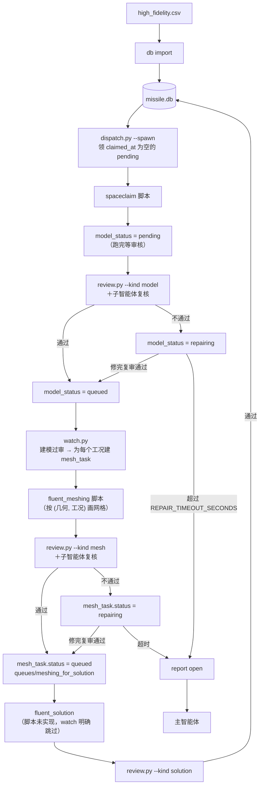
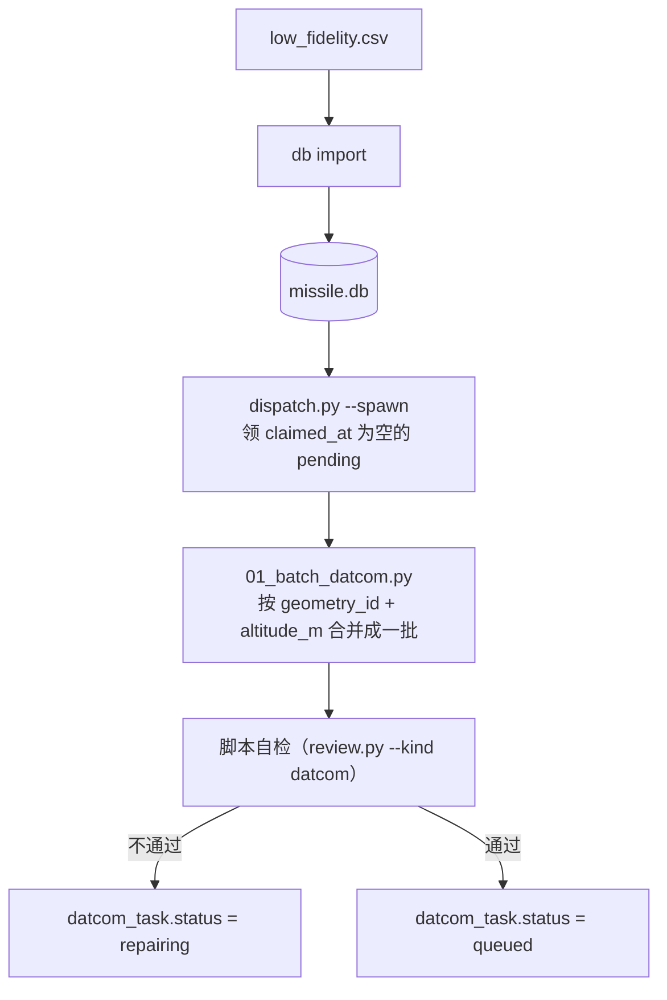
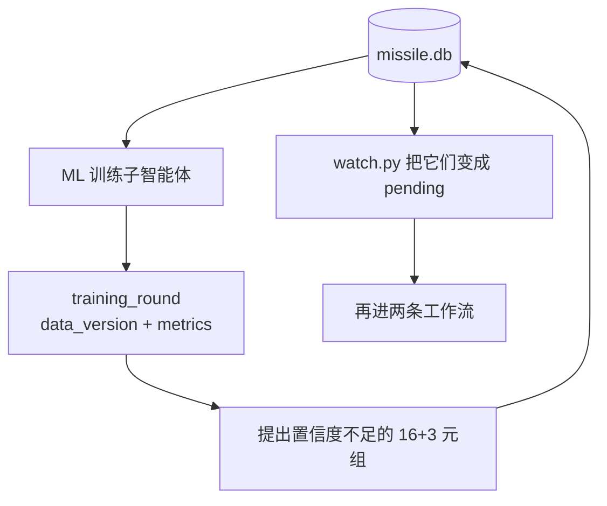

# 工作流与数据闭环计划

> 重构版（2026-11-07）。原版把"设计契约"和"实施工单"写在一起，读不出哪句已经落地。
> 本版分两块：**A 状态总览 / B 已实现 / C 未实现** 在前，**设计契约（原 §1–§12，编号不变）** 在后。
> 正文里 `§7.1`、`§4.3`、`§10`、`§12` 这类引用仍按原编号解析，没有被重排打乱。

现状一句话（2026-11-07 复核）：P0–P4 已跑通真实实例——2 个几何、4 个工况、1 套过审模型、8 条 DATCOM 系数都在库里；**网格还没有任何一个工况按工况重画过**（见下面第三批）。没落地的是**审核子智能体那一层**（含 MCP 注册）、**求解器**、**真实训练一轮**（补算要由 GPR 产生，现在的 `train.py` 只是 k-NN 占位）、**README 回位与七条验收复验**。

2026-11-07 第二批复核：状态机收敛到**三态**（`pending` / `repairing` / `queued`，
`schema_version` 2→3 已迁移，行数不变），**网格改成按 `(geometry_id, condition_id)`**
（新表 `mesh_task`，边界层由 `fluent_meshing/boundary_layer.py` 按工况算），
**`watch.py` 成为唯一推进器**（`dispatch.py --spawn` 起子进程，不会被长任务卡死）。

2026-11-07 第三批复核（本次改动）：修掉上一次改动的三处遗留——
1. **2→3 迁移把一份旧的几何级网格当成 4 个工况「审核通过」**：那 4 行现在全部是
   `pending`、`run_id` / `mesh_path` 全 NULL（**旧路径不入新表**，只作为历史证据留在
   `runs/high/fluent_meshing/g48ee1449b30c__shared__20261031T111141Z/` 下），
   `queues/meshing_for_solution/` 已按库重写为空；**这 4 个工况都必须按各自工况重画**。
   同时修掉了 `init` 的迁移循环**不推进 `meta.schema_version`** 的 bug（它会让 3→4
   无限重跑、库里停在"列已补、版本还是 3"的半迁移状态）；`schema_version` 现为 **4**，
   `check` 48 项（原 39 项 + 新增 9 项）。
2. **watcher 每轮对历史数据报假「修理超时」**：计时起点改成 `repair_started_at`
   （迁移遗留为 NULL = 不参与判断），假单 `pee2211a0d409` 已 `resolved`。
3. 清理测试残留（`runtime/_*.py` 临时脚本、误触发的 Fluent 进程与产物）。


---

## A. 实施状态总览（P0–P7）

| 阶段 | 计划内容（原 §10） | 状态 | 本次复核依据 |
|---|---|---|---|
| **P0** | 库表结构、`normalize()`、`check` | 完成 | `db.py check` 共 **48 项全过**；**12 张表**（新增 `mesh_task`）；`schema_version=4`；另有计划外的 `centroid`（质心参与规范化，`90a4f61`） |
| **P1** | `import` / `export cases-csv` / `watch.py` / `control.py` | 完成 | 库内 2 几何 + 4 工况；`control.py status` 输出 workflow / stage 两层生效状态与三态任务计数（含"已领取"列）；`stop` 用 Win32 终止整棵进程树并把任务置 `repairing` + 写上报单 |
| **P2`*`** | 建模链路 + `review.py --kind model` + `dispatch.py` + 队列指针 + **注册 MCP** | 完成，**MCP 注册未做** | `g48ee1449b30c` 走完 `pending →（跑完）pending →（审核）queued`，`model_path` 已写；`queues/scdoc_for_fluent/` 有指针文件 |
| **P3** | 网格链路：OQ 0.01→0.05、bbox、`review.py --kind mesh` | 链路完成；**四个工况的网格一份都还没重画** | `mesh_validation.py:24` 与 `review.py` 都是 0.05；历史网格 449 万单元、`OQ_min 0.0738`（**这是旧的几何级网格，不是按工况产物**）；新增判据 10/11（condition_id 一致 + 边界层设计值一致）已用合成产物正反验证；`mesh_task` 8 行全 `pending`、无 `mesh_path` |
| **P4** | 低保真：`--input`、按行翼型/头型、`run.json` | 完成 | 8 条 `datcom_task` 迁移后全 `queued`，对应 8 条 `review(kind='datcom')`；`runs/low/g48ee…/` 有批次目录 |
| **P5** | 求解骨架（求解脚本留空） | 骨架完成，求解器按决定不做 | `dispatch.py` 的 `UNIMPLEMENTED_STAGES` 拒绝启动并写上报单；该单已被 `dismissed` |
| **P6** | 训练闭环 + `gc` + 点云改读库 | 部分完成 | `gc` 已实现并验过（网格改按工况逐行清）；`train.py` 能跑但代理模型是 **k-NN 占位**，**GPR 补算未实现**（C.5 / §6.4）；**`training_round` 仍 0 行**，从未真跑 |
| **P7** | 退役 `index.mjs`、逐目录 README、七条验收 | 部分完成 | `scripts/index.mjs` 已不存在；README 全部移入 `.readme/` 暂存，一致性未收尾 |

合计：**P0–P4 五项完成**（其中 P2 差一步 MCP 注册）、**P5 停在骨架**、**P6 / P7 各差尾款**。

---

## B. 已实现

每条写四样：能做什么 / 怎么触发 / 证据 / 已知缺口。证据都可以在仓库里直接复现。

### B.1 库与身份（P0）

- **能力**：**12 张表**（新增 `mesh_task`）；16 参数规范化与 canonical 串；48 bit 哈希 ID
  （`g` / `c` / `r` / `p` 前缀）；质心范围校验；`check` 自检含 PRAGMA、约束、规范化、
  三态 CHECK、`claimed_at` 原子领取五类。
- **入口**：`python scripts/db.py init|check|identify|centroid|import|export|claim|repair-timeout|repair-mesh-migration|release-claim|record-review|report|resolve-report|requeue|control|gc`
- **证据**：`db.py check` → `共 48 项，全部通过。`；`geometry` 2 行、`condition` 4 行、
  `mesh_task` 8 行（迁移时从 `geometry_state` 复制，**全部 `pending` 且无 `mesh_path`**）；
  `schema_version` 2→3 迁移前后
  `geometry/condition/geometry_state/cfd_task/datcom_task/review` 行数完全一致。
- **缺口**：`import` 幂等这次没有重跑验证；`centroid` 原计划没有，属加项。

### B.2 状态推进与启停（P1）

- **能力**：**三态** `pending` / `repairing` / `queued`；领取靠 `claimed_at` 原子写
  （`UPDATE ... WHERE claimed_at IS NULL` + `rowcount`）而不是状态词；僵死回收（含
  "领了却没登记 pid"的孤儿领取）；产物被 `gc` 删除后 `queued` 行回落 `pending`；
  修理超时上报（**计时起点是 `repair_started_at`，不是 `updated_at`**：迁移遗留的
  `repairing` 行该列为 NULL，不参与超时判断，避免把几周前的历史否决误读成当前故障）。
  启停三层优先级 `task > stage > workflow`，`stop` 杀整棵进程树并把任务置 `repairing` + 写上报单。
- **入口**：`python scripts/watch.py --once [--no-dispatch]`、`python scripts/control.py start|pause|stop|status --target …`、
  `python scripts/db.py repair-timeout`、`python scripts/db.py release-claim --run-id …`
- **证据**：`control.py status` 打印 `workflow:high/low` 与四个 `stage:*` 全为 `running`，
  任务计数分三态并单列"已领取"；`watch.py --once --no-dispatch` 在无事可做时输出"跳过
  fluent_solution：……求解脚本未实现"等明确的跳过原因，不报错，且**不会**再对
  `g692bcb5d5e50` 那份 2026-10-31 的历史 `repairing` 报假超时。反向也验过：把某行
  `mark_task(..., repair_started_at='2020-01-01')` 之后 `--repair-timeout 1` 能正确开单。
- **缺口**：见 C.2 —— `pending`（等审核）这一段仍没有无人格进程推进，靠主智能体发起审核。

### B.3 建模链路（P2）

- **能力**：`dispatch.py --stage spaceclaim` → `node spaceclaim/scripts/missile.mjs`（16 参数逐项从库拼命令行）→ 成功后自动补跑点云 → **回到 `pending` 等审核** → `review.py --kind model` → `db record_review`（通过则 `queued`）→ 事务提交后重写队列指针。
- **证据**：`geometry_state.g48ee1449b30c` 的 `model_status='queued'`（迁移后由旧 `passed` 映射而来）且 `model_path` 指向 `runs/high/spaceclaim/g48ee1449b30c__shared__20261031T105042Z/…scdoc`；`review` 表 `model` 2 passed + 2 rejected；`queues/scdoc_for_fluent/g48ee1449b30c__shared__20261031T105042Z.json` 存在。
- **缺口**：
  - **MCP 没注册**（C.1）。
  - 流水线本身不经 MCP：dispatch 直接调 node CLI。也就是说 MCP 只是给智能体用的取证工具，不是流水线组件。

### B.4 网格链路（P3）

- **能力**：同上模式，`--stage fluent_meshing`，但**按 `(geometry_id, condition_id)` 建行与审核**：
  - 建模过审后 `watch.py` 为该几何的每个工况建一条 `pending` 的 `mesh_task`；
  - 派发时用 `fluent_meshing/boundary_layer.py` **按该工况**算首层高度/层数/增长率，
    写进 `mesh_task` 行，并通过 `run_meshing.cmd --first-height/--layers/--growth-rate`
    覆盖 `mesh_missile.P_BOUNDARY_LAYER`（固定值只作为手工调试的回落）；
  - 喂给 Fluent 的是 `runtime/model_stage/<run_id>/missile.scdoc` 副本（避免下游重存
    破坏 sha256 证据链）；
  - `review.py --kind mesh` 现为 **16 条否决 + 1 条告警**，新增判据 10（`condition_id`
    与 `run.json`/`request.json` 一致）与 11（首层高度/层数/增长率等于该工况设计值）。
- **证据**：`g48ee1449b30c` 的 4 个工况在 `mesh_task` 里各有**一行 `pending`**，
  `run_id` / `mesh_path` 全 NULL、边界层设计值全 NULL——**它们都还没按工况重画过**；
  `queues/meshing_for_solution/` 为空。新增判据用合成产物做过正反验证——按设计值写就
  判通过，把首层高度写成旧固定值 0.07 mm + 层数 12 就判否决（差 1727%）。
- **迁移怎么处理旧网格**：2→3 迁移只按 `(几何, 工况)` 建行，状态**写死 `pending`**、
  **不复制** `mesh_path` / `run_id`。那份 449 万单元、`OQ_min 0.0738` 的历史网格是按旧
  规则（固定 0.07 mm / 12 层）画的**几何级**产物，一份网格服务四个工况，从来没按工况
  验证过；它的文件仍在 `runs/high/fluent_meshing/g48ee1449b30c__shared__20261031T111141Z/`
  下作为历史证据，但**不进新表、不进队列**。最早那版 2→3 曾把它复制成 4 行 `queued`
  且共用同一 `run_id` / `mesh_path`，等于宣布四个工况都已有合格网格；`db.py
  repair-mesh-migration`（判据：`first_height_mm IS NULL` + `run_id` 中段是 `shared`）
  已把这 4 行重置为 `pending` 并清空两列，同时按库重写了队列目录。
- **缺口**：**四个工况的网格一份都还没按工况重画**（本机没有可用 Fluent/PyFluent 会话，
  见验收第 5 条）；bbox 判据不是按原计划写进 `quality.json`，改为从 `validation.trn` 解析
  （`review.py:_bbox_from_transcript`），效果等价，但 §11.1 的措辞已过时。

### B.5 低保真链路（P4）

- **能力**：`dispatch.py --stage datcom` 按 `geometry_id + altitude_m` 合并成一批，用 `db.export_batch_input` 现导 CSV 传给 `01_batch_datcom.py --input`，跑完按工况拆回 `datcom_task` 并逐条记 `review`（通过即 `queued`，不通过 `repairing`）。
- **证据**：8 条 `datcom_task` 迁移后全 `queued`；`runs/low/g48ee1449b30c/<run_id>/` 有批次目录。
- **缺口**：脚本默认 `INPUT_TABLE` 仍指向已退役的 `data_lib/inputs/cases.csv`，只影响手工运行，不影响派发。

### B.6 审核闸门（贯穿 P0–P4）

- **能力**：四个 `kind` 的确定性判据；写库前拦截"有否决项未过却记 passed"；核对产物 sha256（审核后有人动文件必被抓）；`--force --force-reason` 用于产物被下游重存后的重审；`attempts` 由 `review` 表的拒绝记录算出；超 `SELF_REPAIR_BUDGET=2` 自动写 `open` 上报单（按阶段+几何+工况去重）；通过即事务提交后重写队列指针。**审核结论映射到三态**：`verdict='passed' → 任务 queued`、`verdict='rejected' → 任务 repairing`。
- **证据**：`review` 表 14 行 = `datcom` 8 passed + `mesh` 1 passed/1 rejected + `model` 2 passed/2 rejected（历史记录，`verdict` 词的语义未变）。
- **缺口**：只有第一层（脚本判据），第二层"审核子智能体复核"没有实现。

### B.7 上报、重排与关闭

- **能力**：`report` 开单与去重、`resolve-report`、`requeue --resolve-reports`（回到 `pending` 时不删审核历史、不重置预算）、`release-claim --run-id`（放弃一次作废的领取：清 `claimed_at` / `run_id`、注销 `task_process`、任务回 `pending` 并开单；拒绝仍然活着的进程）。
- **证据**：`report` 表 9 行，8 条 `resolved` + 1 条 `dismissed`。最早四条 `resolved` 记录了：SpaceClaim 界面打开后污染产物、`flat_percent` 60.995 的回归（改为 64.6 后重建 `g48ee1449b30c`）、`run_meshing.cmd` 的中文注释吞掉 `HERE`、Fluent 用文件名主干拼 face zone label 导致 sizing 失败。第三批新增四条，全部是**本次修复过程本身的证据**：`pee2211a0d409`（历史 `rejected` 迁移成 `repairing` 的假超时单，已 `resolved`）、误触发网格派发引起的僵死回收一单、放弃领取一单、以及真超时的反向验证单。

### B.8 训练骨架与 `gc`（P6 部分）

- **能力**：`train.py`（`--threshold`、`--max-proposals`、`--dry-run`）按 §6.3 写 `training_round` 与 `origin='active_learning'` 的 `pending` 行；`db.py gc` 五步护栏（路径必须在工作区内、必须在规定运行根下、`feedback/` 不碰）。
- **证据**：`gc` 上次实施时五步验证通过（护栏拒深路径、`--apply` 只删假文件、真产物完好）；`training_round` 0 行。
- **缺口**：代理模型是 **k 近邻占位**（`K_NEIGHBOURS=3`、用归一化距离当不确定度），特征只有 12 维、翼型种类与头型没进特征向量；**GPR 版未实现**（§6.4 / C.5）。真样本训练一次都没跑。

### B.9 文档归档与退役（P7 部分）

- **证据**：`scripts/index.mjs` 已不存在（索引改由 `db export --format index` 生成）；README 全部移入 `.readme/`，映射与 SHA-256 记在 `.readme/_manifest.json`，`.readme/` 已进根 `.gitignore`。

---

## C. 未实现

每条写四样：缺什么 / 卡在哪 / 依赖 / 验收判据。C.1–C.6 都在原计划框架内；C.7 是本轮新提出、原计划没有的方向，只登记不展开。

### C.1（P2 尾款）SpaceClaim MCP 没有注册

- **缺什么**：`spaceclaim/server.mjs` 的 7 个工具（`search_api`、`get_doc`、`find_python_command`、`get_geometry_recipe`、`validate_missile_params`、`generate_model_script`、`build_missile_model`）没有接进 DSH：`~/.dsh/settings.yaml` 无 `mcp` 段，工作区无 `.mcp.json`。
- **卡在哪**：只是没接线，服务器本身可跑。
- **影响**：审核子智能体没有取证工具；**不影响流水线**。
- **验收**：会话里能直接调用 `validate_missile_params` 并拿到 errors / warnings / automatic corrections。

### C.2（原 §8.2）三个审核子智能体没有落地

- **缺什么**：模型 / 网格 / 求解三个角色的会话装配、`review.reviewer` 的标识约定
  （`review.py --reviewer` 已支持，但没人填）、"修复"与"判定"是否分离、以及
  **谁发现 `pending`（脚本跑完等审核）**。
- **卡在哪**：`watch.py` 现在做修理超时上报、僵死回收、复活、建网格行、触发网格，
  但**不发起审核**——审核是子智能体的活，脚本这边只提供状态通道；`pending` 目前只有
  会话里的主智能体看着推进。没人看着时任务永远停在 `pending`，不会变 `queued`。
- **依赖**：C.3；模型侧另需 C.1。
- **验收**：`review.reviewer` 出现 `agent:*` 记录；无人值守时 `pending → queued/repairing`
  也在推进；`repairing` 超时能被 watcher 上报（这一条**已实现**，见 §8.4 第 1 条）。

### C.3（关键缺口）"自修重跑"没有合法通道

- **缺什么**：`repairing` 的任务不会被 dispatch 重新领走（dispatch 只认 `pending`），
  必须 `db.py requeue` 打回 `pending` 才能重跑；而各阶段能改的旋钮是：
  - 建模：**0 个** —— `spaceclaim_command` 注释写明"参数只从库里来，不读任何配置文件"，
    改参数等于换 `geometry_id`；
  - 网格：**6 个 CLI** —— `-n/--processors`、`--draw-size-control`、`--start-timeout`、
    `--timeout`，以及本次新增的 `--first-height / --layers / --growth-rate`（后三个由
    `boundary_layer.py` 按工况算出，**不建议**让子智能体手改：改了就与审核判据 11 冲突）；
    决定 OQ 的 `P_IMPORT / P_LOCAL_SIZING / P_SURFACE_MESH / P_BOUNDARY_LAYER /
    P_VOLUME_MESH` 仍是 `mesh_missile.py` 的模块级 dict；
  - 求解：没有脚本。
- **卡在哪**：原计划 §6.1 的"自修白名单"写着"15 个建模字段、`P_*` 表"，但改这两样都
  等于改几何或改源码，与 §8.2 的硬边界冲突。要么给每阶段开一条可审计的 per-run 覆盖
  通道，要么承认自修只覆盖环境类故障。
- **验收**：出现一次真实的 `repairing → requeue → 重跑 → 审核通过 → queued` 自修闭环，
  且 `attempts` 累计到 2 时停止。

### C.4（P5）求解脚本不存在

- **状态**：按 2026-10-31 的决定，求解器不由智能体实现。
- **影响**：`watch.py` 见到 `queued` 的网格只打印"跳过 fluent_solution：…求解脚本未实现"，
  `dispatch.py` 的 `UNIMPLEMENTED_STAGES` 也会拒绝启动并写上报单；P6 的真实训练也没法开始。
- **验收**：这一项不设验收，等决定变更。

### C.5（P6 尾款）GPR 代理模型与补算任务未实现

- **目标（2026-11-07 定）**：补算任务改由**高斯过程回归**产生，逻辑写在 `ML_training/`。方案见 §6.4。
- **现状**：`scripts/train.py` 里是 **k 近邻占位**（`K_NEIGHBOURS=3`、`UNCERTAINTY_THRESHOLD=0.15` 归一化距离、`MAX_PROPOSALS=20`），`ML_training/` 目录仍是空的。k-NN 版的特征只有 11 个长度 + `thickness_percent` 共 12 维（`train.py:65`），**`flat_percent`、`le_radius` / `le_radius_index`、翼型种类、头型都没进特征向量**，等于把所有翼型当成同一片翼型在回归。
- **缺什么**：
  1. `ML_training/` 下的 GP 实现：核函数、逐目标的 `CL` / `CD` / `CM`、后验均值与标准差、留一交叉校验；
  2. 分类变量编码（`fin_section_type`、`nose_shape`）与按种类分段的翼型参数；
  3. 采集规则：按后验标准差比值选点 + 两两去重，替代"到最近邻居距离 > 0.15"；
  4. `scripts/train.py` 改为调用 `ML_training/`，k-NN 降级为 baseline 对照，不删；
  5. 环境归属：GP 依赖（numpy / scikit-learn 或等价）装进哪个独立环境必须写清，**不得混用** `fluent_meshing/_deps`（PyFluent 的 3.10/3.11 环境）或 `.mesh_inspect_deps`。
- **卡在哪**：`cfd_task` 现在 8 条全 `pending`，**0 条 passed**，没有真实高保真样本可训（依赖 C.4）。可以先用 `runs/low/` 里那 8 条 DATCOM 结果做管线连通性原型，但 §6.3 规定第一版只用高保真，不能拿它冒充正式训练集。
- **依赖**：C.4（真样本）、新环境（第 5 条）。
- **验收**：
  1. `training_round` 出现 ≥1 行 passed，`metrics_json` 里有留一交叉的 RMSE 与 σ 校准度；
  2. 它提出的 `origin='active_learning'` 的 `pending` 行能被 `watch.py` 自动入队；
  3. 同一轮提出的补点两两之间间隔 ≥ 阈值（不会输出一堆近似重复点）。

### C.6（P7 尾款）README 一致性与七条验收

- **缺什么**：README 移到 `.readme/` 后的逐目录校对与回位；§1 七条逐条复验。
- **卡在哪**：暂存是有意的中间态，一致性检查要等回位后做。
- **验收**：§1.1 七条全绿。

### C.7（本轮新提出，原计划不含，仅登记）

- 你要的方向：MCP server 放到各自目录（`spaceclaim/`、`fluent_meshing/`、`fluent_solution/`），`multiagents/` 里只写"每个智能体 → 用哪个 MCP、哪个 skill"，且这套东西还需要大改。
- 现状：全仓库只有 `spaceclaim/server.mjs` 一个 MCP；历史上的 `mcp_skill/{spaceclaim,autoCFD,Fluent_meshing_mcp}` 目录已不存在。
- 这一项没有拆解，等你确认要不要立项，再按 §10 的格式补阶段表。


---

# 设计契约（原 §1–§12，编号不变）

下面每一节开头加一行「实现状态」，正文保持原样。改契约只改这一块，改状态只改 A / B / C 三节。


## 1. 目标与成功判据

> **实现状态**：七条判据里 4 条达成、2 条部分达成、1 条未达成，逐条见 §1.1。

目标：让"几何参数 → 建模 → 网格 → 求解 → 气动系数 → 训练 → 补点"这条闭环在**无人手动搬文件**的前提下转起来，并且**任何进入数据库的结果都经过一次可复查的审核**。

成功判据（本计划的验收，不是工程实现的验收）：

1. 一条 `db import` 命令能把两份输入表灌进库，重复执行行数不变。
2. 新几何第一次入库后，`runs/` 下自动出现 `spaceclaim` → `fluent_meshing` 两个阶段的运行目录，产物通过审核后出现在 `queues/` 的两个队列目录里。
3. 任一阶段失败后，最多自修重跑 2 次；仍失败则在 `report` 表留下 `open` 记录，并在 `feedback/<stage>/<run_id>/` 留下失败包。
4. 主智能体能对任意工作流或阶段执行 `pause` / `stop`；`stop` 后 5 秒内对应 ANSYS / `datcom.exe` 进程消失，任务状态为 `cancelled`。
5. 同一 `geometry_id` 的全部工况求解通过后，`gc` 能删掉该几何的 `.scdoc` 与网格文件，且不会误删工作区之外或 `feedback/` 下的文件。
6. 训练一轮后，新提出的几何/工况直接成为 `pending` 任务行，不需要人工再写 SQL。
7. 每个目录的 `README.md` 与实际子项一致（含新增的 `SQLite/`）。

### 1.1 七条验收的当前达成情况（2026-11-07）

| # | 判据 | 状态 | 说明 |
|---|---|---|---|
| 1 | `db import` 重复执行行数不变 | 部分 | 导入确实做过（2 几何 / 4 工况在库），但幂等性这次没有重跑验证 |
| 2 | 新几何自动出现两阶段目录，过审后进两个队列 | 达成 | `g48ee1449b30c` 的 `spaceclaim` / `fluent_meshing` 两个运行目录与两个队列指针都在 |
| 3 | 失败最多自修 2 次，仍失败则 `report` 留 `open` 并留失败包 | 部分 | 上报单与失败包都有真实实例（5 条上报单、`feedback/<stage>/<run_id>/`），但预算机制没被真正跑满过 |
| 4 | `stop` 后 5 秒内进程消失，任务置 `cancelled` | 达成 | 实测 0.08 s 清空父+孙进程并注销 `task_process`，任务置 `cancelled` |
| 5 | `gc` 能删产物且不误删 | 达成（上次验证） | 五步验证通过；本次未复验 |
| 6 | 训练一轮后新行自动变 `pending` | 未达成 | 依赖 C.4 / C.5 |
| 7 | 每个目录 README 与实际子项一致 | 未达成 | README 在 `.readme/` 暂存，收尾见 C.6 |

---

## 2. 配置区（要改路径和参数只改这里）

> **实现状态**：`workspace.json` 已是 `schemaVersion: 2`，`database` 与 `queues` 两项已写入；本表其余数值均已在代码中生效。

路径全部相对工作区根目录；根路径由脚本自 `workspace.json` 推导，代码里不写绝对路径。

| 名称 | 值 | 用途 |
|---|---|---|
| 数据库 | `data_lib/datasets/SQLite/missile.db` | 唯一真相源。WAL 模式，`-wal` / `-shm` 不入库 |
| 高保真输入 | `data_lib/inputs/high_fidelity.csv` | 人工接口，只在初始化导入时读取 |
| 低保真输入 | `data_lib/inputs/low_fidelity.csv` | 人工接口，只在初始化导入时读取 |
| 建模队列 | `data_lib/queues/scdoc_for_fluent/` | 已通过审核的模型（指针文件） |
| 网格队列 | `data_lib/queues/meshing_for_solution/` | 已通过审核的网格（指针文件） |
| 高保真运行 | `data_lib/runs/high/<stage>/<run_id>/` | 临时数据，入库后可清 |
| 低保真运行 | `data_lib/runs/low/<geometry_id>/` | DATCOM 归档，按几何命名 |
| 点云 | `data_lib/datasets/point_clouds/<geometry_id>/` | 每个几何一份，永久保留 |
| 失败包 | `feedback/<stage>/<run_id>/` | 永久保留，不自动清理 |
| 索引视图 | `data_lib/index.json` | 由 `db export` 生成，只读 |
| 每阶段并发 | `1` | 同时处于 `running` 的任务数上限 |
| 自修重试预算 | `2` | 每次上报前允许的自修重跑次数 |
| watch 周期 | `30` 秒 | `scripts/watch.py` 扫描间隔 |
| 文本时间戳 | UTC `YYYYMMDDTHHMMSSZ` | 所有 `run_id` 与数据库时间字段 |

`workspace.json` 新增两项，`schemaVersion` 由 1 升到 2：

```json
"database": "data_lib/datasets/SQLite/missile.db",
"queues": { "scdoc_for_fluent": "data_lib/queues/scdoc_for_fluent",
            "meshing_for_solution": "data_lib/queues/meshing_for_solution" }
```

---


## 3. 标识符与参数规范化

> **实现状态**：已按 16 参数 / 3 工况规范化并参与哈希；`db.py identify` 与计划外的 `centroid` 都已实现。

### 3.1 几何是 16 个参数

| 类别 | 字段 |
|---|---|
| 弹型（11，单位 m） | `L_N` `L` `D` `L_W` `C_RW` `C_TW` `B_W` `L_F` `C_RF` `C_TF` `B_F` |
| 翼型种类（1） | `fin_section_type`：`hex` 或 `naca` |
| 翼型参数（3，按类型二选一） | hex：`thickness_percent` `flat_percent` `le_radius`；naca：`thickness_percent` `le_radius_index` `max_thickness_tenths` |
| 鼻锥头型（1） | `nose_shape`：`ogive` 或 `cone` |

合计 16 个。**鼻锥头型和翼型种类从此进入参数表、参与身份、写进产物**——这是本版与旧版最重要的一处改变，它意味着 `DATCOM/scripts/missile_spec.py` 不再是"唯一配置区"，只保留解析式与**默认值**；实际取值一律来自数据库。

仍**不**进入身份的固定项：锥顶倒角 `NOSE_TIP_FILLET_RATIO`、舵面布局 `LE_MODE` / `FIN_PHASE` / `CRUCIFORM_COUNT`、力矩参考点 `XCG_M = L/2`、后缘对齐。它们变化即视为新一批数据，需人工决定，不静默生效。

### 3.2 工况是 3 个参数

`mach`、`alpha_deg`、`altitude_m`。`condition_id` 由这三者生成，**含高度**。旧表的 `C01`–`C30` 降级为可读标签 `condition.label`：它只编码马赫数与攻角，不含高度，因此同一标签可以在不同高度重复出现，**不得用作主键或查表依据**。

### 3.3 规范化串

字段按上表固定顺序拼接，浮点统一 `%.6f`、禁止科学计数法、枚举小写，分隔符为 `|`：

```text
L_N=0.490000|L=3.690000|D=0.180000|L_W=1.720000|C_RW=0.230000|C_TW=0.060000|B_W=0.230000|L_F=3.200000|C_RF=0.380000|C_TF=0.190000|B_F=0.220000|fin_section_type=hex|thickness_percent=4.462000|flat_percent=60.995000|le_radius=0.050000|nose_shape=cone
```

工况的规范串：

```text
mach=2.000000|alpha_deg=4.000000|altitude_m=0.000000
```

**先规范化、再入库、再算哈希**。规范化的顺序固定在 `scripts/db.py` 的 `normalize()`：

1. 先跑 `DATCOM/scripts/datcom_spec.normalize_geometry` 的几何校验与钳位（梢弦小于 1 mm 时钳到 0.001 m，以及 `L_N<L`、`D<L`、`L_W≥L_N`、`L_W+C_RW≤L`、`L_F≥L_N`、`L_F+C_RF≤L`、`L_W+C_RW≤L_F`）。
2. 按 `fin_section_type` 校验对应的三个翼型参数存在且在允许范围内（`thickness_percent` 0–40、`flat_percent` 0–100、`le_radius` ≥ 0、`le_radius_index` 0–9 整数、`max_thickness_tenths` ∈ {2,3,4,5,6}）。
3. 再生成规范串。

钳位必须在哈希之前完成，否则 `C_TW = 0.0005` 与 `0.001` 会得到两个身份、却是同一个外形。

### 3.4 哈希与字符串格式

| 标识 | 算法 | 示例 |
|---|---|---|
| `geometry_id` | `"g" + sha256(几何规范串)[:12]` | `g692bcb5d5e50` |
| `condition_id` | `"c" + sha256(工况规范串)[:12]` | `cc9633c86a360` |
| `run_id` | `<geometry_id>__<condition_id>__<时间戳>` | `g692b…__shared__20261101T101500Z` |
| `review_id` | `"r" + sha256(kind+run_id+verdict+created_at)[:12]` | `r0a9f2c81d3be` |
| `report_id` | `"p" + sha256(stage+run_id+created_at)[:12]` | `p7c1e2a90b4f3` |

全部小写十六进制，不含 `__`，因此 `run_id` 可按 `__` 从右往左拆：最后一段是时间戳，倒数第二段是 `condition_id`（几何级产物写 `shared`），剩下的是 `geometry_id`。

上表两个身份是**真实值**，不是示意：它们就是 §3.3 那段基准几何（`0.49 / 3.69 / …` ＋ `hex` ＋ `cone`）与 Ma 2、α 4°、0 m 的身份，`python scripts/db.py check` 会逐字比对，改动格式化规则会立刻报错。

`stage` **不进** `run_id`：它已经是运行目录、失败包、队列目录的父目录名，写进字符串只是重复。`run_id` 里唯一无法由身份推出的信息就是"这是第几次跑"。

**碰撞处理**：插入前按 `geometry_id` / `condition_id` 查已有行的 `canonical`；不一致就拒绝写入并报错（要求人工确认是否要加长位数），绝不静默覆盖。6 位小数的 16 维参数在 1 万个几何规模下 48 bit 的碰撞概率约 1e-8，出现即说明规范化有 bug。

---


## 4. 目录与文件命名

> **实现状态**：`runs/high/<stage>/<run_id>/` 与两条队列目录都已实际产出（证据见 B.3 / B.4）。

### 4.1 高保真

```text
data_lib/runs/high/<stage>/<run_id>/
```

`<stage>` 只取 `spaceclaim` / `fluent_meshing` / `fluent_solution`。本次把旧版的 `<run-id>/<阶段>/` 顺序**倒过来**，因为你在需求里写的就是 `runs/high/spaceclaim`、`runs/high/fluent_meshing`。

产物文件名：跟几何绑定的以 `geometry_id` 开头，跟工况绑定的以 `run_id` 开头。

| 文件 | 文件名 |
|---|---|
| 模型 | `<geometry_id>_spaceclaim.scdoc` |
| 建模日志 | `<geometry_id>_spaceclaim.log` |
| 建模参数快照 | `params.json` |
| 建模验收结果 | `result.json` |
| 运行记录 | `run.json`（每阶段每 `run_id` 一份） |
| 网格 | `<geometry_id>_fluent_meshing.msh.h5` |
| 网格日志 | `<geometry_id>_fluent_meshing.log` |
| 网格质量 | `quality.json` |
| 求解结果 | `<run_id>_fluent_solution.<扩展名>` |
| 求解日志 | `<run_id>_fluent_solution.log` |

### 4.2 低保真

```text
data_lib/runs/low/<geometry_id>/
data_lib/runs/low/<geometry_id>/<run_id>/run.json     ← 每批次一份运行记录
```

归档文件（系数表跨高度合并，只有一张）：

| 文件 | 文件名 |
|---|---|
| 输入卡片 | `<geometry_id>_for005.dat` |
| 原始输出 | `<geometry_id>_for006.dat` |
| 外形 | `<geometry_id>_for022.dat` |
| 系数总表 | `<geometry_id>_aero_coefficients.csv` |
| 几何核对 | `<geometry_id>_geometry_check.txt` |
| 几何核对图 | `<geometry_id>_geometry_check.png` |
| 参数快照 | `<geometry_id>_case_params.json` |
| 计算日志 | `<geometry_id>_datcom.log` |

DATCOM 运行当下的协议文件仍放在 `data_lib/runs/low/.work/`，算完删除。`DATCOM/` 目录下不保留任何算例结果。

### 4.3 队列目录

```text
data_lib/queues/scdoc_for_fluent/<run_id>.json
data_lib/queues/meshing_for_solution/<run_id>.json
```

队列里**不放产物本体**，只放指针文件：

```json
{
  "schemaVersion": 1,
  "queue": "scdoc_for_fluent",
  "run_id": "g692bcb5d5e50__shared__20261101T101500Z",
  "geometry_id": "g692bcb5d5e50",
  "condition_id": "shared",
  "artifact": {
    "rel_path": "data_lib/runs/high/spaceclaim/<run_id>/g692bcb5d5e50_spaceclaim.scdoc",
    "size": 4488574,
    "sha256": "…"
  },
  "review_id": "r0a9f2c81d3be",
  "approved_at": "2026-11-01T10:15:00Z"
}
```

**队列目录是数据库的导出视图，不是第二份真相。** 下游领任务只看数据库；指针文件由 `db export queue` 生成，任何不一致以数据库为准，可随时整目录删掉重建。

网格的指针**每个 `(几何, 工况)` 一份**（文件名仍是 `<run_id>.json`，`run_id` 的三段里已经含
`condition_id`），因为网格已经按工况分开了。`condition_id` 字段写该工况的 ID，不再写 `shared`。

### 4.4 失败包

```text
feedback/<stage>/<run_id>/
```

包内是当次运行的完整副本（`run.json`、日志、参数快照、已产生的产物），沿用上面的文件名；`DATCOM` 失败包放 `feedback/datcom/<run_id>/`。失败包永久保留，不参与 `gc`。

---


## 5. SQLite 数据库

> **实现状态**：**12 张表**（新增 `mesh_task`）全部建出，`db.py check` 48 项全过，`schema_version=4`（v4 给四张任务表补了 `repair_started_at`，并修正 2→3 迁移留下的旧网格行）。

单一库文件，WAL 模式，`PRAGMA foreign_keys=ON`，`busy_timeout=5000`。写入统一经过 `scripts/db.py`，任何子智能体、脚本、智能体都不直接开 `sqlite3` 连接写（避免 `database is locked` 与半事务）。

### 5.1 表清单

| 表 | 作用 |
|---|---|
| `meta` | 键值对，存 `schema_version` |
| `geometry` | 16 个几何参数 + 规范串 + 可读标签 + SpaceClaim 实测质心三列（派生量，不进身份） |
| `geometry_state` | 几何级状态：建模状态、模型/点云路径、`claimed_at`、可删除标志 |
| `mesh_task` | **网格任务：几何 × 工况**，状态、网格路径、边界层设计值（首层高度 / 层数 / 增长率 / y+ / Re / Cf / u_τ / δ）与可追溯证据 |
| `condition` | 3 个工况参数 + 规范串 + 可读标签 |
| `cfd_task` | 高保真任务：几何 × 工况，求解状态与三个气动系数 |
| `datcom_task` | 低保真任务：几何 × 工况，运行状态与三个气动系数 |
| `review` | 每次审核的判据与结论（唯一的入库凭证） |
| `report` | 上报主智能体的问题单 |
| `control` | 启停开关 |
| `task_process` | 运行中任务的 `pid`，供叫停与僵死回收使用 |
| `training_round` | 训练轮次、数据版本、模型路径、提出了哪些新行 |

### 5.2 字段

```sql
CREATE TABLE meta (key TEXT PRIMARY KEY, value TEXT NOT NULL);

CREATE TABLE geometry (
  geometry_id        TEXT PRIMARY KEY,              -- 'g' + 12 hex
  L_N REAL NOT NULL, L REAL NOT NULL, D REAL NOT NULL,
  L_W REAL NOT NULL, C_RW REAL NOT NULL, C_TW REAL NOT NULL, B_W REAL NOT NULL,
  L_F REAL NOT NULL, C_RF REAL NOT NULL, C_TF REAL NOT NULL, B_F REAL NOT NULL,
  fin_section_type   TEXT NOT NULL CHECK (fin_section_type IN ('hex','naca')),
  thickness_percent  REAL NOT NULL,
  flat_percent       REAL,          -- 仅 hex
  le_radius          REAL,          -- 仅 hex
  le_radius_index    INTEGER,       -- 仅 naca
  max_thickness_tenths INTEGER,     -- 仅 naca
  nose_shape         TEXT NOT NULL CHECK (nose_shape IN ('ogive','cone')),
  canonical          TEXT NOT NULL UNIQUE,
  label              TEXT,          -- 人工可读名，不参与身份
  created_at         TEXT NOT NULL,
  cg_x_m REAL, cg_y_m REAL, cg_z_m REAL,   -- 实测质心（弹尖起算，m）；派生量，不参与身份
  CHECK ( (fin_section_type='hex'
           AND flat_percent IS NOT NULL AND le_radius IS NOT NULL
           AND le_radius_index IS NULL AND max_thickness_tenths IS NULL)
       OR (fin_section_type='naca'
           AND le_radius_index IS NOT NULL AND max_thickness_tenths IS NOT NULL
           AND flat_percent IS NULL AND le_radius IS NULL) )
);

CREATE TABLE geometry_state (
  geometry_id   TEXT PRIMARY KEY REFERENCES geometry(geometry_id),
  model_status  TEXT NOT NULL DEFAULT 'pending'  CHECK (model_status  IN
                ('pending','repairing','queued')),
  model_path    TEXT, cloud_path TEXT,
  model_run_id  TEXT, cloud_run_id TEXT,
  claimed_at    TEXT,             -- 非空 = 已被某进程领走；结束时清空。与 task_process 的 pid 一起防重复领取
  repair_started_at TEXT,         -- 进入 repairing 的时刻；NULL = 不是真在修（迁移遗留），不计超时
  deletable     INTEGER NOT NULL DEFAULT 0 CHECK (deletable IN (0,1)),
  updated_at    TEXT NOT NULL
);

-- 网格按 (geometry_id, condition_id)：同一几何不同马赫数的 y+ 首层高度不同，
-- 共用一个网格必有工况落在 y+ 目标之外。
CREATE TABLE mesh_task (
  geometry_id    TEXT NOT NULL REFERENCES geometry(geometry_id),
  condition_id   TEXT NOT NULL REFERENCES condition(condition_id),
  status         TEXT NOT NULL DEFAULT 'pending' CHECK (status IN
                 ('pending','repairing','queued')),
  run_id         TEXT, mesh_path TEXT,
  first_height_mm REAL, n_layers INTEGER, growth_rate REAL,   -- 本次网格用的设计值
  y_plus_target  REAL, re REAL, cf REAL, u_tau REAL, delta_m REAL,  -- 可追溯证据
  attempts       INTEGER NOT NULL DEFAULT 0,
  claimed_at     TEXT,
  repair_started_at TEXT,         -- 进入 repairing 的时刻；NULL = 不是真在修（迁移遗留），不计超时
  review_id      TEXT REFERENCES review(review_id),
  created_at     TEXT NOT NULL, updated_at TEXT NOT NULL,
  PRIMARY KEY (geometry_id, condition_id)
);

CREATE TABLE condition (
  condition_id TEXT PRIMARY KEY,                    -- 'c' + 12 hex
  mach REAL NOT NULL, alpha_deg REAL NOT NULL, altitude_m REAL NOT NULL,
  canonical    TEXT NOT NULL UNIQUE,
  label        TEXT,                                -- 'C01'..'C30'，可为空
  created_at   TEXT NOT NULL,
  UNIQUE (mach, alpha_deg, altitude_m)
);

CREATE TABLE cfd_task (
  geometry_id  TEXT NOT NULL REFERENCES geometry(geometry_id),
  condition_id TEXT NOT NULL REFERENCES condition(condition_id),
  status       TEXT NOT NULL DEFAULT 'pending' CHECK (status IN
               ('pending','repairing','queued')),
  attempts     INTEGER NOT NULL DEFAULT 0,
  CL REAL, CD REAL, CM REAL,
  converged    INTEGER,            -- 0/1，求解阶段填
  residual     REAL,               -- 连续性残差
  run_id       TEXT, result_dir TEXT, log_path TEXT,
  claimed_at   TEXT,
  repair_started_at TEXT,         -- 进入 repairing 的时刻；NULL = 不是真在修（迁移遗留），不计超时
  review_id    TEXT REFERENCES review(review_id),
  origin       TEXT NOT NULL DEFAULT 'human' CHECK (origin IN ('human','active_learning')),
  round_id     TEXT REFERENCES training_round(round_id),
  created_at   TEXT NOT NULL, updated_at TEXT NOT NULL,
  PRIMARY KEY (geometry_id, condition_id)
);

CREATE TABLE datcom_task (
  geometry_id  TEXT NOT NULL REFERENCES geometry(geometry_id),
  condition_id TEXT NOT NULL REFERENCES condition(condition_id),
  status       TEXT NOT NULL DEFAULT 'pending' CHECK (status IN
               ('pending','repairing','queued')),
  attempts     INTEGER NOT NULL DEFAULT 0,
  CL REAL, CD REAL, CM REAL,
  run_id       TEXT, result_dir TEXT, log_path TEXT,
  claimed_at   TEXT,
  repair_started_at TEXT,         -- 进入 repairing 的时刻；NULL = 不是真在修（迁移遗留），不计超时
  review_id    TEXT REFERENCES review(review_id),
  origin       TEXT NOT NULL DEFAULT 'human' CHECK (origin IN ('human','active_learning')),
  round_id     TEXT REFERENCES training_round(round_id),
  created_at   TEXT NOT NULL, updated_at TEXT NOT NULL,
  PRIMARY KEY (geometry_id, condition_id)
);

CREATE TABLE review (
  review_id       TEXT PRIMARY KEY,
  kind            TEXT NOT NULL CHECK (kind IN ('model','mesh','solution','datcom')),
  geometry_id     TEXT NOT NULL,
  condition_id    TEXT,            -- model 为 NULL；mesh / solution / datcom 必须给
  run_id          TEXT NOT NULL,
  reviewer        TEXT NOT NULL,   -- 'script:review.py' 或子智能体标识
  verdict         TEXT NOT NULL CHECK (verdict IN ('passed','rejected')),
  checks_json     TEXT NOT NULL,   -- 每条判据的 name/ok/detail
  artifact_sha256 TEXT,
  attempts        INTEGER NOT NULL DEFAULT 0,
  created_at      TEXT NOT NULL
);

CREATE TABLE report (
  report_id    TEXT PRIMARY KEY,
  stage        TEXT NOT NULL CHECK (stage IN
               ('spaceclaim','fluent_meshing','fluent_solution','datcom')),
  geometry_id  TEXT NOT NULL,
  condition_id TEXT,
  attempts     INTEGER NOT NULL,
  last_error   TEXT,
  review_json  TEXT,
  feedback_dir TEXT,
  status       TEXT NOT NULL DEFAULT 'open' CHECK (status IN ('open','resolved','dismissed')),
  resolution   TEXT,
  created_at   TEXT NOT NULL, resolved_at TEXT
);

CREATE TABLE control (
  target     TEXT PRIMARY KEY,     -- 'workflow:high' | 'stage:spaceclaim' | 'task:<run_id>'
  state      TEXT NOT NULL CHECK (state IN ('running','paused','stopped')),
  reason     TEXT,
  updated_at TEXT NOT NULL,
  updated_by TEXT NOT NULL
);

CREATE TABLE task_process (
  run_id TEXT PRIMARY KEY, pid INTEGER NOT NULL, started_at TEXT NOT NULL
);

CREATE TABLE training_round (
  round_id      TEXT PRIMARY KEY,
  status        TEXT NOT NULL CHECK (status IN ('running','passed','failed','cancelled')),
  data_version  TEXT,              -- 参与训练的样本集指纹
  model_path    TEXT,
  metrics_json  TEXT,
  proposed_rows INTEGER NOT NULL DEFAULT 0,
  log_path      TEXT,
  created_at    TEXT NOT NULL, finished_at TEXT
);
```

索引：`cfd_task(status)`、`datcom_task(status)`、`mesh_task(status)`、`geometry_state(model_status)`、`report(status)`、`review(kind, geometry_id)`。

### 5.3 状态词表

只有三个词，四个阶段共用（`db.TASK_STATUSES`）：

| 代码 | 中文 | 含义 |
|---|---|---|
| `pending` | 待处理 | 已入库 / 刚建行 / 脚本跑完**等审核**。下一步是审核，不是执行 |
| `repairing` | 修理中 | 审核不通过，或进程非正常消失。子智能体修完再送审；超过 `REPAIR_TIMEOUT_SECONDS` 由 watcher 上报 |
| `queued` | 排队中 | **审核通过**，可被下一流程领取 |

生命周期：

```text
pending   --审核通过-->      queued
pending   --审核不通过-->    repairing
repairing --修理完成、复审通过--> queued
```

`running` / `reviewing` / `rejected` / `passed` / `cancelled` 全部删除。**"谁在跑"不再是一个状态**，
而是两样东西的组合：

- `claimed_at`：四张任务表（`geometry_state` / `mesh_task` / `cfd_task` / `datcom_task`）都有这一列。
  领取是 `UPDATE ... WHERE claimed_at IS NULL`，用 `rowcount == 1` 判断成功——两个进程同时看到
  同一条任务时只有一个能拿到。**这是"不重复启动第二个进程"的唯一保证**。
- `task_process`：进程真起来之后登记 `run_id → pid`，供 `control.py stop` 与僵死回收使用。

**`repair_started_at` 记"这一轮修理从何时开始"**（四张任务表都有）：置 `repairing` 时写当前
时刻，离开 `repairing`（`pending` / `queued`）时清 NULL。修理超时按它判断而不是 `updated_at`
——后者只是"这一行最后被写"的时刻，迁移时旧 `rejected` 行被映射成 `repairing`，它的
`updated_at` 还是当年被否决的时间，拿它判超时会让 watcher 每轮对历史数据报一张假单。
**该列为 NULL 的 `repairing` 行不参与超时判断**：那是迁移/历史遗留，没有"开始修理"这个事件。

审核与排队是**两层不同的词**：

- `review.verdict` 是**审核结论**，取值仍是 `passed` / `rejected`——那是审核表自己的词。
- 任务表的 `status` 只表示**排队位置**：`verdict='passed'` → 任务 `queued`；
  `verdict='rejected'` → 任务 `repairing`。

派生查询代替旧版的布尔：

- 「模型已过审」= `model_status='queued' AND model_path IS NOT NULL`
- 「某工况的网格已过审」= `mesh_task.status='queued' AND mesh_path IS NOT NULL`（按工况逐行看）
- 「是否可删除」= `deletable=1`（自动判定见 §9）

---


## 6. 三条工作流

> **实现状态**：高保真前两阶段与低保真链路已跑通真实实例；求解阶段按设计拒绝启动；训练闭环只有骨架——`scripts/train.py` 是可跑的 **k-NN 占位**，**§6.4 的 GPR 补算方案已定、代码未写**（C.5）。

### 6.1 高保真



分阶段细则：

| 阶段 | 任务行 | 领取条件（`db.claim_*`） | 通过判据 |
|---|---|---|---|
| `spaceclaim` | `geometry_state`（几何级） | `model_status='pending' AND claimed_at IS NULL` | §7.1 |
| `fluent_meshing` | `mesh_task`（**几何 × 工况**） | `status='pending' AND claimed_at IS NULL` **且** 建模 `model_status='queued'` 且有 `model_path` | §7.2 |
| `fluent_solution` | `cfd_task`（几何 × 工况） | `status='pending' AND claimed_at IS NULL`（脚本未实现，dispatch 拒绝启动） | §7.3 |

**建模按几何，网格按工况**：同一 `geometry_id` 只建一次模型、算一份点云；但网格是
`(geometry_id, condition_id)` 一行——见 §7.2 的边界层判据。

### 6.2 低保真



**低保真没有 LLM 审核子智能体**，只有脚本自检（你给的流程里这一环就是"通过 DATCOM 得到气动参数 → 修改 SQLite 数据库"）。自检通过即 `queued`；不通过置 `repairing` 并写 `report`，让主智能体看得见。一次调用覆盖该 `geometry_id` 在该 `altitude_m` 下的全部 `pending` 工况，算完拆回各行。

两条链路从同一张库分出来，之后互不阻塞：DATCOM 不等建模/网格/求解，网格不等 DATCOM。

### 6.3 训练闭环



每一轮：

1. 从库里取 `cfd_task.status='passed'` 的样本（第一版**只用高保真**，DATCOM 留作后续多保真升级）。
2. 训练、记录 `data_version`、`metrics_json`、`model_path`，`training_round` 置 `running` → `passed`。
3. 把置信度不足的 `(16 参数, 3 工况)` 直接写进 `geometry` / `condition` / `cfd_task`，`origin='active_learning'`、`round_id` 指向本轮，状态 `pending`。**不另设"建议表"**——反馈和初始化走同一条入库路径。
4. `watch.py` 下一轮扫描自动把它们入队。

置信度阈值、每轮最多补几行、补点范围仍待定（§12）。阈值一旦确定就写进 GP 模块 `ML_training/` 的前部配置区——不再写 `scripts/db.py`，因为补算决策属于训练那一层，数据库只管收行。

### 6.4 补算任务的 GPR 方案（2026-11-07 定，代码未写）

"下一轮该算什么"先用**高斯过程回归**给出，实现落在 `ML_training/`，`scripts/train.py` 只做取样本、写 `training_round`、写回候选行三件事。

- **输入**：样本行 = `cfd_task.status='passed'` 的 16 个几何参数 + `mach` / `alpha_deg` / `altitude_m`，共 19 维。其中 `fin_section_type`、`nose_shape` 是分类量，**必须先编码**（one-hot，或按种类分组建模）——现在的 k-NN 版本把它们直接丢了，这是要在 GPR 版里修掉的第一个缺陷。
- **输出**：`CL` / `CD` / `CM` 各一个 GP（现阶段不做多目标联合），每个给出后验均值 μ(x) 与后验标准差 σ(x)。
- **"置信度"改定义**：不再是"到最近样本的归一化距离"，而是 **σ(x) 与训练集该目标标准差的比值 σ/σ_y**。§12 里"置信度阈值"这一项的对象随之替换。
- **采集规则**：在候选池上取 σ/σ_y 最大的一批点，同时要求两两之间的归一化间隔 ≥ 阈值（去重），再截到 `MAX_PROPOSALS`。候选池现在只有工况格点（`CANDIDATE_MACH` / `CANDIDATE_ALPHA` / `CANDIDATE_ALTITUDE`）；**要不要给新几何补点仍待定**（§12）。
- **写回**：与现在一致——直接插 `geometry` / `condition` / `cfd_task`，`origin='active_learning'`、`round_id` 指回本轮、状态 `pending`，由 `watch.py` 入队；不另设建议表。
- **训练集规模**：GP 要解 n×n 核矩阵，几百条样本没问题；真到几千条再谈稀疏近似或分批。
- **降级路径**：k-NN 版保留作 baseline，每轮用同一批样本对比留一 RMSE，GP 不比 baseline 好就不该上线。

---


## 7. 审核判据

> **实现状态**：`review.py` 四个 `kind` 的确定性判据全部实现并入库；**第二层"审核子智能体复核"未实现**（C.2）。

审核是**唯一的入库闸门**。两层：先由 `scripts/review.py` 跑确定性判据写 `checks_json`，再由审核子智能体复核并调用 `db record_review`。子智能体不在场时任务停在 `pending`（脚本跑完等审核），不会自动变成 `queued`。

### 7.1 模型（`kind='model'`）

| # | 判据 | 来源 |
|---|---|---|
| 1 | `run.json.status='PASSED'` 且 `verification.runtimeVerified=true` | `run.json` |
| 2 | `result.json.status='PASS'` | `result.json` |
| 3 | `run.json.artifacts` 每个文件的 sha256 与磁盘一致 | 重算 |
| 4 | `abs(result.json.measurements.extentsM.axial − L) ≤ 1e-3` m | 几何参数 |
| 5 | `lateral`、`vertical` 与 `D + 2·max(B_W, B_F)` 相差 ≤ 1e-3 m | 几何参数 |
| 6 | 点云目录存在且 `*_meta.json` 的 16 参数与库一致 | 点云 |
| 7 | `params.json` 的 `fin_section` 与 `fin_section_type` 一致 | 参数快照 |

### 7.2 网格（`kind='mesh'`）

网格按 `(geometry_id, condition_id)` 审核，所以 `condition_id` **必填**。

| # | 判据 | 来源 |
|---|---|---|
| 1 | `run.json.status='PASSED'` 且 `runtimeVerified=true` | `run.json` |
| 2 | 最小正交质量 `OQ_min ≥ 0.05` | `quality.json`（阈值从 0.01 提到 0.05） |
| 3 | 最小单元体积 `> 0` | `quality.json` |
| 4 | `inlet` / `outlet` / `wall` 三个面 zone 均非空 | `mesh-inspection.json` |
| 5 | 恰好一个非空的流体 cell zone | `mesh-inspection.json` |
| 6 | `quality.json` 的单元数 == 导出文件 `cellCount` | 两者比对 |
| 7 | 维度 3D、单位 `mm` | `mesh-inspection.json` |
| 8 | 网格域 bbox 与 SpaceClaim `extentsM` 相差 ≤ 10% | 两者比对 |
| 9 | 同一几何本次单元数与上一次通过值相差 > 50% 时**告警**（不否决） | 历史 |
| **10** | **`run.json.conditionId` 与 `request.json` 的 condition 都等于该 `mesh_task` 行的 `condition_id`** | 二者比对 |
| **11** | **`run.json.boundaryLayer` 的 `firstHeightMm` / `numberOfLayers` / `growthRate` 与该工况的设计值一致（首层与增长率相对误差 ≤ 1%，层数完全一致）** | `boundary_layer.py` 重算 |

判据 11 的"设计值"由 `fluent_meshing/boundary_layer.py` **按该工况重算**，而不是读
`mesh_task` 行里存的那几个数——两处都读同一行等于自己证明自己。公式与本项目取值：

```text
U     = mach · a(height)              ISA 标准大气（ISO 2533 对流层）：T/p/rho/a
mu    = Sutherland(T)                 T_ref 273.15 K、mu_ref 1.716e-5 Pa·s、S 110.4 K
Re    = rho·U·L / mu                  L = 几何总长（geometry.L）
Cf    = 0.058 · Re^-0.2               Schlichting 平板湍流摩阻（Ch.21）
tau_w = 0.5·Cf·rho·U²
u_tau = sqrt(tau_w/rho)
y     = y+ · mu / (rho·u_tau)         y+ 目标 1.0（SST k-ω 壁面解析）
h1    = 2·y                           FirstHeight ≈ 2 × 首层质心距离
delta = 0.37 · L · Re^-0.2            平板 1/5 次幂律
n     = min{h1·(r^n−1)/(r−1) ≥ delta}，夹在 [8, 60]，r = 1.2
```

适用性限制：平板、零攻角、不可压近似；Re ≈ 5e5–1e9；ISA 只覆盖 0–11 km；只给沿 L 的一维设计。
它是**网格设计量级**，不是流场预测。

为什么必须按工况：同外形 L = 3.69 m，Ma 2 海平面 y+ = 1 的首层高度约 **0.0017 mm**（46 层），
Ma 0.8 / 5000 m 约 **0.0059 mm**（40 层）——差 3.5 倍。共用一个网格，必有一个工况落在
y+ 目标之外，壁面解析失效。

长宽比、歪斜度暂不设阈值——`mesh_validation.py` 目前根本不提取这两个量，写进判据就是空判据。

### 7.3 求解（`kind='solution'`）

求解脚本本次不实现（§10 的 P5），判据先定死、等脚本接入后启用：

| # | 判据 |
|---|---|
| 1 | 连续性残差 < `1e-4` |
| 2 | 最后 200 步的 `CL`/`CD`/`CM` 相对波动 < `0.5%` |
| 3 | 进出口质量流量不平衡 < `0.1%` |
| 4 | 三个系数均有限、`CD > 0` |

与 DATCOM 的对比**只告警不否决**：`abs(ΔCL) > 30%`、`abs(ΔCD) > 40%`、`abs(ΔCM) > 30%` 时写进 `checks_json` 并上报。CFD 与 DATCOM 在跨声速区本来就可能差 20–40%，在没有一批已验证 CFD 样本前把它设成否决条件只会把正确的算例判死。

### 7.4 DATCOM 脚本自检（无子智能体）

1. 几何核对报告里没有未通过的项。
2. `{geometry_id}_aero_coefficients.csv` 的行数等于本批领取的工况数。
3. 每行的马赫数、攻角、高度都能对上 `condition` 表。
4. 进程退出码为 0 且 `failed == 0`。

---


## 8. 智能体与控制

> **实现状态**：§8.4 watcher、§8.5 dispatcher、§8.6 启停已实现并实测；**§8.1 主智能体的无人值守职责、§8.2 三个审核子智能体、§8.3 MCP 均未落地**（C.1 / C.2）。

### 8.1 主智能体

- 会话里负责**发起审核**：看到 `pending`（脚本跑完等审核）就去起审核子智能体；看到
  `report` 里 `status='open'` 就决定"原参数重跑 / 改设置新建行 / 请人决定"，结论写回 `resolution`。
  - "原参数重跑"用 `python scripts/db.py requeue --stage <阶段> --geometry-id <id>
    [--condition-id <id>] --resolve-reports --reason "<结论>"`：任务回到 `pending`，
    `dispatch.py` 会重新领它，`reason` 写进 `report.resolution`。重排**不删审核历史、
    不重置自修预算**——预算按 `review` 表里的拒绝记录算，清它等于篡改历史。
  - 网格阶段必须带 `--condition-id`：网格按 `(几何, 工况)` 一行。
- 负责**启停**：`control` 表 + 命令行。
- **不直接写库**，一律调 `scripts/db.py` 的命令。
- 修改几何或设置要求换参数时，一律追加新的 16 元组（新 `geometry_id`），不改旧行。

### 8.2 三个审核子智能体

| 子智能体 | 阶段 | 允许做的事 |
|---|---|---|
| 子智能体 1 | 模型 | 读 `runs/high/spaceclaim/<run_id>/`、跑 `review.py`、用 SpaceClaim MCP 复核/重建、调 `db record_review` |
| 子智能体 2 | 网格 | 读 `runs/high/fluent_meshing/<run_id>/`、跑 `review.py`、改 `P_*` 表后重跑、调 `db record_review` |
| 子智能体 3 | 求解 | 读结果与日志、跑 `review.py`、与 DATCOM 对比并写告警、调 `db record_review` |

共同的硬边界：

- **能改**：本阶段的运行参数/模板选项（建模 15 个字段、网格 `P_*`、求解设置），改完重跑。
- **不能改**：脚本源码、几何参数、已经入库的系数。
- **重试预算**：同一任务自修重跑最多 2 次；第 3 次仍不过 → 写 `report` 并停手。预算按"每次上报前"计，不是全生命周期总量。
- 一任务一会话，判完即退，不跨任务保留状态。

### 8.3 SpaceClaim MCP

已注册 7 个工具（`spaceclaim/server.mjs:58/65/80/85/117/131/142`），其中 `build_missile_model` 真的会以 `/RunScript=... /Headless=True /ExitAfterScript=True` 启动 SpaceClaim 建模型，但**只能建固定参数化模板**，改不了任意几何。

本计划前提：把 `scripts/run.ps1 spaceclaim-mcp` 这条 stdio 命令注册进 DSH 的 MCP 配置，让子智能体 1 能用上这 7 个工具。注册不影响标准输出，仍只走 JSON-RPC。

PyFluent MCP 只有文档、未安装未注册，网格/求解侧不依赖它；`fluent_meshing` 走现有命令行（PyFluent 0.19.2 + Fluent 24.1，3D 双精度，无头）。

### 8.4 watcher

`scripts/watch.py` 是**唯一的推进器**：只有 `queued` 的记录才有资格被下一阶段选中。
每 30 秒（`SCAN_INTERVAL_SECONDS`）扫一轮，依次做：

1. **修理超时上报**：`repairing` 行的 `repair_started_at` 超过 `REPAIR_TIMEOUT_SECONDS`（默认 1800 秒）
   → 写一条 `open` 的 `report`（按 stage + 几何 + 工况去重），并在输出里明确打印
   "已停滞超过 N 分钟 → 上报 <report_id>"。同一行每轮都扫到，但只开一张单。
   **不用 `updated_at` 计时**：迁移遗留的 `repairing` 行（`repair_started_at IS NULL`）
   直接跳过——那是几周前的历史否决，不是当前故障。
2. **僵死回收**：`claimed_at` 挂着、但进程已经没了 → `repairing` + `attempts+1` + 上报。
   两种来源：`task_process` 里登记过的 pid 已消失；或**领取后没来得及登记 pid 就崩了**
   （超过 `CLAIM_ORPHAN_SECONDS`）。
3. **复活被 `gc` 删过产物的行**：`queued` 但路径为 NULL → 回落 `pending`。
4. **建模过审 → 建网格行**：`geometry_state.model_status='queued'` 且有 `model_path`，
   就给该几何**每个还没有 `mesh_task` 行的工况**建一条 `pending` 的 `mesh_task`。
5. **推进 `queued`**：
   - 网格 `mesh_task.status='queued'` 且有 `mesh_path` → 触发求解。**求解未实现**，
     明确打印"跳过 fluent_solution：N 条 queued 网格可以求解，但求解脚本未实现"，
     不启动任何进程，也不假装把数据推进库。
   - 求解数据 `cfd_task.status='queued'` → 推到数据库：**占位**，理由同上。
   - 低保真 `datcom_task.status='queued'` → 已在入库时推进，不需要再动。
6. **触发能跑的阶段**：`DISPATCH_STAGES`（当前只有 `fluent_meshing`）每轮最多起一个子进程。
   加 `--no-dispatch` 时这一步整段跳过（其余巡检照做），用于验收与排障——否则一次
   `--once` 就可能真的拉起 30 分钟级的 Fluent 网格任务。

**"触发"怎么落地才不会卡住循环**：`dispatch.py --spawn` 领一条、起一个独立子进程、立刻退出。
watch 只等 `SPAWN_POLL_SECONDS`（1 秒）确认子进程没立刻崩，不等任务跑完。防重复领取全靠
`claimed_at` 的原子写——被领走的行下一轮根本不在候选里，所以同一个任务不会被起第二个进程。

### 8.5 dispatcher

`scripts/dispatch.py`，每阶段并发 1（`CLAIM_LIMIT`）：

1. 原子领一条 `pending`（`UPDATE ... WHERE claimed_at IS NULL`，`rowcount == 1` 才算领到），
   同时写入本次的 `run_id`。网格阶段还要求建模已过审（`CLAIM_GATES`）。
2. 拉起本阶段命令；进程起来后登记 `task_process` 的 pid，结束时清 `claimed_at`。
3. 退出码 0 且 `run.json` 为 `PASSED` → **回到 `pending` 等审核**（不是 `queued`：
   `queued` 只有审核通过才能给）。失败也回 `pending` + `attempts+1` + 写 `report`。
4. 清 `task_process` 行。

三种运行模式：

```text
python scripts/dispatch.py --stage spaceclaim --once      # 前台跑一条，跑完才退出
python scripts/dispatch.py --stage spaceclaim --spawn     # 领一条、起子进程、立刻退出（watch 用）
python scripts/dispatch.py --stage spaceclaim             # 循环模式
```

### 8.6 启停

```text
python scripts/control.py start|pause|stop|status --target workflow:high
python scripts/control.py stop --target stage:fluent_meshing
python scripts/control.py stop --target task:<run_id>
```

- 优先级：`task` > `stage` > `workflow`。
- `paused`：不再领新任务，当前任务允许跑完。
- `stopped`：不再领新任务，并对 `task_process` 里的 pid 终止整棵进程树（Win32
  `TerminateProcess` + `Toolhelp32` 快照，等价 `taskkill /T /F`）；任务置 **`repairing`**
  （三态里没有 `cancelled`），并写一条 `open` 的 `report` 说明"被 stop 终止"；
  产物留在 `runs/` 但不入库、不删。
- `stopped` 的开关状态不会自动恢复，必须显式 `start`。
- `control` 表的 `running` / `paused` / `stopped` 是**开关词**，与任务排队状态无关。

---


## 9. 数据登记与删除

> **实现状态**：`deletable` + `gc` 已实现并验过；入队指针由 `record_review` 在事务提交后自动重写。

### 9.1 入库时机

| 数据 | 写入时机 | 内容 |
|---|---|---|
| `review` | 每次审核结束 | 判据明细、结论、产物 sha256 |
| `geometry_state.model_*` | 模型审核通过 | 路径、`model_run_id` |
| `mesh_task.mesh_path` | 该工况的网格审核通过 | 路径、`run_id`、设计值（首层高度 / 层数 / 增长率 / y+ / Re / Cf / u_τ / δ） |
| `cfd_task` | 求解审核通过（脚本接入后） | `CL` `CD` `CM`、`converged`、`residual`、`run_id` |
| `datcom_task` | DATCOM 自检通过 | `CL` `CD` `CM`、路径 |
| `point_clouds/` | 新 `geometry_id` 入库 | 16 参数生成的 `*_pointcloud.ply` 与 `*_meta.json` |
| 队列指针 | 模型/网格审核通过后由 `db export queue` 重写 | 见 §4.3（网格指针按工况一份，`condition_id` 写在指针里） |

三个系数沿用现有口径：升力系数 `CL`、阻力系数 `CD`、俯仰力矩系数 `CM`；参考面积 π(D/2)²，参考长度 D，力矩参考点 `L/2`。高低保真使用同一套。冻结约定：舵面相位 `+`、后缘对齐、力矩点 `L/2`——它们不参与身份，记在 `{geometry_id}_case_params.json`。

### 9.2 可删除与 `gc`

自动判定：该几何**至少有一行** `cfd_task`，且该几何**所有** `cfd_task.status='queued'`
（`queued` = 审核通过）；同时该几何的**每一行** `mesh_task` 都必须是 `queued` 且有
`mesh_path`（网格按工况，一行没通过就不算完成）。人工可以强制置 1。

```text
python scripts/db.py gc           # 只列出将要删什么
python scripts/db.py gc --apply   # 真删
```

删除范围：只删 `model_path` 与每一行 `mesh_task.mesh_path` 指向的文件及其同目录日志。
**点云永久保留**——它是几何特征，体积小，训练还要用。

安全校验（任一不满足就跳过并写日志）：绝对路径解析后必须在工作区内；父目录必须是
`runs/high/<stage>/`；文件名前缀必须是该 `geometry_id`；不得位于 `feedback/` 下。

删除成功后：`model_path` 与 `mesh_task.mesh_path` / `run_id` 置 NULL，状态**不回退**
（表示"曾经审过"）。若之后又出现该几何的待处理工况，`watch.py` 见路径为 NULL 会把
`queued` 的建模 / 网格行回落 `pending` 重跑，点云复用。

### 9.3 索引视图

`data_lib/index.json` 退役为**只读导出视图**：`db export index` 从库里生成，`scripts/index.mjs` 退役。现有索引已经坏了（24 条里 14 条指向已删目录，磁盘上 35 份 `run.json` 有 25 份没被索引，`runs/low/*` 完全进不去）。保留 `data_lib/index.json` 这个文件名只是为了让 `run.ps1 index` 这类习惯用法还能用。

---


## 10. 实施顺序

> **实现状态**：本节的逐阶段状态表（原 10.1）已被 A 节取代，下面只留计划原文。

| 阶段 | 内容 | 完成标志 |
|---|---|---|
| **P0** | 改 `workspace.json`、建 `data_lib/datasets/SQLite/README.md`、写 `scripts/db.py` 的建表与 `normalize()`、`check` | `db.py init` 建出 11 张表，`db.py check` 全绿 |
| **P1** | `db import` + `export cases-csv` + `watch.py` + `control.py` | 两份输入表导入幂等；`pending → queued`（审核）与 `pending`（领取执行）能推进；启停命令生效 |
| **P2** | 建模链路：`<stage>/<run_id>/` 目录改造、SpaceClaim 跟随 `fin_section_type`、注册 MCP、`review.py --kind model`、`dispatch.py`、队列指针 | 一个 `geometry_id` 从 `pending` 走到 `model_status='passed'`，队列目录出现指针文件 |
| **P3** | 网格链路：OQ 阈值 0.01→0.05、`quality.json` 增导出 bbox、`review.py --kind mesh` | 网格走到 `mesh_task.status='queued'`；人为把 OQ 调低能被判 `rejected` |
| **P4** | 低保真：`01_batch_datcom.py` 增 `--input`、翼型/头型按行读取、写 `run.json`、回写 `datcom_task` | 两类翼型/两种头型在同一批里混跑且系数正确分开 |
| **P5** | 求解骨架：`cfd_task` 状态流转、`review.py --kind solution`、**求解脚本留空** | `dispatch.py` 拒绝启动 `fluent_solution` 并说明未实现，其余状态流可用 |
| **P6** | 训练闭环（高保真单保真）+ `gc` + 点云改读库 | 一轮训练后新行自动变 `pending`；`gc` 在假文件上不误删 |
| **P7** | 退役 `index.mjs`、标注历史数据、逐目录对 README | §1 的七条验收逐条通过 |

P0–P1 是其余全部工作的前提，不能并行跳过。

### 10.1 实施状态

见 **A 节**。这里不再维护第二份状态表，避免两处说法不一致。


## 11. 必须同步的文档与代码

> **实现状态**：本表是当时的工单清单。代码项基本落地（判据是 §4 的目录约定已在真实产物中生效）；文档项因为 README 暂存到 `.readme/` 而未收尾。已知过时的一行：§11.1 说"`quality.json` 增导出 bbox"，实际改为从 `validation.trn` 解析（B.4）。

### 11.1 代码改动

| 文件 | 改动 |
|---|---|
| `scripts/db.py`（新） | 建表、`normalize()`、`import`、`claim`、`record_review`、`report`、`control`、`export`、`gc`、`check` |
| `scripts/watch.py`（新） | 唯一推进器：`queued` 推进、建 `mesh_task` 行、僵死回收、修理超时上报、已删产物复活 |
| `scripts/dispatch.py`（新） | 原子领取（`claimed_at`）、启动、`task_process`、状态推进；`--spawn` 供 watch 用 |
| `fluent_meshing/boundary_layer.py`（新） | 按工况算边界层首层高度 / 层数（ISA + Sutherland + 平板关联式），证据写进 run.json 与 `mesh_task` |
| `scripts/review.py`（新） | 四个 `kind` 的确定性判据，输出 `checks_json` |
| `scripts/control.py`（新） | `start` / `pause` / `stop` / `status`，进程树终止 |
| `scripts/run.ps1` | `ValidateSet` 增加 `db` `watch` `dispatch` `review` `control` |
| `scripts/index.mjs` | 退役，改由 `db export index` 生成 |
| `spaceclaim/lib/workspace-runtime.mjs` | 输出目录改为 `<stage>/<run_id>/`（现为 `<run-id>/<stage>`，`:50-51`） |
| `spaceclaim/lib/runner.mjs` 与 `lib/missile-schema.mjs` | `fin_section` 改为按几何传入；`hex_flat_start` / `hex_flat_end` 由 `flat_percent` 推导，不再单独配置 |
| `fluent_meshing/workspace_runtime.py` | 输出目录同上（`:99-100`） |
| `fluent_meshing/mesh_validation.py` | `MINIMUM_ORTHOGONAL_QUALITY` 0.01→0.05（`:21`）；`quality.json` 增导出体网格 bbox |
| `DATCOM/scripts/01_batch_datcom.py` | 新增 `--input`（默认仍是 `data_lib/inputs/cases.csv`）；翼型与头型按行读取，缺列时回落 `missile_spec.py` 默认值；每批写 `run.json` |
| `DATCOM/scripts/04_pointnet_demo.py` | `--geometry-id` 改为从数据库读 16 参数（不再读 `cases.csv`） |
| `DATCOM/scripts/missile_spec.py` | 配置区降级为**默认值**来源，页首说明改写 |
| `DATCOM/scripts/datcom_spec.py` | `MASTER_TABLE_COLUMNS` 增加 6 个翼型/头型列 |

每个新增/修改的代码文件前部必须有符合根 `AGENTS.md` 的「输入 / 输出 / 参数配置」区：数据库路径、输入 CSV、输出目录模板、并发、重试、时间戳格式、watch 周期都放那里，并写清命令行与 `workspace.json` 的覆盖优先级。

### 11.2 文档改动

| 文件 | 改动 |
|---|---|
| `AGENTS.md` | 几何 14→16；`missile_spec.py` 从"唯一配置区"改为"默认值来源"；`runs/high/<stage>/<run_id>/`；DATCOM 允许改脚本层、但不改 `datcom_bin/` 内核；SQLite 与两条队列目录；index 退役；审核闸门 |
| `DATCOM/AGENTS.md` | 翼型/头型按行传入；输入表新列；配置区角色变化 |
| `README.md` | 参数表、目录组成、启动与验收、数据与回退 |
| `data_lib/README.md` | 新增 `SQLite/`、两份输入表、两条队列目录；删掉不存在的 `datcom_data/` |
| `data_lib/queues/README.md` | 现在描述的五份 JSON 全都不存在，按 §4.3 重写 |
| `data_lib/datasets/README.md` | 新增 `SQLite/` |
| `data_lib/datasets/SQLite/README.md`（新） | 库文件、WAL 附属文件不入库、schema 版本 |
| `data_lib/datasets/point_clouds/README.md` | 点云改由数据库的 16 参数生成 |
| `data_lib/runs/README.md`、`runs/high/README.md`、`runs/low/README.md` | 目录顺序改变、`run_id` 新格式 |
| `feedback/README.md` | 失败包与 `report` 表的对应关系 |
| `scripts/README.md` | 五个新脚本 |
| `spaceclaim/README.md` | 输出目录、`fin_section` 按几何传入 |
| `fluent_meshing/README.md` | 输出目录、OQ 阈值、bbox 导出 |
| `DATCOM/README.md` | `--input`、按行翼型/头型、`run.json` |
| `fluent_solution/README.md`、`ML_training/README.md` | 骨架范围与"求解器未实现"的明确说明 |

### 11.3 历史数据

- `data_lib/runs/low/1/`、`data_lib/datasets/point_clouds/1/`、`data_lib/runs/high/run-20261028…/` **不迁入新库**。`geometry_id=1` 是旧临时写法，且它的工况（Ma 0.8、α 3–6°）不在 C01–C30 网格内，迁进去会污染任务表的完整性假设。
- 这些目录保留为历史证据，在各 README 里标注"非新 ID 体系产物"。
- `data_lib/queues/` 里已被删除的五份 JSON 队列确认彻底移除，不再恢复。

---


## 12. 待定项

> **实现状态**：原 9 条待定项里，"求解器"已于 2026-10-31 决定暂缓，"置信度阈值"与"补点范围"的口径按 §6.4 的 GP 方案改写（2026-11-07）；本轮（2026-11-07 第二批）把**网格边界层设计口径**定下来并写进代码，同时新增一条"网格按工况后的清理口径"。其余仍未定。

以下各项不阻塞 P0–P4，取值定下来后改一处配置即可：

| 待定项 | 需要决定的内容 |
|---|---|
| 置信度阈值 | **口径已改（§6.4）**：GP 后验标准差比值 σ/σ_y 超过多少时追加新行，以及每轮最多追加多少行；不再是 k-NN 的归一化距离 |
| 补点范围 | 新 `mach` / `alpha_deg` / `altitude_m` 取哪些值；是否给**新几何**补点（`L_N`、`L`、`D` 的允许范围）；候选池怎么配合 §6.4 的采集规则 |
| GP 超参与环境 | 核函数（RBF / Matérn）、长度尺度初值与是否各向异性；numpy / scikit-learn 装进哪个独立环境（不得混用 `fluent_meshing/_deps`） |
| 点云最终格式 | 点数（现默认 16384）与最终文件格式 |
| 求解器 | `fluent_solution` 的可执行流程（本次只建骨架，§10 P5）；**2026-10-31 用户决定暂缓，不由智能体实现** |
| 网格附加阈值 | 长宽比、歪斜度——需先扩展 `mesh_validation.py` 提取，之后才谈阈值 |
| 对比容差升级 | DATCOM 与 CFD 的 30%/40%/30% 是否降级为硬门槛，需积累一批已验证样本再定 |
| 并发与重试 | 每阶段并发 1（`dispatch.CLAIM_LIMIT`）、自修 2 次（`db.SELF_REPAIR_BUDGET`）是否够用；修理超时 `REPAIR_TIMEOUT_SECONDS` 默认 1800 秒是否合适 |
| 上报后的调整权 | 白名单之外（脚本源码、几何参数）必须人工；是否要再放宽 |
| **网格边界层设计口径** | **本次已定并写进代码**（y+ = 1、Cf = 0.058·Re^-0.2、δ = 0.37·L·Re^-0.2、增长 1.2、层数夹在 [8, 60]）。仍未定的是：是否要为**壁面函数**工况留一条 y+ ≈ 30–100 的选择（改 `boundary_layer.Y_PLUS_TARGET` 即可，但要不要按工况切换还没定） |
| **网格按工况后的清理口径** | `gc` 现在按"每行 `mesh_task` 都 `queued` 且有 `mesh_path`"才判可删。一个几何有多个工况时要删多份网格，是否要保留最近一份作对照，未定 |

---


## 与上一版的差异

| 项 | 上一版 | 本版 |
|---|---|---|
| 状态存放 | 五份 JSON 队列 + `cases.csv` | 单一 SQLite 库，JSON 队列目录降为导出视图 |
| 身份来源 | 14 参数，头型/翼型种类固定在配置文件 | 16 参数，全部进库、参与哈希 |
| `condition_id` | `C01`–`C30`，只含 `Ma` 与 `α` | 哈希，含 `mach`/`alpha_deg`/`altitude_m`；`C01`–`C30` 降为标签 |
| 高保真目录 | `runs/high/<run-id>/<stage>/` | `runs/high/<stage>/<run_id>/` |
| `run_id` | `{geometry_id}__{condition_id}__{altitude_m}` | `<geometry_id>__<condition_id>__<时间戳>`（仍为三段；几何级产物的 `condition_id` 写 `shared`，第三段由"高度"换成"执行时间戳"） |
| 完成判据 | 两个布尔 | **三态状态机**（`pending` / `repairing` / `queued`）+ `claimed_at` 领取标记 + `review` 表凭证 |
| 网格粒度 | **按几何**（同几何共用一个网格） | **按 `(geometry_id, condition_id)`**（`mesh_task` 表），边界层首层高度/层数由工况算 |
| 审核 | 只说"验收通过" | 确定性判据 + 审核子智能体复核，两层 |
| 求解 | "求解器待定" | 明确本次只建骨架，求解脚本留空 |
| 重试 | 瞬时故障 2 次 | 每条任务每次上报前自修 2 次 |
| 输入 | `cases.csv` 是人工表 | 两份输入表只在初始化导入；之后只改库 |
| 索引 | `index.mjs` 全量重扫 | `db export` 生成的只读视图 |
| 文件删除 | 未定义 | `deletable` 自动判定 + `gc` + 路径安全校验 |

---


## 附：一次性迁移命令序列

```powershell
# P0
python scripts/db.py init
python scripts/db.py check

# P1
python scripts/db.py import --table high --file data_lib/inputs/high_fidelity.csv
python scripts/db.py import --table low  --file data_lib/inputs/low_fidelity.csv
python scripts/db.py export --format cases-csv --out data_lib/runs/low/.work/cases.csv

# P2–P4
.\scripts\run.ps1 control start --target workflow:high
python scripts/watch.py --once              # 唯一推进器：建 mesh_task 行、触发网格、上报修理超时
python scripts/watch.py --once --no-dispatch # 只巡检不派发（验收/排障，不会真起 Fluent）
python scripts/dispatch.py --stage spaceclaim --once      # 前台跑一条
python scripts/dispatch.py --stage fluent_meshing --spawn # 领一条、起子进程、立刻退出
python scripts/review.py --kind model --run-id <run_id> --record
python scripts/review.py --kind mesh --run-id <run_id> --record   # mesh 审核按工况，condition_id 从库里反查
python scripts/db.py requeue --stage fluent_meshing --geometry-id <g> --condition-id <c> --resolve-reports --reason "<结论>"
python scripts/db.py repair-timeout         # 单独跑一次修理超时扫描
python scripts/db.py repair-mesh-migration  # 一次性：把 2→3 迁移的旧网格行改回 pending 并重写队列
python scripts/db.py repair-mesh-migration --release-claim   # 连"还挂着 claimed_at"的旧网格行一起清
python scripts/db.py release-claim --run-id <run_id>          # 放弃一次作废的领取（进程已不在）

# P6
python scripts/db.py gc
python scripts/db.py gc --apply
python scripts/db.py export --format index --out data_lib/index.json
```
