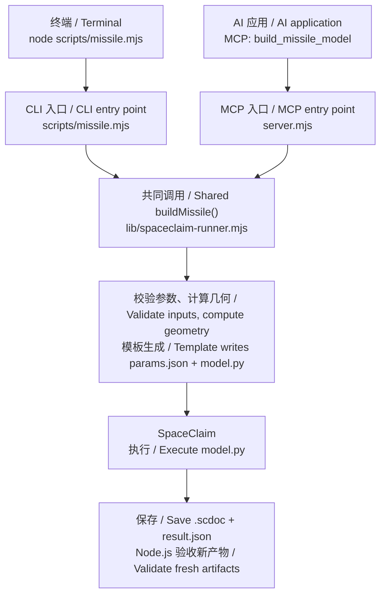

# ansys-scdmdoc-mcp

[中文完整说明](README.md) · [Full English guide](README.en.md)

本项目是 Windows 本地 stdio MCP 服务：检索用户已安装的官方 SpaceClaim/SCDM API CHM，并提供有限的 Python 候选模板和参数化建模入口。标准输出只承载 JSON-RPC。

This Windows-local stdio MCP server searches the official SpaceClaim/SCDM API CHM already installed on the user's computer. It also provides a limited set of Python candidate templates and a parameterized model workflow. Server stdout is reserved for JSON-RPC.

## 修改输入、输出和参数 / Editing inputs, outputs, and parameters

自有源码在必要的 shebang、模块说明和 import 后列出输入/输出与可调默认参数。入口集中修改区为 `server.mjs` 的 `MCP_DEFAULTS`、`scripts/missile.mjs` 的 `DEFAULT_OPTIONS`、`scripts/setup.mjs` 的回环地址/端口/关闭延迟，以及 `scripts/verify-geometry.mjs` 的输出目录默认值、超时和文件名。转发和检查入口说明实际配置来源；固定验收用例的几何数值和断言不作为生产参数修改。

Project-owned source files list inputs, outputs, and adjustable defaults after required shebangs, module documentation, and imports. Entry-point settings are grouped in `MCP_DEFAULTS` in `server.mjs`, `DEFAULT_OPTIONS` in `scripts/missile.mjs`, loopback host/port/close delay in `scripts/setup.mjs`, and output-directory default/timeout/filenames in `scripts/verify-geometry.mjs`. Forwarding and check entrypoints explain their configuration sources. Fixed acceptance geometry and assertions are not production parameters.

几何参数仍统一在 `lib/missile-schema.mjs`；输入文件用 CLI `--preset`，输出覆盖用 `--out`/`--name` 或 MCP `outputDir`/`fileName`。优先级仍为显式参数 > 预设 > schema 默认值。空目录保留执行器和 `workspace.json` 的运行时解析；不把某次 run 的编号、目录或失败留存路径写成源码绝对路径。安装继续通过 AWP 或受支持的本机配置发现。入口与产物详见 [scripts/README.md](scripts/README.md)。

Model parameters remain in `lib/missile-schema.mjs`; choose input files with CLI `--preset` and override outputs with `--out`/`--name` or MCP `outputDir`/`fileName`. Precedence remains explicit fields > preset > schema defaults. Empty directories defer to the runner and `workspace.json` at runtime; do not hard-code one run's IDs, resolved directories, or failed-artifact paths. Installations still come from AWP or supported local setup. See [scripts/README.md](scripts/README.md) for entrypoints and artifacts.

## 功能与边界 / Capabilities and limits

| 工具 / Tool | 输入与功能 / Inputs and behavior |
| --- | --- |
| `search_api` | `query`；`kind=all`（`all/class/method/property/event`）；`limit=25`，最大 / max 100。搜索官方索引。 / Search the official index. |
| `get_doc` | `docPath`；`maxChars=50000`，最大 / max 100000。读取搜索结果中的相对 HTML 路径。 / Read a relative HTML path from search results. |
| `find_python_command` | `intent`；`parameters={}`；`limit=5`，最大 / max 20。返回关联文档和 `inferred` 候选。 / Return related documentation and an inferred candidate. |
| `get_geometry_recipe` | `task`；`parameters={}`。拉伸任务返回“矩形轮廓 → 拉伸”两步，其余任务返回一步。 / Extrusion tasks receive rectangle-profile and extrusion steps; other tasks receive one step. |
| `validate_missile_params` | 可选模型字段；返回有效参数、来源、错误、警告、修正和优化参数池，不执行建模。 / Optional model fields; return effective values, sources, errors, warnings, corrections, and optimization fields without building. |
| `generate_model_script` | 模型字段，以及 `outputDir`、`fileName`。生成请求和 IronPython 脚本，不启动 SpaceClaim。 / Model fields plus output controls; generate the request and script without launching SpaceClaim. |
| `build_missile_model` | 同上，另有 / same plus `timeoutMs=300000`（最大 / max 1800000）、`execute=true`。运行并验收；`execute:false` 仅生成。 / Execute and grade fresh artifacts, or generate only. |

`parameters` 的值限于字符串、数字和布尔值。意图模板覆盖圆周阵列、圆柱、拉伸、矩形、布尔差、球和平面；多数模板是注释提示，圆周阵列候选也需要调用方提供基体和上下文。未匹配的意图返回检索结果和提示。它们不支持通用自然语言建模或从图片重建几何；固定 `V261` 提示不证明兼容性。

`parameters` values may be strings, numbers, or booleans. Intent templates cover circular patterns, cylinders, extrusion, rectangles, subtraction, spheres, and planes. Most are comment-level guidance; circular-pattern candidates also need a seed and surrounding context. Unmatched intents receive search results and guidance. This is not a general natural-language or image-to-geometry engine; fixed `V261` text is not compatibility evidence.

## 安装与配置 / Installation and setup

要求 Windows、Node.js 18+。MCP 启动时解析并缓存官方 CHM，因此所有 MCP 工具均依赖有效 CHM，包括参数校验和脚本生成。独立 CLI 的 `--generate-only` 可以在未安装 ANSYS 的机器上运行。

Windows and Node.js 18+ are required. The MCP server resolves and caches the official CHM at startup, so every MCP tool requires a usable CHM, including validation and script generation. Standalone CLI `--generate-only` works without ANSYS installed.

```powershell
npm ci
npm run setup
node server.mjs
```

`npm run setup` 打开回环地址配置页，列出所有非空 `AWP_ROOT<number>`，也允许手动输入 `SpaceClaim.exe` 路径以查找对应 CHM。AWP 确认失败时必须显示下列原文，并仅保留手动输入恢复路径：

`npm run setup` opens a loopback page listing every nonempty `AWP_ROOT<number>`, or accepts a manual `SpaceClaim.exe` path to discover its CHM. Failed AWP confirmation displays exactly this message and leaves manual entry as the recovery path:

```text
无法根据 AWP 确定环境变量的路径，无法确定 SpaceClaim 的路径
```

配置位于 `%LOCALAPPDATA%\ansys-scdmdoc-mcp\config.json`。CHM 解析顺序：`SCDM_CHM`、已保存配置、按版本降序的 `AWP_ROOT<number>`、通用 `AWP_ROOT`（可配合 `SCDM_API_VERSION`，并探测已安装 API 目录）。`hh.exe` 将文档解包到用户缓存，通常为 `%LOCALAPPDATA%\ansys-scdmdoc-mcp\cache`；配置和缓存根目录在缺少 `LOCALAPPDATA` 时依次回退到 `TEMP` 和当前目录，应确保它们位于仓库外。

Configuration lives at `%LOCALAPPDATA%\ansys-scdmdoc-mcp\config.json`. CHM resolution tries `SCDM_CHM`, saved setup, versioned AWP roots in descending order, then generic `AWP_ROOT` with optional `SCDM_API_VERSION` and installed API-directory detection. Windows `hh.exe` extracts documentation to the user cache, normally `%LOCALAPPDATA%\ansys-scdmdoc-mcp\cache`. Configuration and cache roots fall back to `TEMP`, then the current directory when `LOCALAPPDATA` is absent; keep them outside the repository.

执行程序依次从 `SCDM_EXECUTABLE`、手动配置、版本化 AWP 和通用 AWP 查找。脚本 API 版本由安装目录、所选 CHM 或安装中的 API 目录自动探测；当前 `scdm_api_version` 输入不覆盖该结果。

Executable discovery tries `SCDM_EXECUTABLE`, saved manual setup, versioned AWP roots, then generic AWP. Script API versions are detected from the executable layout, selected CHM, or installed API directories; the current `scdm_api_version` input does not override detection.

## 参数模型 / Parameterized model

### CLI 与 MCP 的共同建模流程 / Shared CLI and MCP workflow

[CLI 入口](scripts/missile.mjs) 和 [MCP 工具](server.mjs) 最终调用同一个 [buildMissile()](lib/spaceclaim-runner.mjs)。CLI 按已有参数化代码执行，无需 AI：校验参数、计算几何，再使用现有[脚本模板](lib/missile-template.mjs)生成 `params.json` 和 `model.py`，并非每次运行都由大模型编写一份新建模脚本。

The [CLI](scripts/missile.mjs) and [MCP tool](server.mjs) call the same [buildMissile()](lib/spaceclaim-runner.mjs). The CLI follows the existing parameterized code without AI: it validates inputs, computes geometry, and generates `params.json` and `model.py` from the existing [script template](lib/missile-template.mjs). A language model does not write a new modeling script on each run.



AI 应用可理解自然语言、选择[参数](lib/missile-schema.mjs)及 MCP 工具；普通 MCP 客户端也能在不使用 AI 的情况下调用同一工具。两条入口均受当前已实现参数化几何的限制，新几何类型需要扩展代码。图中是默认 `execute:true` 的执行流程；CLI `--generate-only` 或 MCP `execute:false` 在生成文件后停止，不启动 SpaceClaim、不生成已建好的模型，也不构成运行验证。

An AI application can interpret natural language, choose [parameters](lib/missile-schema.mjs), and select MCP tools; ordinary MCP clients can invoke the same tool without AI. Both paths cover only implemented parametric geometry; a new geometry type requires code changes. The diagram shows default `execute:true` execution. CLI `--generate-only` or MCP `execute:false` stops after file generation, without launching SpaceClaim, building a model, or establishing runtime verification.

字段与默认值以 [missile-schema.mjs](lib/missile-schema.mjs) 为准，完整说明见 [中文指南](README.md) 和 [English guide](README.en.md)。主要默认值如下；长度单位为米。

[missile-schema.mjs](lib/missile-schema.mjs) defines fields and defaults. See the full [Chinese](README.md) and [English](README.en.md) guides for details. Main defaults below use meters for lengths.

| 类别 / Category | 默认值 / Defaults |
| --- | --- |
| 主体 / Body | `L_N=0.49`, `L=3.69`, `D=0.18` |
| 前舵 / Front fins | `L_W=1.72`, `C_RW=0.23`, `C_TW=0.06`, `B_W=0.23` |
| 后舵 / Rear fins | `L_F=3.2`, `C_RF=0.38`, `C_TF=0.19`, `B_F=0.22` |
| 翼型、倒圆 / Airfoil, fillets | `thickness_percent=4.48`, `le_radius_index=6`, `max_thickness_tenths=3`, `k_nose=0.005`, `k_tip=0.002`, `fillet_location=both` |
| 舵面约定 / Fin conventions | `fin_phase=+`, `root_overlap=0.005`, `le_mode=trailing_aligned`, `cruciform_count=4` |
| 外壳 / Enclosure | `enclosure_shape=cylinder`, `enclosure_radius=2.7`, `enclosure_front=3.69`, `enclosure_back=16.45`, `enclosure_name=Enclosure` |
| 加密区 / BOI | `boi_radius=0.45`, `boi_front=0.5`, `boi_back=2.5`, `boi_name=BOI` |
| 定位 / Placement | `model_placement=ensemble`, `model_offset=-4`; 默认弹尖站位 / default nose-tip station `x=1.38` |

工作区几何参数一共 14 个：11 个主尺寸，加上前后舵共用的翼型参数 `thickness_percent`、`le_radius_index`、`max_thickness_tenths`（定义与 `DATCOM/scripts/naca_section.py` 相同）。平面形状仍是梯形。横截面按当地弦长缩放为对称 NACA 四位数，并在根梢之间直线放样。本模块另用倒圆系数 `k_nose`、`k_tip`。

The workspace geometry set has 14 parameters: 11 lengths, plus the shared airfoil parameters `thickness_percent`, `le_radius_index`, and `max_thickness_tenths`, defined the same way as `DATCOM/scripts/naca_section.py`. The planform stays trapezoidal. The section is a symmetric NACA four-digit airfoil scaled by the local chord and ruled from root to tip. This module also uses fillet coefficients `k_nose` and `k_tip`.

优先级为显式字段 > JSON 预设 > 默认值。优化区间仅产生警告；梢弦 `[0, 0.001)` 自动抬至 `0.001 m`。仅实现 `le_mode=trailing_aligned` 和圆柱外壳；相位支持 `+`、`x`，每级舵面数须为不小于 2 的偶数。倒圆位置支持 `cone_cylinder`、`nose_tip`、`both`，定位支持 `ensemble`、`missile`、`offset`。

Precedence is explicit fields > JSON preset > defaults. Optimization ranges are advisory; tip chords in `[0, 0.001)` are corrected to `0.001 m`. Only `le_mode=trailing_aligned` and cylindrical enclosures are implemented. Phase supports `+` and `x`; fin counts must be even and at least 2. Fillet locations are `cone_cylinder`, `nose_tip`, and `both`; placement modes are `ensemble`, `missile`, and `offset`.

```powershell
node scripts/missile.mjs --list
node scripts/missile.mjs --generate-only
node scripts/missile.mjs --preset ..\data_lib\inputs\missile_params_example.json --generate-only
node scripts/missile.mjs --k_nose 0.006 --timeout 300000 --json
node scripts/missile.mjs --out ..\data_lib\runs --name custom.scdoc --generate-only
```

CLI 输出开关是 `--out`、`--name`，不是 schema 字段 `--output_dir`、`--file_name`。预设可为参数对象，或读取已生成 `params.json` 的 `params` 对象。MCP 使用 `outputDir`、`fileName`，默认文件名 `missile.scdoc`。

CLI output switches are `--out` and `--name`, not schema fields `--output_dir` and `--file_name`. Presets may be parameter objects or the `params` object from generated `params.json`. MCP uses `outputDir` and `fileName`, with default filename `missile.scdoc`.

执行后单一 `.scdoc` 包含合并后的 `Missile`、圆柱外壳和独立 `BOI`。舵面使用 `Pattern.CreateCircular` 与 `Combine.Merge`；外壳使用 `Enclosure.Create`，轴向沿 X，`Subtract=False`、`CreateShareTopology=False`，名称设在组件上；BOI 通过回转生成。流程不执行网格划分或 CFD 求解。

One `.scdoc` contains the merged `Missile`, cylindrical enclosure, and independent `BOI`. Fins use `Pattern.CreateCircular` and `Combine.Merge`; the enclosure uses `Enclosure.Create` aligned with X, with `Subtract=False` and `CreateShareTopology=False`, and is identified by its component name. BOI is revolved. The workflow does not mesh or solve CFD.

通常创建 `inlet`、`wall`、`outlet`、`missile_nose_tip`、`missile_nose`、`missile_body`、`missile_fin` 七组；无球面弹尖时省略 `missile_nose_tip`。脚本删除已确认为空的阵列组件，并对保留对象之外的结构对象调用物理抑制。验收检查调用报告，不能回读证明宿主的抑制状态。

Normally seven named selections are created: `inlet`, `wall`, `outlet`, `missile_nose_tip`, `missile_nose`, `missile_body`, and `missile_fin`. The tip group is omitted without a spherical tip cap. The script deletes verified-empty pattern components and requests physics suppression outside the keep set. Acceptance checks call reports; it cannot read back the host's suppression state.

## 运行与证据 / Runs and evidence

入口按脚本位置读取上一级 `workspace.json`。默认运行目录是 `../data_lib/runs/high/<run-id>/spaceclaim`，失败时尝试移至 `../feedback/spaceclaim/<run-id>`；文件系统或权限错误可能中断移动和清单收尾。`--out`、MCP `outputDir` 或 `SCDM_MISSILE_OUTPUT` 可指定输出父目录，其下仍新建唯一运行目录；失败留存目标仍为配置的反馈目录。

Entrypoints resolve the parent `workspace.json` relative to the scripts. Default runs live at `../data_lib/runs/high/<run-id>/spaceclaim`; failed runs attempt relocation to `../feedback/spaceclaim/<run-id>`. Filesystem or permission errors may interrupt relocation and manifest finalization. `--out`, MCP `outputDir`, or `SCDM_MISSILE_OUTPUT` selects an output parent with a unique run child; failed retention still targets the configured feedback directory.

每次写入 `request.json`、`run.json`；有效请求增加 `params.json`、`model.py`。执行增加模型、`result.json` 和可选诊断、`preview.png`、`preview-assembly.png`。清单记录状态、时间、检查、产物大小和 SHA-256。预览图是辅助产物，不是验收门槛。

Every run writes `request.json` and `run.json`; valid requests add `params.json` and `model.py`. Execution adds the model, `result.json`, and optional diagnostics and previews. The manifest records status, timestamps, checks, artifact sizes, and SHA-256 hashes. Previews are advisory, not acceptance gates.

| `run.json` 状态 / Status | 含义 / Meaning |
| --- | --- |
| `GENERATED` | 仅生成；`runtimeVerified=false`。 / Generation only; no runtime verification. |
| `PASSED` | 本次进程和新产物验收通过；`runtimeVerified=true`。 / The current process and fresh artifacts passed. |
| `FAILED` | 参数、执行或验收失败并完成收尾。 / Parameter, execution, or acceptance failure with finalization completed. |

CLI 和 `generate_model_script` 的生成结果为 `status=script-generated`；`build_missile_model` 将其显示为 `GENERATED`。执行结果使用 `PASS` / `FAIL`，与清单词汇不同。

CLI generation and `generate_model_script` return `status=script-generated`; `build_missile_model` presents it as `GENERATED`. Executed model results use `PASS` / `FAIL`, distinct from manifest statuses.

`official-doc` 表示 CHM 文档事实，`inferred` 表示推导候选，`runtime-verified` 只用于目标安装实际执行且新产物验收通过。历史记录不是本次验收；退出码 0、HTTP 成功、缓存或文件存在均不足以单独证明正确。

`official-doc` denotes CHM facts; `inferred` denotes candidates; `runtime-verified` requires execution and fresh accepted artifacts in the target installation. Historical records are not current acceptance. Exit code 0, HTTP success, a cache, or file existence alone does not prove correctness.

参数模型验收覆盖新产物、单一主体、尺寸、回转体体积与面积、质心、舵面站位、区域位置、命名选择覆盖和结构清理，项数随参数与报告变化。独立圆周夹具必须执行以下流程，另检查新模型与 PASS 结果新鲜且非空、合并拓扑面数非零：

Model acceptance covers fresh artifacts, one merged main body, dimensions, revolved volume and areas, center of mass, fin stations, region placement, named-selection coverage, and cleanup. Counts vary with parameters and reports. The separate circular fixture must follow this workflow and check fresh nonempty model and PASS results plus nonzero merged face topology:

```text
0° seed → Pattern.CreateCircular(CircularPatternData, count=6, angle=360°)
→ 0/60/120/180/240/300°, step=60°, coverage=360°
→ Combine.Merge → 1 merged body, merged_face_count > 0
```

## 开发与目录 / Development and directories

```powershell
npm ci
npm test
npm run smoke
npm run verify:real
npm run verify:geometry
```

测试不执行 SpaceClaim；存在 CHM/AWP 环境变量时，协议用例会自动连接真实 CHM 并验证仅生成模式。`SCDM_RUN_REAL_CHM_TEST=1` 另可启用真实 CHM 解包测试。`verify:real` 仅检查文档和索引；`verify:geometry` 执行圆周夹具。`smoke` 启动实际 MCP 服务检查工具和 CHM，但其预检查要求存在 `SCDM_CHM`、非空版本化 AWP 或通用 `AWP_ROOT`；仅有 setup 配置不能通过该项预检查。

Tests do not launch SpaceClaim. With CHM/AWP environment variables present, the protocol case automatically connects to a real CHM and checks generation-only behavior. `SCDM_RUN_REAL_CHM_TEST=1` separately enables real CHM extraction testing. `verify:real` checks documentation and indexing only; `verify:geometry` executes the circular fixture. `smoke` starts the actual MCP service and checks tools and CHM, but its precheck requires `SCDM_CHM`, a nonempty versioned AWP root, or generic `AWP_ROOT`; saved setup alone does not satisfy it.

| 根目录子目录 / Direct child | 用途 / Purpose |
| --- | --- |
| [`.github/`](.github/README.md) | GitHub 工作流与协作配置。 / GitHub workflows and collaboration configuration. |
| `.vscode/` | 本机编辑器配置，不纳入版本控制。 / Local editor configuration, not version-controlled. |
| [`docs/`](docs/README.md) | 文档、资源和历史设计记录。 / Documentation, assets, and historical design records. |
| [`lib/`](lib/README.md) | CHM、配置、参数、几何与运行记录实现。 / CHM, setup, parameters, geometry, and run records. |
| `node_modules/` | 安装生成的依赖，不纳入版本控制，不手动编辑。 / Installed dependencies; not version-controlled, do not edit by hand. |
| [`scripts/`](scripts/README.md) | 配置、CLI、smoke 与真实验收入口。 / Setup, CLI, smoke, and real acceptance entrypoints. |
| [`tests/`](tests/README.md) | 自动测试和夹具。 / Automated tests and fixtures. |

每次代码修改必须同步修改对应 README，使功能、接口、默认值、运行方式、目录说明及所有语言版本保持一致。具体要求见 [AGENTS.md](AGENTS.md)。

Every code change must update its corresponding README so behavior, interfaces, defaults, execution instructions, directory descriptions, and all language editions stay consistent. See [AGENTS.md](AGENTS.md).

官方 CHM、解包内容、缓存、本机配置、模型和日志不进入版本库。项目使用 [MIT License](LICENSE)，不代表 ANSYS 官方；发布、推送和外部 GitHub 修改须取得当次明确授权。

Keep official CHM files, extracted content, caches, local configuration, models, and logs out of version control. The project uses the [MIT License](LICENSE) and is not official ANSYS software. Publishing, pushing, or changing external GitHub state requires explicit authorization in the current turn.
