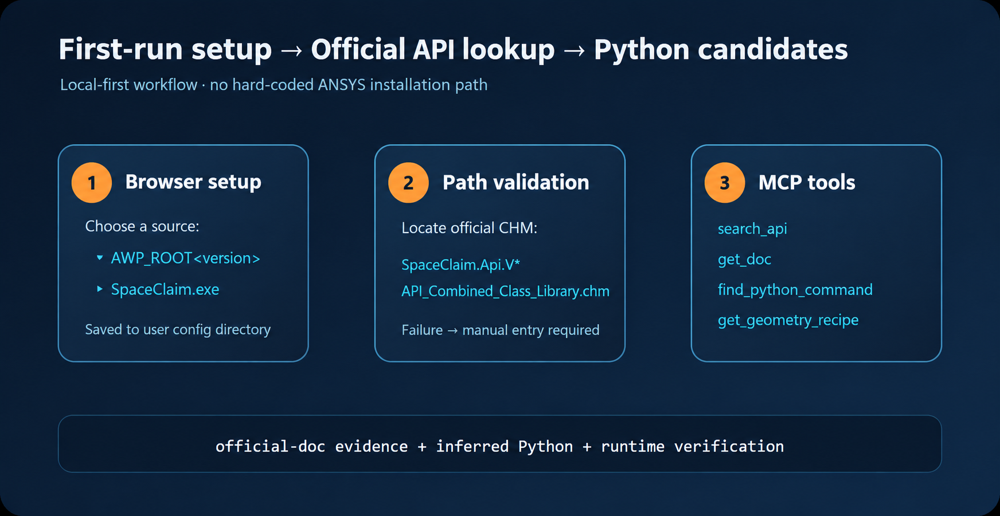

# ansys-scdmdoc-mcp

[中文](README.md) | **English**


Use MCP to find SpaceClaim Python modeling commands faster.

## What problem does this solve?

In SpaceClaim, knowing the feature name is often not enough to write Python directly:

- You may not know which command implements named geometry, shared topology, or a circular pattern.
- You may not know how to discover usable scripts beyond opening the script recorder.
- The official help is provided as a CHM file containing a large collection of HTML pages.
- API documentation is usually expressed as C#/.NET signatures, making types, namespaces, parameters, and return values difficult to interpret.
- Even after finding a method, it can be difficult to tell whether it can be combined into a runnable SCDM Python script.

This project turns CHM documentation lookup into a natural-language workflow while keeping the evidence boundary explicit.

## Our approach: an MCP assistant for the SpaceClaim API

MCP (Model Context Protocol) is a standard protocol that lets AI applications call external tools and data sources. This project connects MCP to the official API CHM installed with ANSYS SpaceClaim/SCDM on the user’s computer.

An AI can use MCP to:

1. Search the official SpaceClaim API documentation;
2. Read the relevant class, method, or property documentation;
3. Organize related APIs around a modeling intent;
4. Return an SCDM Python candidate with an explicit evidence boundary;
5. Generate ordered geometry-modeling steps when needed.



## Two main usage patterns

### 1. Ask MCP which command implements a feature

When you know the desired outcome but not the SpaceClaim command, describe the goal directly:

```text
How do I create a named selection for geometry in SpaceClaim?
```

```text
How do I create shared topology in SpaceClaim? Please provide the relevant API and a Python candidate.
```

```text
Create a 0-degree solid, make six instances at 60-degree intervals with a circular pattern, and merge them. Which commands should I use?
```

MCP first searches the relevant APIs in the official CHM, such as:

```text
Pattern.CreateCircular
CircularPatternData
Combine.Merge
```

It then returns the command meaning, official documentation page, parameter information, and a Python candidate for further verification.

This pattern is useful for finding feature APIs, understanding required inputs, comparing modeling approaches, and organizing several APIs into modeling steps.

### 2. Provide complete modeling inputs

For a defined modeling task, provide input parameters, geometric constraints, reference images, and target results so the AI can generate a reproduction script.

Recommended inputs include:

- Geometry dimensions and units;
- Datum information such as points, lines, faces, axes, and coordinate systems;
- Pattern count, angle, spacing, and rotation direction;
- The order of extrusions, chamfers, fillets, Boolean operations, and other operations;
- Requirements for named selections, shared topology, or assembly relationships;
- Input images, sketches, screenshots, or target-geometry diagrams;
- Acceptance criteria such as body count, angles, dimensions, and output files.

This pattern is useful for reproducing geometry from images or existing designs, generating parametric scripts, breaking complex tasks into verifiable stages, and completing or debugging existing SpaceClaim scripts.

## Tools provided by this MCP

| Tool | Purpose |
| --- | --- |
| `search_api` | Search classes, methods, properties, events, and geometry keywords in the official CHM |
| `get_doc` | Read the official API page for one search result |
| `find_python_command` | Return Python candidates associated with a natural-language modeling intent |
| `get_geometry_recipe` | Organize a geometry task into ordered modeling steps |

Example intent:

```text
Circular pattern: 6 instances at 60-degree intervals, then merge
```

Typical API candidates:

```python
Pattern.CreateCircular(...)
Combine.Merge(...)
```

## Installation and first-run setup

Requirements: Windows, Node.js 18+, and ANSYS SpaceClaim/SCDM installed locally.

```powershell
git clone <your-github-repository-url>
cd ansys-scdmdoc-mcp
npm ci
npm run setup
node server.mjs
```

The first `npm run setup` opens a local browser configuration page with two choices:

1. Detect an installation through `AWP_ROOT<number>`;
2. Enter the `SpaceClaim.exe` application path manually.

In automatic-detection mode, the program scans all versioned AWP_ROOT environment variables and lets the user choose one. It then validates the official CHM for that version. If validation fails, it shows:

```text
无法根据 AWP 确定环境变量的路径，无法确定 SpaceClaim 的路径
Unable to determine the environment-variable path from AWP; unable to determine the SpaceClaim path.
```

Configuration is stored at:

```text
%LOCALAPPDATA%\ansys-scdmdoc-mcp\config.json
```

The program does not write a user’s ANSYS installation path into source code or the README. Manual mode stores the application path, and the CHM is discovered from the corresponding SCDM installation directory.

## Path resolution and documentation source

Path resolution uses this priority order:

1. Explicit `SCDM_CHM`;
2. The saved AWP or SpaceClaim path from first-run setup;
3. The highest-version available `AWP_ROOT<number>`;
4. Generic `AWP_ROOT` plus `SCDM_API_VERSION`.

On the first CHM read, the program uses Windows `hh.exe` to unpack the help content into the user cache and build a search index:

```text
%LOCALAPPDATA%\ansys-scdmdoc-mcp\cache
```

The project queries only the official CHM on the user’s computer; it does not distribute or store ANSYS proprietary documentation in the repository.

## How to interpret results

This project distinguishes three evidence levels:

- `official-doc`: a page, type, method, or property from the official SpaceClaim CHM;
- `inferred`: a Python candidate inferred from an official API signature and modeling intent;
- `runtime-verified`: executed in the target SpaceClaim/SCDM installation and checked against model results.

The CHM commonly contains C#/.NET signatures. That proves the API documentation exists, but does not by itself prove that an IronPython snippet runs successfully. Python returned by MCP must still be executed and verified in the target SCDM version.

## Real geometry acceptance example

The project provides a real SpaceClaim acceptance script: [spaceclaim-circular-repeat-smoke.py](scripts/spaceclaim-circular-repeat-smoke.py). It validates the complete circular-pattern and merge workflow:

```text
Create a 0-degree seed
    ↓
Pattern.CreateCircular
    ↓
CircularPatternData: 6 instances, 360-degree total angle
    ↓
Check 0/60/120/180/240/300 degrees
    ↓
Combine.Merge
    ↓
One final merged body
```

Acceptance must verify all of the following:

- Six patterned bodies;
- 60-degree spacing;
- Full 360-degree coverage;
- Successful `Combine.Merge`;
- One merged body;
- A fresh model file and a fresh result file with `status=PASS`.

Successful MCP queries, a populated cache, or a SpaceClaim process exit code of 0 cannot replace real geometry acceptance on their own.

## Development and testing

```powershell
npm ci
npm test
npm run smoke
```

To verify the real CHM locally:

```powershell
$env:SCDM_RUN_REAL_CHM_TEST = "1"
npm test
```

Real SpaceClaim geometry acceptance requires a valid ANSYS SpaceClaim/SCDM installation on the target computer. Save its output files in a temporary directory outside the repository.

## Release and copyright boundaries

Before publishing to GitHub, confirm that none of the following are committed:

- ANSYS or SpaceClaim CHM files;
- Extracted CHM HTML, HHK, or HHC files;
- Local user caches and indexes;
- SpaceClaim models and runtime logs;
- User configuration, credentials, and machine-specific installation paths.

This project publishes only the MCP implementation, tests, and documentation; it does not publish ANSYS proprietary documentation. ANSYS, SpaceClaim, SCDM, and related product names belong to their respective owners. This project is not official ANSYS software and does not claim authorization, affiliation, or endorsement by ANSYS.

The project code is released under the MIT License; see [LICENSE](LICENSE).
