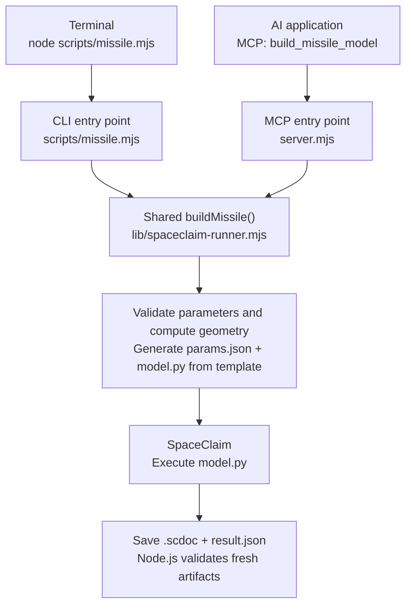

# ansys-scdmdoc-mcp

[中文](README.md) | **English** | [中英对照 / Bilingual](README.bilingual.md)


A Windows-local MCP server for searching the official SpaceClaim/SCDM API CHM, returning evidence-labelled Python candidates, and generating or running a defined parametric model.

The server provides seven tools over stdio. It searches the user's installed official CHM only; it does not load a local Python knowledge base. Documentation lookup, script generation, and fresh geometry acceptance are separate capabilities.

## Editing inputs, outputs, and parameters

Project-owned source files list inputs, outputs, and adjustable defaults after required shebangs, module documentation, and imports, before processing logic. Entry-point configuration is grouped in `server.mjs` (`MCP_DEFAULTS`), `scripts/missile.mjs` (`DEFAULT_OPTIONS`), `scripts/setup.mjs` (loopback host, port, and close delay), and `scripts/verify-geometry.mjs` (output-directory default, timeout, and filenames). Forwarding and check entrypoints explain the actual configuration source at the top. Fixed acceptance geometry and assertions remain test fixtures, not production parameters.

Model parameters remain defined in `lib/missile-schema.mjs`. Select input files with CLI `--preset` and override outputs with `--out`/`--name` or MCP `outputDir`/`fileName`. Precedence remains explicit fields > preset > schema defaults. Empty output-directory defaults still defer to runtime resolution through the runner and `workspace.json`; do not replace run IDs, resolved run directories, or failed-artifact retention paths with one run's absolute paths. Installation discovery still uses AWP or supported local setup. See [scripts/README.md](scripts/README.md) for entrypoints and artifacts.

## Current capabilities and limits

- Search API classes, methods, properties, events, and geometry terms, then read the matching HTML page.
- Match modeling intents to a small set of Python templates: circular pattern, cylinder, extrusion, rectangle, Boolean subtraction, sphere, and plane. Most templates are guidance comments; the circular-pattern candidate assumes an existing `seed_body`. Candidates require version-specific execution and verification.
- Return a two-step rectangle/extrusion recipe for extrusion tasks; other tasks currently return one candidate step. This is not a general geometry planner.
- Validate shared model parameters, generate `params.json` and an IronPython `model.py`, or run SpaceClaim headlessly and grade fresh artifacts.
- Build a cone/cylinder body with optional nose-tip and shoulder rounding, two patterned fin stages, a cylindrical enclosure, a cylindrical body of influence (BOI), and face named selections in one `.scdoc`.

There is no arbitrary image-to-CAD reconstruction or general shared-topology operation. API search can find relevant documentation, but that does not add an implemented modeling feature. The model enclosure uses `Subtract=False` and `CreateShareTopology=False`: it remains a full solid rather than a subtracted fluid volume. Meshing and solver execution are outside this repository.

## Installation and first-run setup

Requirements: Windows, Node.js 18+, and a locally installed official SpaceClaim/SCDM CHM. Actual model execution also needs a usable SpaceClaim installation.

Run from this repository:

```powershell
npm ci
npm run setup
node server.mjs
```

`npm run setup` opens a loopback browser page with two modes:

1. AWP mode lists every non-empty `AWP_ROOT<number>` variable and lets the user select one. Confirmation validates the official CHM associated with that variable.
2. Manual mode accepts a `SpaceClaim.exe` path and finds an available API CHM beside that installation.

If AWP validation fails, the UI shows exactly the following message and leaves manual entry as the recovery path:

```text
无法根据 AWP 确定环境变量的路径，无法确定 SpaceClaim 的路径
```

Local configuration is stored under `%LOCALAPPDATA%\ansys-scdmdoc-mcp\config.json`. Do not commit it or copy installation paths into project files. MCP client registration is external to this repository; use `node` with this checkout's `server.mjs` as the stdio command. Server stdout is reserved for JSON-RPC.


### Documentation and executable resolution

CHM candidates are checked in this order, taking the first accessible file:

1. `SCDM_CHM`;
2. The saved setup selection, re-resolved against the local installation;
3. Versioned `AWP_ROOT<number>` variables, highest version first;
4. Generic `AWP_ROOT`, trying `SCDM_API_VERSION` first when supplied, then discovered API versions in descending order.

The server resolves and extracts the CHM **before registering any tools**. Consequently, even analytical validation needs a configured CHM when accessed through MCP. The standalone CLI's `--list` and `--generate-only` modes can work without ANSYS.

Windows `hh.exe` normally extracts the CHM into `%LOCALAPPDATA%\ansys-scdmdoc-mcp\cache`, where the search index is also cached. Configuration and cache locations choose their base in order: `LOCALAPPDATA`, `TEMP`, then `.` (the process working directory). Ensure the selected base is outside the checkout before setup or startup. Repository policy prohibits storing extracted official documentation or local configuration here, but the current path helpers do not enforce that boundary when environment variables are missing or point inside the checkout. Official documentation is not distributed with this project.

SpaceClaim execution has its own lookup order: `SCDM_EXECUTABLE`, a saved manual executable, versioned AWP roots in descending order, then generic `AWP_ROOT`. A saved AWP selection determines the CHM selection; it does not override executable lookup. Keep documentation and executable versions consistent when configuring multiple installations.

The generated script version is inferred from the executable's installation layout, then the resolved CHM, then available API folders. Without an installation, generation may produce a script without a version header; generating that file does not establish compatibility.

## MCP tools and inputs

All properties below are optional unless marked **required**. `parameters` values may be strings, numbers, or booleans.

| Tool | Input schema and behavior |
| --- | --- |
| `search_api` | **`query: string`** (non-empty); `kind: "all" \| "class" \| "method" \| "property" \| "event"` (default `"all"`); `limit: integer 1–100` (default `25`). Returns ranked CHM records. |
| `get_doc` | **`docPath: string`** (non-empty, relative to the extracted help root); `maxChars: integer 1–100000` (default `50000`). Reads page metadata, syntax, and text, truncating text when necessary; rejects paths escaping the help root. |
| `find_python_command` | **`intent: string`** (non-empty); `parameters: object`; `limit: integer 1–20` (default `5`). Returns an `inferred` template with matching API pages and a confidence indicator. |
| `get_geometry_recipe` | **`task: string`** (non-empty); `parameters: object`. Returns the limited recipe steps described above; candidates remain inferred. |
| `validate_missile_params` | Shared model inputs below. Returns `ok`, errors, warnings, corrections, effective parameters and their sources, and the optimization field pool. Performs analytical validation without building a model. |
| `generate_model_script` | Shared model inputs plus `outputDir: string` and `fileName: string` (default `"missile.scdoc"`). Writes run records, parameters, and the script without launching SpaceClaim; successful status is `"script-generated"`. Returns script text and artifact paths. |
| `build_missile_model` | Shared model inputs plus `outputDir: string`, `fileName: string` (default `"missile.scdoc"`), `timeoutMs: integer 1–1800000` (default `300000`), and `execute: boolean` (default `true`). Runs and grades the model, or reports `"GENERATED"` when `execute:false`; executed results use `"PASS"` / `"FAIL"`. |

For the three model tools, dimensional/coefficient inputs use JSON numbers, `cruciform_count` uses an integer, and convention/name/version fields use strings. All shared inputs default to [lib/missile-schema.mjs](lib/missile-schema.mjs); allowed combinations are checked analytically after schema parsing. `output_dir` and `file_name` are not MCP input properties: use `outputDir` and `fileName`. The filename must be a leaf filename; choose its directory separately.

Example requests:

```json
{"query":"Pattern.CreateCircular","kind":"method","limit":5}
```

```json
{"intent":"circular pattern","parameters":{"count":6,"angle":360}}
```

```json
{"execute":false,"k_nose":0.006,"fileName":"candidate.scdoc"}
```

The third request is for `build_missile_model`: it generates files only. A returned `modelPath` is an intended output path, not evidence that a model exists.

## Parametric model contract

### How the CLI and MCP build the same model

The [CLI](scripts/missile.mjs) and [MCP tool](server.mjs) both call `buildMissile()` in [lib/spaceclaim-runner.mjs](lib/spaceclaim-runner.mjs). The CLI follows the existing parameterized code without AI: it validates inputs, computes geometry, and writes `params.json` and `model.py` using the existing [script template](lib/missile-template.mjs). A language model does not write a new modeling script on each run.



An AI application can interpret natural-language requests, choose [parameters](lib/missile-schema.mjs), and select MCP tools. Ordinary MCP clients can invoke the same tool without AI. Both paths cover the currently implemented parametric geometry; adding a new geometry type requires extending the code.

The diagram shows normal execution, which defaults to `execute:true`. CLI `--generate-only` or MCP `execute:false` stops after file generation: SpaceClaim is not launched, no model is built, and geometry is not runtime-verified.

All lengths are in metres. The model axis is X; the nose points toward −X. `L_W` and `L_F` measure from the nose tip to the visible fin leading edge at the body surface. Root chords are defined at that surface, spans extend outward from it, and `root_overlap` extends fins inward to support merging.

| Geometry input | Default | Meaning |
| --- | --- | --- |
| `L_N` | `0.49` | Nose-cone length |
| `L` | `3.69` | Overall body length |
| `D` | `0.18` | Maximum body diameter |
| `L_W` | `1.72` | Front-stage leading-edge station |
| `C_RW` | `0.23` | Front root chord |
| `C_TW` | `0.06` | Front tip chord |
| `B_W` | `0.23` | Front span |
| `L_F` | `3.2` | Rear-stage leading-edge station |
| `C_RF` | `0.38` | Rear root chord |
| `C_TF` | `0.19` | Rear tip chord |
| `B_F` | `0.22` | Rear span |
| `thickness_percent` | `4.48` | Maximum fin thickness, percent of local chord; shared by both stages |
| `le_radius_index` | `6` | Leading-edge radius index. `0` is sharp, `6` is the standard round nose |
| `max_thickness_tenths` | `3` | Chordwise station of maximum thickness, in tenths of chord |
| `k_nose` | `0.005` | Shoulder-round radius coefficient, `r_f = L × k_nose` |
| `k_tip` | `0.002` | Tangent spherical nose-tip radius coefficient, `r_t = L × k_tip` |

The workspace geometry set has 14 parameters: the 11 lengths above, plus three shared NACA fin-section parameters, `thickness_percent`, `le_radius_index`, and `max_thickness_tenths`. Their allowed values match `DATCOM/scripts/naca_section.py`: thickness is greater than 0 and less than 40 and is rounded to 0.01; the leading-edge index is an integer from 0 to 9 and scales the standard nose radius by `(index/6)²`; the thickness station is 2, 3, 4, 5, or 6. The planform stays the trapezoid fixed by root chord, tip chord, span, and trailing-edge alignment. This module also uses the nose fillets `k_nose` and `k_tip`.

`fin_section` selects the cross-section and defaults to `naca`. `naca` is the symmetric four-digit section, scaled by the local chord and ruled from the buried root to the tip; `le_radius_index` and `max_thickness_tenths` apply only then. `hexagon` is a symmetric hexagon with a sharp leading edge and a sharp trailing edge. Maximum thickness is still `thickness_percent`. The upper and lower surfaces stay parallel to the chord from `hex_flat_start` to `hex_flat_end`, 20% to 80% of the local chord by default. The hexagonal section ignores the leading-edge index and the thickness station. Lofting, the circular pattern, and the merge are the same as for NACA.

| Convention input | Default | Supported behavior |
| --- | --- | --- |
| `fin_phase` | `"+"` | `"+"` or `"x"`; `"x"` adds a 45° rotation |
| `root_overlap` | `0.005` | Positive inward overlap, smaller than either fin span |
| `le_mode` | `"trailing_aligned"` | Only trailing-edge alignment is accepted; `leading_aligned` and `symmetric` are rejected |
| `fin_section` | `"naca"` | `"naca"` or `"hexagon"` |
| `hex_flat_start` | `0.2` | Chord fraction where the hexagonal flat begins; used only by `hexagon` |
| `hex_flat_end` | `0.8` | Chord fraction where the hexagonal flat ends; requires `0 < hex_flat_start < hex_flat_end < 1` |
| `fillet_location` | `"both"` | `"cone_cylinder"`, `"nose_tip"`, or `"both"`; a zero coefficient disables that rounding |
| `cruciform_count` | `4` | An even integer ≥ 2, per stage; real circular pattern over 360° |
| `scdm_api_version` | `""` | Accepted compatibility field; currently does not override the version inferred by the runner |

| Region input | Default | Meaning |
| --- | --- | --- |
| `enclosure_shape` | `"cylinder"` | Only cylindrical enclosures are accepted |
| `enclosure_radius` | `2.7` | Fixed enclosure radius |
| `enclosure_front` | `3.69` | Fixed enclosure front extent before the unshifted nose datum |
| `enclosure_back` | `16.45` | Fixed enclosure back extent after the unshifted tail datum |
| `boi_radius` | `0.45` | Cylindrical BOI radius |
| `boi_front` | `0.5` | BOI extension before the placed nose |
| `boi_back` | `2.5` | BOI extension after the placed tail |
| `model_placement` | `"ensemble"` | Center missile+BOI (`"ensemble"`), center the missile (`"missile"`), or use only an offset (`"offset"`) |
| `model_offset` | `-4.0` | Added axial translation in every placement mode; negative moves toward the nose |
| `enclosure_name` | `"Enclosure"` | Enclosure component name |
| `boi_name` | `"BOI"` | BOI body name |

The enclosure stays at `[-enclosure_front, L + enclosure_back]`; the missile and BOI move together. Centering is computed first, then `model_offset` is added. Thus the default `-4.0` deliberately moves the pair forward from its centered position; use `model_offset:0` for exact centering under the selected rule.

Explicit values override preset values, which override defaults. The CLI accepts a bare parameter JSON object or the `params` object of a generated `params.json`. Validation rejects impossible body/fin placements, unsupported conventions, invalid rounding, and regions that fail containment. Non-negative tip chords below `0.001` m are raised to that minimum and recorded as corrections. Optimization ranges are advisory warnings, not validation limits; use `--list` to inspect current defaults and ranges.

### CLI examples

Run from this repository; sibling data paths are relative to that location:

```powershell
# List parameters and optimization ranges; no ANSYS needed
npm run missile -- --list

# Generate only; no SpaceClaim launch
npm run missile -- --generate-only --k_nose 0.006 --json
npm run missile -- --fin_section hexagon --timeout 300000 --json

# Load an existing workspace input file and execute SpaceClaim
npm run missile -- --preset ..\data_lib\inputs\model-params.json --name model.scdoc --json

# Choose a workspace data output base and execution timeout
npm run missile -- --out ..\data_lib\runs --timeout 300000 --name model.scdoc
```

`--preset` requires an existing input file. Use `--out` / `--name` for outputs; although the schema lists `output_dir` and `file_name`, they are not accepted as model switches. Other options are `--generate-only`, `--timeout`, `--json`, `--list`, and `--help`. The standalone CLI reports generated-only success as `script-generated`.

### Model artifacts and acceptance

The executed workflow revolves the body profile, extrudes two independent seed fins, uses `Pattern.CreateCircular` for both stages, then merges them with `Combine.Merge` into the single `Missile` body. It creates the enclosure with the official `Enclosure.Create` command in its own component and revolves the BOI separately. One document contains three final bodies: missile, enclosure, and BOI.

Face named selections are `missile_nose_tip` (when tip rounding creates that face), `missile_nose`, `missile_body`, `missile_fin`, `inlet`, `wall`, and `outlet`. Inlet is the low-X enclosure cap; outlet is the high-X cap. Empty pattern components are removed only after checking that they contain no bodies. Other structure objects are suppressed for physics while retaining the three model bodies and enclosure component. Suppression acceptance checks retained objects and successful API calls; SpaceClaim provides no getter for reading the suppression state back.

The runner checks fresh model/result timestamps, `status=PASS`, body counts, model dimensions, revolved volume and face areas, fin stations, region dimensions/volumes/positions, enclosure provenance, and named-selection face counts and area coverage. A successful process exit alone does not pass acceptance. Images are previews, not independent geometry proof.

Run storage follows the parent `workspace.json` using script-relative repository discovery. Defaults are `data_lib/runs/high/<run-id>/spaceclaim`; `outputDir`, CLI `--out`, or `SCDM_MISSILE_OUTPUT` can select an output base, beneath which a unique run directory is created. Keep that base outside code repositories. Managed runs initially write `request.json` and `run.json`; finalization adds artifact hashes to the manifest. Generated-only runs also write `params.json` and `model.py`, record `GENERATED`, and set `runtimeVerified:false`. Successful execution adds the model, `result.json`, diagnostics, and available preview images. On failure, the runner attempts to retain artifacts under `feedback/spaceclaim/<run-id>` and update returned paths. Filesystem move or permission errors can interrupt this retention and manifest finalization, so inspect the original run directory if relocation fails.

## Evidence and verification

- `official-doc`: facts derived from the installed official CHM.
- `inferred`: Python or modeling guidance inferred from API signatures and intent templates.
- `runtime-verified`: execution in the target SpaceClaim installation followed by fresh artifact acceptance.

CHM C#/.NET signatures establish documented APIs, not IronPython runtime compatibility. A populated cache, HTTP success, an output filename, or historical records do not establish a fresh successful geometry run. This README makes no claim that a current local ANSYS run has passed.

Normal code-change checks are:

```powershell
npm ci
npm test
npm run smoke
```

| Command | What it verifies / prerequisites |
| --- | --- |
| `npm test` | Node tests for parsing/search, setup/path resolution, parameters, analytical geometry, templates, runners, acceptance, and protocol behavior. The generated-only MCP protocol test runs automatically when CHM/AWP environment variables are present. It does not build geometry. |
| `npm run smoke` | Real CHM-backed MCP startup, all seven tool registrations, searches/document reads, candidates/recipes, and parameter validation. Its precheck requires `SCDM_CHM`, a versioned AWP variable, or generic `AWP_ROOT`; saved setup configuration alone does not satisfy this precheck. Does not launch SpaceClaim. |
| `npm run verify:real` | Explicit local CHM extraction/index/search verification using normal CHM resolution, including setup configuration. Does not launch SpaceClaim; its output can contain local paths, so keep reports private and outside the repository. |
| `npm run verify:geometry -- --timeout 300000` | Explicit opt-in SpaceClaim execution of the circular-pattern acceptance fixture, with workspace run records and failed-artifact retention. Requires a usable local executable/API version. |

The separate real CHM extraction test is opt-in:

```powershell
$env:SCDM_RUN_REAL_CHM_TEST = "1"
npm test
Remove-Item Env:SCDM_RUN_REAL_CHM_TEST
```

The [circular fixture](scripts/spaceclaim-circular-repeat-smoke.py) is distinct from the parametric model. It must use a 0° seed → `Pattern.CreateCircular` with `CircularPatternData`, six instances and 360° → verify `0/60/120/180/240/300°` → `Combine.Merge` → verify one merged body. Its fresh structured result must report `PASS`, six pattern bodies, the angles, 60° steps, 360° coverage, one merged body, and a non-zero merged face count; the runner also requires a fresh non-empty `.scdoc` and a completed process without timeout.

Every code modification must update the relevant README files in the same change to describe resulting behavior, inputs/outputs, limitations, and verification. See [AGENTS.md](AGENTS.md).

## Repository structure

| Direct child directory | Purpose |
| --- | --- |
| [`.github/`](.github/README.md) | Repository workflows and GitHub metadata |
| `.vscode/` | Local editor configuration; `settings.json` is ignored and not version-controlled |
| [`docs/`](docs/README.md) | Documentation illustrations and their usage notes |
| [`lib/`](lib/README.md) | CHM search, setup, model schema/geometry/templates, runner, acceptance, and workspace run records |
| `node_modules/` | Generated installed dependencies, ignored and not version-controlled; do not edit by hand |
| [`scripts/`](scripts/README.md) | Setup, MCP smoke, local verification, model CLI, and SpaceClaim fixture entry points |
| [`tests/`](tests/README.md) | Automated tests and opt-in installed-CHM checks |

Root files include `server.mjs`, package manifests, the license, and repository instructions. Each maintained directory README documents its own direct children. Runtime models, meshes, logs, and retained failures belong in sibling workspace data/feedback directories, not this checkout. `spaceclaim` and `fluent_meshing` are independent repositories; solution/training modules are reserved, and retained `experiments/autoCFD` research is not this project's validated solver.

## Security, release, and license

Do not commit proprietary CHM files, extracted HTML/HHK/HHC content, caches/indexes, models, runtime logs, local configuration, credentials, or machine-specific installation paths. Review staged changes and confirm these exclusions before a release. External MCP registration and GitHub publication are separate actions; pushing, publishing, releases, and other external GitHub changes require explicit user confirmation in the current turn.

ANSYS, SpaceClaim, SCDM, and related product names belong to their respective owners. This project is not official ANSYS software and claims no authorization, affiliation, or endorsement. The implementation is released under the [MIT License](LICENSE); ANSYS proprietary documentation is not distributed.
