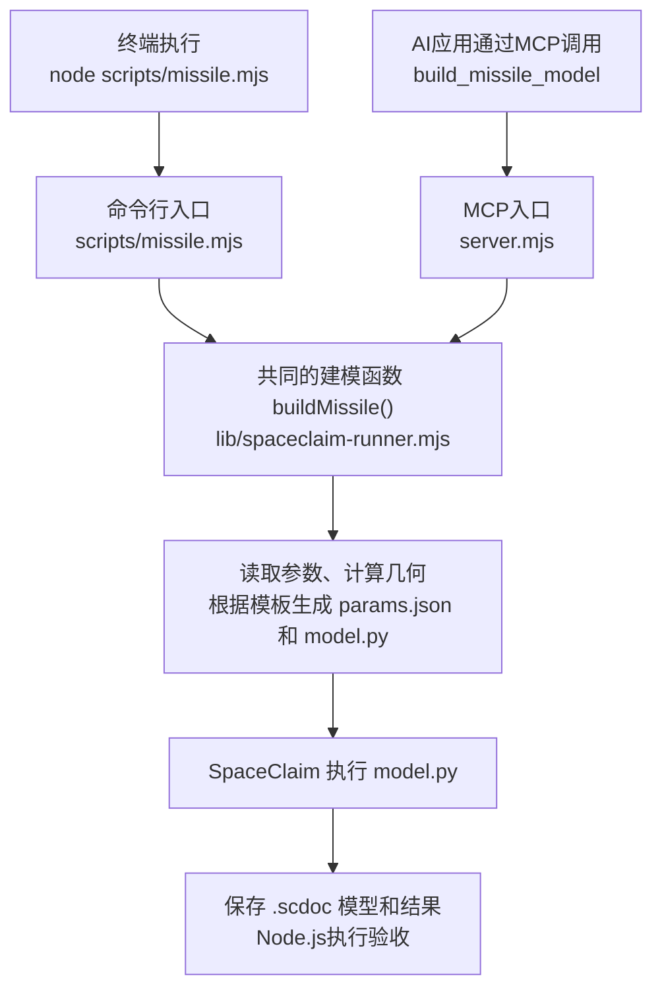

# ansys-scdmdoc-mcp


Windows 本地 MCP 服务：检索已安装的 ANSYS SpaceClaim/SCDM 官方 API CHM，返回 API 文档、Python 候选和建模步骤；同时提供参数化导弹几何的参数校验、脚本生成、无界面建模与产物验收。

运行目标为 Windows、Node.js 18+。MCP 使用 stdio，标准输出只承载 JSON-RPC。文档检索和 MCP 启动需要本机官方 CHM；实际建模还需要可运行的 SpaceClaim。独立命令行的仅生成模式可在没有 ANSYS 的机器上使用。

## 修改输入、输出和参数

自有源码在必要的 shebang、模块说明和 import 之后，先列出输入/输出与可调默认参数，再进入处理逻辑。入口的集中修改区为：`server.mjs` 的 `MCP_DEFAULTS`、`scripts/missile.mjs` 的 `DEFAULT_OPTIONS`、`scripts/setup.mjs` 的回环地址/端口/关闭延迟，以及 `scripts/verify-geometry.mjs` 的输出目录默认值、超时和文件名。仅转发或检查入口在文件前部说明实际配置来源；固定验收用例的几何数值与断言不作为生产参数修改。

几何参数仍统一在 `lib/missile-schema.mjs`，输入文件通过 CLI `--preset` 选择，输出通过 `--out`/`--name` 或 MCP `outputDir`/`fileName` 覆盖。优先级保持显式参数 > 预设 > schema 默认值。空输出目录仍交给执行器和 `workspace.json` 在运行时解析；运行编号、实际 run 目录和失败留存路径不能提前写成某次运行的固定绝对路径。安装仍通过 AWP 或受支持的本机配置发现。完整入口与产物说明见 [scripts/README.md](scripts/README.md)。

## 安装与首次配置

在本项目目录执行：

```powershell
npm ci
npm run setup
```

`npm run setup` 在 `127.0.0.1` 的随机端口启动浏览器配置页：

1. AWP 模式列出所有非空的 `AWP_ROOT<number>`，按版本降序供用户选择，并检查对应的官方 CHM。
2. 手动模式接受本机 `SpaceClaim.exe` 路径，查找其同级 `SpaceClaim.Api.V*` 目录中的 API CHM。

AWP 确认失败时，页面显示下面的原文，并在该错误页面禁用 AWP 选项，使用手动输入恢复：

```text
无法根据 AWP 确定环境变量的路径，无法确定 SpaceClaim 的路径
```

配置保存在 `%LOCALAPPDATA%\ansys-scdmdoc-mcp\config.json`。安装路径仅保留在本机配置中，不应写入源码、文档或提交记录。

配置完成后，由支持 MCP stdio 的客户端启动 `node server.mjs`；客户端工作目录设为本项目目录，也可使用 `server.mjs` 的绝对路径。直接运行此命令会等待客户端通过标准输入发送 JSON-RPC。


## MCP 工具

工具注册与输入定义以 [server.mjs](server.mjs) 为准，当前共 7 个工具。

| 工具 | 输入与功能 |
| --- | --- |
| `search_api` | `query` 必填；可选 `kind`（`all/class/method/property/event`）与 `limit`（默认 25，最多 100）。检索 CHM 索引，返回相对文档路径等元数据。 |
| `get_doc` | `docPath` 为检索得到的相对路径；`maxChars` 默认 50000，最多 100000。读取页面正文、命名空间、程序集和签名，拒绝越出缓存根目录的路径。 |
| `find_python_command` | `intent` 必填；可选 `parameters`、`limit`（默认 5，最多 20）。匹配内置意图模板并关联 API 文档，返回 `inferred` 候选。 |
| `get_geometry_recipe` | `task` 必填，可选 `parameters`。拉伸任务拆为轮廓和拉伸两步，其余任务返回一步候选。 |
| `validate_missile_params` | 接受模型参数，返回 `ok`、错误、警告、自动修正、生效参数及来源、优化区间；不创建模型。 |
| `generate_model_script` | 模型参数，加可选 `outputDir`、`fileName`。写入 `params.json` 和 `model.py`，返回脚本内容及路径，状态为 `script-generated`。 |
| `build_missile_model` | 模型参数，加可选 `outputDir`、`fileName`、`timeoutMs`、`execute`。默认执行 SpaceClaim 并验收；默认超时 300000 ms，MCP 上限 1800000 ms。`execute:false` 只生成脚本，工具状态为 `GENERATED`。 |

模型参数由 [lib/missile-schema.mjs](lib/missile-schema.mjs) 统一定义。默认模型文件名为 `missile.scdoc`。MCP 的输出选项使用 `outputDir` / `fileName`，CLI 使用 `--out` / `--name`。

可以向 AI 描述“圆周阵列 6 个、覆盖 360°、最后合并”，再检查 `Pattern.CreateCircular`、`CircularPatternData` 和 `Combine.Merge` 对应的文档。内置候选模板覆盖圆周阵列、圆柱、拉伸、矩形、布尔差、球和平面；其中多种模板只是实现提示，需要继续编写脚本。未匹配的意图回退到关键词检索提示。当前没有任意图片自动复现、通用复杂任务规划或专门的共享拓扑生成器。

参数校验和脚本生成本身不需要执行 ANSYS，但 **MCP 服务在注册工具前就会解析并解包 CHM**，因此通过 MCP 使用这些工具仍需满足 CHM 启动条件。

## 参数化建模

`node scripts/missile.mjs` 可以直接使用已有的参数化建模程序生成模型，运行过程中不需要 AI 参与。命令行与 MCP 是两个调用入口，最终共用同一个 `buildMissile()` 函数：



命令行入口位于 [scripts/missile.mjs](scripts/missile.mjs)，MCP 工具入口位于 [server.mjs](server.mjs)；两者调用 [lib/spaceclaim-runner.mjs](lib/spaceclaim-runner.mjs) 中的建模流程。[lib/missile-template.mjs](lib/missile-template.mjs) 根据预先编写的模板生成 `model.py`。生成的脚本读取 `params.json`，在 SpaceClaim 内调用建模 API；每次建模不需要让大语言模型重新编写脚本。

AI 可以理解自然语言、选择参数和安排工具调用；普通程序也可以作为 MCP 客户端调用这些工具。现有建模算法只覆盖已实现的参数化几何，新增不同的几何结构需要扩展代码。上图展示实际执行的流程；使用 CLI `--generate-only` 或 MCP `execute:false` 时，流程停在参数文件和脚本生成阶段，不启动 SpaceClaim，也不产生已建好的模型。

所有长度使用米，半径系数无量纲。输入优先级为显式参数 > 预设 JSON > schema 默认值；预设可为参数对象，也可为此前生成的 `params.json`。CLI `--list` 输出全部默认值、几何字段和优化区间。

```powershell
node scripts/missile.mjs --list
node scripts/missile.mjs --help
node scripts/missile.mjs --preset my.json --generate-only
node scripts/missile.mjs --k_nose 0.006 --name missile.scdoc --timeout 300000 --json
node scripts/missile.mjs --fin_section hexagon --timeout 300000 --json
```

预设文件要自己准备：字段名与默认值见 `--list`，也可以直接复用上一次运行生成的 `params.json`；工作区不保存示例副本。
需要另选输出位置时，使用仓库外目录，例如 `--out ..\data_lib\runs`；程序会在其中新建唯一运行子目录。

| 几何参数 | 含义 | 默认值 |
| --- | --- | --- |
| `L_N` / `L` / `D` | 鼻锥长度 / 总长 / 直径 | 0.49 / 3.69 / 0.18 m |
| `L_W` / `C_RW` / `C_TW` / `B_W` | 前舵可见前缘站位 / 根弦 / 梢弦 / 展长 | 1.72 / 0.23 / 0.06 / 0.23 m |
| `L_F` / `C_RF` / `C_TF` / `B_F` | 后舵可见前缘站位 / 根弦 / 梢弦 / 展长 | 3.2 / 0.38 / 0.19 / 0.22 m |
| `thickness_percent` | 舵面最大厚度，占弦长的百分数；前后舵共用 | 4.462 |
| `le_radius_index` | 前缘半径指数。0 为尖前缘，6 为标准圆前缘 | 6 |
| `max_thickness_tenths` | 最大厚度距前缘的位置，单位是 1/10 弦长 | 3 |
| `k_nose` | 锥柱交接倒圆半径 / `L` | 0.005 |
| `k_tip` | 弹尖球面钝化半径 / `L` | 0.002 |

工作区几何参数一共 16 个：上表前 11 个主尺寸，加上翼型种类 `fin_section`（`hex` / `naca`）、三个翼型参数与鼻锥头型 `nose_shape`（`cone` / `ogive`）。三个翼型参数按种类二选一：`naca` 用 `thickness_percent`、`le_radius_index`、`max_thickness_tenths`，允许值与 `DATCOM/scripts/missile_spec.py` 第 4 节 `NacaSection` 相同：厚度大于 0 且小于 40，写卡时四舍五入到 0.01；前缘指数为整数 0–9，半径按 `(指数/6)²` 相对标准圆前缘缩放；最大厚度位置只允许 2、3、4、5、6。`hex` 用 `thickness_percent`、`flat_percent`、`le_radius`。基准值见工作区 [几何参数表](../README.md#几何参数定义与范围)。舵面平面形状仍由根弦、梢弦、展长和后缘对齐决定。本模块另外使用头部倒圆 `k_nose`、`k_tip`。

**头型只实现 `cone`。** 本模块的鼻锥母线是一条直线（圆锥），`ogive` 没有实现；传入 `ogive` 会按"不得静默降级"的规则直接报错，不会偷偷建成圆锥。

横截面由 `fin_section` 选择，默认 `hexagon`（工作区的默认翼型就是 `hex`）。`naca` 是对称 NACA 四位数，按当地弦长缩放，在埋入根部与梢部之间直线放样；此时 `le_radius_index` 和 `max_thickness_tenths` 进入剖面。`hexagon` 是对称六边形：最大厚度仍是 `thickness_percent`，上下表面在等厚段内与弦线平行。**等厚段只有一个入口 `flat_percent`**（占当地弦长的百分数，默认 64.6）：起止由它在 `lib/missile-params.mjs` 的 `hexFlatFromPercent` 里推导——`hex_flat_start = (1 - p/100) / 2`、`hex_flat_end = (1 + p/100) / 2`，默认即 17.7%–82.3%，与 DATCOM 卡片的 `LMAXU` / `LFLATU` 是同一个量。这两个键不再是 schema 字段，既不能从命令行传入，也不会出现"数据库一套、模型另一套"；它们仍以派生值写进 `params.json` 供审核核对。六边形不使用前缘半径指数和最大厚度位置。肩部和后缘的圆弧倒角默认是几何模块中的 `HEX_FILLET_RADIUS_M = 0.001` m（1 mm）。前缘圆弧单独使用 `HEX_FILLET_LE_RADIUS_M = 0.0018` m（1.8 mm）。两者都是绝对长度，不是弦长比例，也不是 schema 里的设计参数。未缩小时验收带为 ±10%。前缘圆弧的最前点和后缘圆弧的最后点落在原来的尖点站位上，并与两侧直线相切，因此按最前点、最后点量得的弦长不变，弹尖到舵面前缘的距离也不变。肩部圆弧与等厚平直段和斜边相切，最大厚度不变。六个尖角各是一条连续圆弧，与相邻直线在接点相切，草图用 `SketchArc.CreateSweepArc` 画出这条圆弧，不是弦，也不是折线。梢部肩圆可能短到内核创建时不留下曲线；这时草图按 `sketchScale` 放大绘制，再用 `Scale.Execute` 绕原点缩回，半径和展向站位仍是真值。`sketchScale` 由 `HEX_FILLET_SKETCH_MIN_ARC_M`（0.0002 m）和 `HEX_FILLET_SKETCH_MIN_SAGITTA_M`（5e-6 m）决定，不是设计参数。六边形舵梢部保持设计梯形的尖角：梢弦与前缘、后缘在设计站位直接相交，不做平面圆弧，也不切角，因此梢弦就是完整的设计梢弦。前舵和后舵与弹体的交接各自做一圈 `ConstantRound`。后舵半径是 `HEX_ROOT_JUNCTION_RADIUS_M = 0.003` m。前舵先试同一半径；径向接缝在默认参数下直接接受 0.003 m，若拒绝则沿 `HEX_ROOT_JUNCTION_PROBE_RADII_M` 降到不低于 `HEX_ROOT_JUNCTION_FORWARD_MIN_RADIUS_M = 0.0015` m 的最大可执行半径，即 1.5–3 mm 之间的 1.5 mm，不收到 1.5 mm 以下。实际半径写入成功目录的 `params.json`。交接边按“中点落在弹体柱面上”选边（`HEX_ROOT_JUNCTION_SEAM_TOLERANCE_M = 0.001` m），前后舵用同一条规则；贴着柱面的局部弹体面不影响判断。每个站位把整圈接缝一次倒圆，不按边长筛掉短边：短边正是肩部圆弧那几段，去掉后链在切向接点断开，试过的 0.2 mm 以上半径全部被内核拒绝；整圈一起倒则后舵 3 mm、前舵 1.5 mm 都能执行。没有逐边降半径的回退，也没有零点几毫米的替代值。设计弦长和弹尖到前缘的距离不变。NACA 不做这两处根部圆角。肩部和后缘保持 1 mm，前缘是 1.8 mm。顺时针标志与弹身倒圆相同。根梢各自按当地弦长建弧，放样后每个尖角沿展向是一张连续圆角面。草图必须新建剖面实体，不能把已有实体交回放样。当地半厚度、弦长或等厚段放不下请求的相切圆角时，该半径收到仍能相切且草图放得下的最大值，并在该剖面的 `filletClamped` 与 `filletClampNote` 中说明。设计厚度 4.462% 在库里的几何行与 schema 默认值上是同一个数，所以手工裸跑和派发跑出同一个截面（NACA 写卡时仍四舍五入到两位小数，读作 4.46）；前舵梢弦 0.06 m、厚度 4.462% 时半厚度约 1.37 mm，放不下 1.8 mm 前缘圆，只缩小这一处前缘半径；肩部和后缘仍是 1 mm。其余三个默认站位的前缘保持 1.8 mm。**前舵与后舵都保持径向，两者在同一平面内，不斜置。** 早期版本曾把前舵绕弦向轴转过六边形斜边半角（默认约 6.4°），理由是“根部截面与弹体切面平行、夹角为 0°，内核会拒绝该接缝的 `ConstantRound`”。V241 实测推翻了这一前提：径向前舵的接缝同样接受完整 3 mm `ConstantRound`（48 条边、8 个实测圆柱面），与后舵完全相同。斜置因此没有换来任何东西，反而在轴向后视图中让前后舵形成剪刀状双影，所以已彻底移除。`hexagonBevelAngle` 仍用于描述剖面自身的斜边坡度，但不再改变舵面朝向。NACA 剖面不涉及这些根部圆角。放样、圆周阵列和合并与 NACA 相同。

> **这一版把终点放回 82.3%。** 等厚段终点由 `flat_percent` 推导，默认 64.6 对应 0.177–0.823；早期 P0 统一参数时曾取 60.995（0.195–0.805），真机实测立即复现了下面记录的故障：前舵根部 3 mm 圆角被判不可执行、压到 1.5 mm 下限，合并后留下 24 个无法删除的非圆角碎面（证据：`feedback/spaceclaim/g692bcb5d5e50__shared__20261031T104432Z/run.json`，`clamped=true`、`belowFloor=24`、`roundFaces=24`）。改回 64.6 即回到已验证的 0.823 口径。注意 DATCOM 的六边形本身对称（`LMAXU=(1-LFLATU)/2`），两边必须共用同一个 `flat_percent`，所以终点取 0.823 时起点只能落在 0.177，不能保留旧版的 0.20。

舵根碎面的真正成因不是修复不足，而是 `hex_flat_end` 太低：等厚段终点决定后肩圆弧，这段弧是舵体接缝最短的一段。0.80 时前舵接缝拒绝 3 mm，圆角被压到 1.5 mm 下限，未倒圆的残余带在合并后形成 24 个四边形碎面（0.18–0.98 mm²，长宽比约 119）。这些面删不掉：`FixSpecific` 报告成功却不动、逐个 `DeleteFaces` 每删一个反而多加一个面和三条边、`RepairAction.None` 能删干净但实体变成非流形（体积测量直接抛异常）。因此只改 `hex_flat_end`：0.80→0.823（+2.875% 弦），前舵接缝接受完整 3 mm 圆角、碎面归零。厚度保持原始 4.48% 不动——`thickness_percent` 是前后舵共用的翼型最大厚度，改它会改变翼型截面和气动结果，而实测它对碎面无效（平面终点 0.816 下把厚度提到 4.50 / 4.52 / 4.54 / 4.55 均仍剩 8 个碎面）。实测分界在 0.8220（8 个碎面）与 0.8221（0 个）之间，取 0.823 留约一个步长余量。代价：根弦等厚段终点外移约 5.4 mm，整体体积 +0.048%、湿面积 −0.036%，横向包围盒 −0.0003%、轴向不变。同一区间扫过 `root_overlap`（0.0025–0.010，完全无效）、`hex_flat_start`、`C_RW`、`C_TW`、`B_W`、`HEX_ROOT_JUNCTION_SEAM_TOLERANCE_M`（0.0006–0.004，体积零变化但碎面仍为 24），都不能清除碎面。

改完几何后仍需两步修复：第一步 `FixInexactEdges` 清除非精确边（此时默认模型剩 20 处，全部清除，面数与边数不变），第二步用 `FixSmallFaces.FixSpecific` 逐个试修小面（此时已无候选）。

关键约束是**绝不碰设计圆角**。前舵根部圆角由 48 条细条组成，单条面积约 0.094 mm²，低于任何小面阈值；若按面积删除，会把这个圆角整个抹掉（实测面数 205→197，前舵圆角从 8 个面降为 0）。因此选面时排除所有圆柱面——`CylinderDiameter` 有效的面一律跳过，这样根部 `ConstantRound` 和各站位剖面圆角都受到保护。同时限制半径 `REPAIR_SMALL_FACE_MAX_RADIUS_M = 0.12` m，避免在舵尖修复时把梢部外推（实测未限制时横向尺寸从 0.6363 m 涨到 0.6402 m）。

修复完成后会核对圆角面数量：3.0 mm、1.5 mm、1.0 mm 各级圆角必须与修复前逐一相等，否则判失败。验收还要求「面积低于 1 mm² 且非圆角」的面数为零——现在默认几何已经能做到，不再容忍残留。保存前再用 `audit_geometry` 对**即将写入文件的实体**复查一遍非精确边和圆角数量——命名选择、空组件清理、物理抑制都会改文档，可能在早期修复之后又引入新的非精确边，这一步保证 `result.json` 记录的是文件真实状态。

体积与表面积变化受 `REPAIR_MAX_VOLUME_CHANGE` / `REPAIR_MAX_SURFACE_CHANGE`（各 0.5%）约束，实测分别只有 1.8e-8 和 −1.5e-6，超出即判失败。修复记录写入 `result.json` 的 `diagnostics.repair` 与 `diagnostics.finalGeometry`。NACA 模型不做这步修复。

| 约定与区域参数 | 默认值与支持范围 |
| --- | --- |
| `fin_phase` | `+`；也支持 `x`。 |
| `root_overlap` | 0.005 m；必须为正且小于最小展长。 |
| `le_mode` | 当前只实现 `trailing_aligned`；其余声明的模式会被拒绝。 |
| `fin_section` | `naca`；也支持 `hexagon`。六边形肩部和后缘是 0.001 m，前缘是 0.0018 m，见上文，不是单独的输入字段。 |
| `hex_flat_start` / `hex_flat_end` | **不再是输入字段**：由 `flat_percent` 推导（见上文），默认 64.6 → 0.177 / 0.823。要改等厚段就改 `flat_percent`，须在 `(0, 100)` 内。 |
| `fillet_location` | `both`；也支持 `cone_cylinder`、`nose_tip`。 |
| `cruciform_count` | 每级 4 片；接受大于等于 2 的偶数。 |
| `scdm_api_version` | 默认空字符串；执行器自动检测目标 API 版本，生成脚本使用检测结果。 |
| `enclosure_shape` | 只支持 `cylinder`。 |
| `enclosure_radius` / `enclosure_front` / `enclosure_back` | 2.7 / 3.69 / 16.45 m。 |
| `boi_radius` / `boi_front` / `boi_back` | 0.45 / 0.5 / 2.5 m。 |
| `model_placement` / `model_offset` | `ensemble` / -4.0 m；定位模式还支持 `missile`、`offset`。 |
| `enclosure_name` / `boi_name` | `Enclosure` / `BOI`；分别为外壳组件名和 BOI 实体名。 |

优化区间仅用于警告，不限制合法几何的输入范围；小于 0.001 m 的非负梢弦会自动修正为 0.001 m。非法尺寸、前后舵重叠、区域不能包住模型或未实现的模式会产生校验错误，不会静默回退。

### 坐标、站位与区域

弹尖朝 -X，弹尾位于弹尖的 +X 方向。`L_W` / `L_F` 从最终弹尖量到弹体表面处的舵面可见前缘；根弦也在弹体表面定义。`root_overlap` 将舵根沿设计边延伸进弹体以便合并，不改变可见前缘和根弦。球面钝化会缩短鼻锥，但保持总长 `L` 和弹尖站位。

外壳固定，导弹和 BOI 一起沿 X 定位。弹尖站位为“定位规则 + `model_offset`”：

| `model_placement` | 定位规则 |
| --- | --- |
| `ensemble` | `(enclosure_back - enclosure_front)/2 - (boi_back - boi_front)/2`，使导弹与 BOI 整体居中。 |
| `missile` | `(enclosure_back - enclosure_front)/2`，使导弹本体居中。 |
| `offset` | `0`，直接使用 `model_offset`。 |

负偏移向弹尖方向移动。按当前默认值计算，弹尖站位为 1.38 m，弹尾为 5.07 m，外壳轴向区间为 `[-3.69, 20.14]` m；这些是解析值，不能替代本次运行的实测验收。

生成目标为同一个 `.scdoc` 中的三个实体：合并后的 `Missile`、外壳和 BOI。外壳调用官方 `Enclosure.Create`，沿 X 轴设置圆柱、`Subtract=False`、`CreateShareTopology=False`，通过包围盒和缓冲量换算目标尺寸；组件名使用 `enclosure_name`。BOI 为独立旋转实体。外壳保留完整实体，不自动扣除导弹或建立共享拓扑；这里生成几何和区域，不执行网格划分或 CFD 求解。

### 命名选择与结构清理

| 命名选择 | 几何内容 |
| --- | --- |
| `inlet` / `wall` / `outlet` | 外壳低 X 端盖 / 圆柱侧面 / 高 X 端盖。 |
| `missile_nose_tip` | 存在球面钝化时的弹尖面；尖头时不创建该组。 |
| `missile_nose` | 鼻锥锥面。 |
| `missile_body` | 柱面、锥柱交接圆角及弹底。 |
| `missile_fin` | 前后全部舵面。 |

默认创建 7 组；数量和面数随实际几何变化。脚本核对导弹分组的面数及面积总和，检查外壳端盖与侧面面积。阵列合并后只删除确认不含实体的残留组件；保留模型、BOI、外壳实体及其组件，其余枚举到的结构对象调用物理抑制。抑制验收检查调用结果与保留集合，当前实现不回读抑制状态。

## 安装发现、缓存与运行记录

CHM 按以下顺序查找，候选不存在时继续尝试：

1. `SCDM_CHM`；
2. 首次配置保存的 AWP 选择或手动可执行文件路径；
3. 所有非空 `AWP_ROOT<number>`，按版本降序；
4. 通用 `AWP_ROOT`：优先尝试 `SCDM_API_VERSION`，再扫描该安装中的 API 版本目录。

SpaceClaim 可执行文件单独按 `SCDM_EXECUTABLE`、手动配置、降序 AWP 变量、通用 `AWP_ROOT` 查找。API 版本优先取可执行文件的安装目录版本，其次取解析到的 CHM 版本，最后扫描同级 API 目录；当前运行器不会用模型参数 `scdm_api_version` 强制覆盖检测结果。

CHM 使用 Windows `hh.exe` 解包，并按源文件路径、大小和修改时间缓存提取结果及索引。默认缓存为 `%LOCALAPPDATA%\ansys-scdmdoc-mcp\cache`（无 `LOCALAPPDATA` 时依次回退到 `TEMP` 和当前目录，应配置到仓库外）。不读取本地 Python 知识库，也不随仓库分发 ANSYS 文档。

建模与圆周验收根据项目父目录的 `workspace.json` 解析工作区数据路径；缺失该配置时使用同级默认 `data_lib` / `feedback`。默认运行位置是 `data_lib/runs/high/<runId>/spaceclaim`；失败时尝试将产物移至 `feedback/spaceclaim/<runId>`，文件系统或权限错误可能中断移动及清单收尾。`--out`、MCP `outputDir` 或 `SCDM_MISSILE_OUTPUT` 可覆盖建模输出根目录，应始终指定仓库外位置。

运行开始时会写 `request.json` 和 `run.json`。参数有效后写入 `params.json` 和 ASCII 源码 `model.py`。执行期间还会生成模型、`result.json`、诊断文本和可选预览图，验收在内存中读这些结果，控制台打印每一项检查。成功目录随后清理为 `params.json`、`model.py`、模型文件（默认 `missile.scdoc`）以及文本记录 `run.json` 和 `result.json`；脚本写过异常的还会有 `diagnostic.txt`。`run.json` 在清理之后写定，因此它列出的产物就是目录里实际剩下的文件，`verification.checks` 保存本次全部验收明细。`request.json`、`error.txt` 和预览图属于执行中间产物，不留在成功目录。预览和诊断都不作为几何验收依据。

仅生成时目录仍保留 `run.json`，状态为 `GENERATED` 且 `verification.runtimeVerified=false`，不产生已经建好的模型。成功建模时验收状态为 `PASSED`，MCP 建模返回 `PASS`，成功目录同样保留带 `verification.checks` 明细的 `run.json`。失败时整份运行目录移到 `feedback/spaceclaim/<runId>`，清单为 `FAILED`，避免成功位置留下未通过的产物。旧记录和历史方案仅作证据快照。

## 验证与证据边界

- `official-doc`：官方 CHM 中的 API 文档事实。
- `inferred`：由 C#/.NET 签名、内置模板和建模意图推导的 Python 候选。
- `runtime-verified`：本次在目标 SpaceClaim 执行后，新生成产物通过验收。

建模验收检查新鲜非空模型和结果、实体数量、尺寸、旋转体体积及面面积、轴向质心、舵面站位、六边形圆角（剖面圆弧半径、梢部 3 mm 平面圆弧、根部交接圆角所用半径，以及从倒圆面读回的柱面半径）、外壳与 BOI 的尺寸/体积/定位、命名选择覆盖、组件清理与物理抑制调用结果。全部检查通过并且进程正常结束，才报告运行验证成功；检查项数量随几何条件变化。

普通开发检查：

```powershell
npm ci
npm test
npm run smoke
```

`npm test` 主要检查解析、路径、模板、参数和验收逻辑；存在 CHM/AWP 环境变量时，协议测试还会连接真实 CHM 并验证仅生成模式。完整 CHM 解包与缓存测试需显式设置 `SCDM_RUN_REAL_CHM_TEST=1` 后运行 `npm test`。它们不执行真实几何建模。

本机文档与协议检查需要已安装的官方 CHM：

```powershell
npm run smoke
npm run verify:real
```

`smoke` 检查 7 个工具、检索、页面读取、路径拒绝、候选与参数校验；其启动预检查要求 `SCDM_CHM`、版本化 AWP 或通用 `AWP_ROOT`，仅有已保存的 setup 配置还不够。`verify:real` 检查 CHM 解包、索引和查询，可使用 setup 配置。两者都不证明几何执行成功。

需要真实几何验证时，手动运行：

```powershell
npm run verify:geometry
npm run verify:geometry -- --timeout 300000
```

该命令启动目标 SpaceClaim，运行 [圆周阵列夹具](scripts/spaceclaim-circular-repeat-smoke.py)：

```text
0° 基体 → Pattern.CreateCircular(CircularPatternData, 6 个, 360°)
→ 检查 0/60/120/180/240/300° → Combine.Merge → 1 个合并实体
```

结果保存在新运行目录的 `result.txt`，结构化键值必须包含 `status=PASS`、阵列体数、角度、步长、覆盖度、合并体数和非零面数；同时检查新模型 `circular.scdoc` 和新结果的时间、大小及进程状态。成功查询、缓存存在、旧模型或退出码 0 都不能单独证明几何正确。本 README 不声明此次文档修改已完成真实 ANSYS 验证。

## 目录与维护

| 直接子目录 | 用途 |
| --- | --- |
| [.github/](.github/README.md) | GitHub Actions 配置；`workflows/` 运行 Windows 单元测试。 |
| `.vscode/` | 本机编辑器配置；当前本机设置不纳入版本控制，不保存可分发的安装路径。 |
| [docs/](docs/README.md) | 说明素材 `assets/` 和历史设计 `superpowers/`。 |
| [lib/](lib/README.md) | CHM、索引、参数、几何、脚本模板、执行器和运行记录模块。 |
| `node_modules/` | npm 生成的第三方依赖；不纳入版本控制，不手工编辑其文件或 README。 |
| [scripts/](scripts/README.md) | 首次配置、CLI、文档检查和真实几何验收入口。 |
| [tests/](tests/README.md) | Node.js 测试；真实 CHM 测试的启用条件见上文。 |

入口为 `server.mjs`，命令与依赖版本见 `package.json` / `package-lock.json`。工作区总览见 [../README.md](../README.md)；历史建模设计见 [计划目录](docs/superpowers/plans/README.md)。

根目录文件：

| 文件 | 用途 |
| --- | --- |
| `server.mjs` | MCP stdio 服务入口，7 个工具的注册与输入定义。 |
| `package.json` / `package-lock.json` | 依赖与脚本入口（`npm test` / `npm run smoke` / `npm run missile` / `npm run setup`）。 |
| `AGENTS.md` | 本仓库给编码代理的规则、证据分级与验收契约。 |
| `CHANGELOG.md` | 版本变更记录。 |
| `CONTRIBUTING.md` | 贡献流程与提交规范。 |
| `SECURITY.md` | 漏洞报告渠道与支持范围。 |
| `LICENSE` | 开源许可证。 |
| `.gitignore` | 忽略规则：依赖、缓存、生成模型与运行日志不入库。 |
| `README.md` | 本文件。 |

[AGENTS.md](AGENTS.md) 要求每次修改代码都在同一变更中同步更新相关 README；本仓库只维护一份中文 README（英文版与双语速览已删除），参数表的数值由 `../scripts/docs.py` 从代码生成。目录变动须同步更新父目录说明。依赖自身的 README 不属于本项目维护范围。

## 发布边界

仓库只发布实现、测试和说明；不要提交 CHM、解包的 HTML/HHC/HHK、缓存、运行日志、模型、本机配置、凭据或安装路径。推送、发布或修改外部 GitHub 状态须获得当轮明确授权。

代码采用 [MIT License](LICENSE)。ANSYS、SpaceClaim、SCDM 及相关名称属于各自权利人，本项目不代表 ANSYS 官方。
